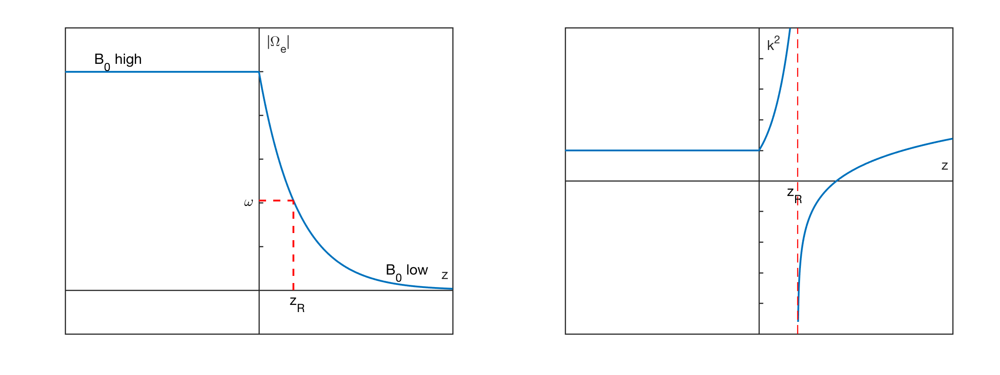
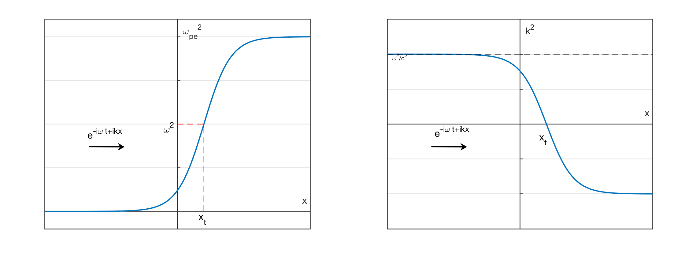

# Wave Fundamentals and Cold Plasma Waves {#sec-waves}

::: {.callout-tip title="Related Chapters"}
For MHD, Alfvén, and two-fluid/kinetic Alfvén waves, see @sec-mhd-waves; for warm, electrostatic, and wave–particle resonance physics, see @sec-warm-waves; for whistler waves and observational wave identification, see @sec-whistler; for kinetic dispersion relations and Landau damping, see @sec-kinetic and @sec-dispersion; for geometrical-optics propagation, see @sec-ray-tracing; for numerical wave benchmarks, see @sec-test.
:::

Waves are generated by instabilities (@sec-stability). In this chapter, we mainly focus on the wave propagation.

## Basic Properties

### Polarization

* [Electromagnetic Waves and Polarization](https://svs.gsfc.nasa.gov/4580/)

In plasma physics, wave polarization is defined with respect to the background magnetic field $\mathbf{B}_0$, not the wave propagation direction $\mathbf{k}$.[^polarization-def]

[^polarization-def]: This is different from the definition in optics, which makes it easier to analyze the interaction with particles since the particle gyration handedness around the magnetic field is also defined in the same way.

[Wave Polarization](https://farside.ph.utexas.edu/teaching/plasma/lectures/node70.html)

* Compressibility: Certain waves can modify plasma densities, while others can't.

### Dispersion Relation

Waves are a very general phenonmenon of most media. In order for a wave to propagate in the medium a number of conditions need to be satisfied, however. The first is that the medium allows for a particular range of frequencies $\omega$ and wave-vectors $\mathbf{k}$ to exist in the medium; i.e., it allows for eigenmodes. These ranges are specified by the dispersion relation $D(\omega,\mathbf{k},...)=0$ which formulates the condition that the dynamical equations of the medium possess small-amplitude solutions. This dispersion relation is usually derived in the linear infinitesimally small amplitude approximation. However, nonlinear dispersion relations can sometimes also be formulated in which case $D(\omega,\mathbf{k},|\mathbf{a}|)$ depends on the fluctuation amplitude $|\mathbf{a}|$ as well.

Dispersion relations describe the effect of dispersion on the properties of waves in a medium. A dispersion relation relates the wavelength or wavenumber of a wave to its frequency. Given the dispersion relation, one can calculate the phase velocity and group velocity of waves in the medium, as a function of frequency. Therefore, obtaining the dispersion relation is the key of describing the wave propagation.

Often when we say a wave mode is _dispersive_, it means that waves at different frequencies $\omega$ (or wavelength $\lambda$) travel at different phase velocities $v_\text{ph}$. Common dispersive waves include water waves in the ocean, light waves in a prism, and sound waves in bars and plates; non-dispersive waves include sound waves in air, and light waves in a vacuum.

### Damping/Growth Rate

The solutions of the dispersion relation are in most cases complex, and for real wave vector $\mathbf{k}$ can be written as $\omega(\mathbf{k}) = \omega_r(\mathbf{k}) + i\gamma(\omega_r,\mathbf{k})$, where the index $r$ indicates the real part, and $\gamma$ is the imaginary part of the frequency which itself is a function of the real frequency and wave number, because each mode of given frequency can behave differently in time, and the wave under normal conditions will be dispersive, i.e. it will not be a linear function of wave number. In most cases the amplitude of a given wave will change slowly in time, which means that the imaginary part of the frequency is small compared to the real frequency. If this is granted, then $\gamma$ can be determined by a simple procedure directly from the dispersion relation $D(\omega,\mathbf{k}) = D_r(\omega,\mathbf{k}) + iD_i(\omega,\mathbf{k})$, which can be written as the sum of its real $D_r$ and imaginary $D_i$ parts because a small imaginary part $\gamma$ in the frequency changes the dispersion relation only weakly, and it can be expanded with respect to this imaginary part. Up to first order in $\gamma/\omega$ one then obtains[^dispersion_derive]
$$
\begin{aligned}
D_r(\omega_r,\mathbf{k}) &= 0 \\
\gamma(\omega_r, \mathbf{k}) &= -\frac{D_i(\omega,\mathbf{k})}{\partial D_r(\omega_r,\mathbf{k})/\partial \omega |_{\gamma=0}}
\end{aligned}
$$ {#eq-dispersion-sol}

The first of these expressions determines the real frequency as function of wave number $\omega_r(\mathbf{k})$ which can be calculated directly from the real part of the dispersion relation. The second equation is a prescription to determine the imaginary part of the frequency, i.e. the damping or growth rate of the wave.

[^dispersion_derive]: HOW TO DERIVE THIS?

### Dielectric Function

Usually when the permittivity of a material is function of space or frequency, it is call dielectric function.
The dielectric constant $\epsilon$ is a quantity which appears in electrostatic when people describe how a material screens an external time-independent electric field. When they begin to study how a material screens an external time-dependent electric field $\mathbf{E}\propto e^{-i\omega t}$ in electrodynamic sense they found that the number $\epsilon$ depends on frequency, so one gets $\epsilon(\omega)$. It would be stupid to call a quantity, which essentially depends on frequency, just "dielectric constant", therefore one calls it "dielectric function". Further studies showed that $\epsilon$ depends not only on the frequency but also on the wave-vector of the field, $\mathbf{E}\propto e^{-i\omega t +ikx}$, so one gets the dielectric function $\epsilon=\epsilon(k,\omega)$.

## Plasma Oscillations {#sec-oscillations}

If the electrons in a plasma are displaced from a uniform background of ions, electric fields will be built up in such a direction as to restore the neutrality of the plasma by pulling the electrons back to their original positions. Because of their inertia, the electrons will overshoot and oscillate around their equilibrium positions with a characteristic frequency known as the _plasma frequency_. This oscillation, also known as the Langmuir oscillation, is so fast that the massive ions do not have time to respond to the oscillating field and may be considered as fixed. In Fig. 4.2 (ADD IT!), the open rectangles represent typical elements of the ion fluid, and the darkened rectangles the alternately displaced elements of the electron fluid. The resulting charge bunching causes a spatially periodic $\mathbf{E}$ field, which tends to restore the electrons to their neutral positions.

::: {.content-visible unless-format="pdf"}

[Demonstration of plasma oscillation](https://henry2004y.github.io/space-physics-threejs/langmuir.html)

:::

We shall derive an expression for the plasma frequency $\omega_p$ in the simplest case, making the following assumptions:

1. There is no magnetic field;
2. there are no thermal motions ($k_B T=0$);
3. the ions are fixed in space in a uniform distribution;
4. the plasma is infinite in extent; and
5. the electron motions occur only in the x direction. As a consequence of the last assumption, we have

$$
\nabla = \hat{x}\partial x,\, \mathbf{E} = E\hat{x},\, \nabla\times\mathbf{E} =0,\, \mathbf{E}=-\nabla\phi
$$

There is, therefore, no fluctuating magnetic field; this is an electrostatic oscillation.

The electron equations of continuity and motion are
$$
\begin{aligned}
\frac{\partial n_e}{\partial t} + \nabla\cdot(n_e\mathbf{u}_e) = 0 \\
m_e n_e\Big[ \frac{\partial \mathbf{u}_e}{\partial t} + (\mathbf{u}_e\cdot\nabla)\mathbf{u}_e \Big] = -en_e\mathbf{E}
\end{aligned}
$$

The only Maxwell equation we shall need is the one that does not involve $\mathbf{B}$: Poisson's equation. This case is an exception to the general rule of @sec-plasma_approximation that Poisson's equation cannot be used to find $\mathbf{E}$. This is a high-frequency oscillation; electron inertia is important, and the deviation from neutrality is the main effect in this particular case. Consequently, we write
$$
\epsilon_0\nabla\cdot\mathbf{E} = \epsilon_0 \partial \mathbf{E}/\partial x = e(n_i - n_e)
$$

The last three equations together can be easily solved by the procedure of _linearization_. By this we mean that the amplitude of oscillation is small, and terms containing higher powers of amplitude factors can be neglected. We first separate the dependent variables into two parts: an "equilibrium" part indicated by a subscript 0, and a "perturbation" part indicated by a subscript 1:
$$
n_e = n_0 + n_1\quad \mathbf{u}_e = \mathbf{u}_0 + \mathbf{u}_1\quad \mathbf{E}_e = \mathbf{E}_0 + \mathbf{E}_1
$$

The equilibrium quantities express the state of the plasma in the absence of the oscillation. Since we have assumed a uniform neutral plasma at rest before the electrons are displaced, we have
$$
\begin{aligned}
\nabla n_0 = \mathbf{u}_0 = \mathbf{E}_0 = 0 \\
\frac{\partial n_0}{\partial t} = \frac{\partial\mathbf{u}_0}{\partial t} =  \frac{\partial\mathbf{E}_0}{\partial t} = 0
\end{aligned}
$$

The momentum equation now becomes
$$
m_e\frac{\partial \mathbf{u}_1}{\partial t} = -e\mathbf{E}
$$

The term $(\mathbf{u}_1\cdot\nabla)\mathbf{u}_1$ is seen to be quadratic in an amplitude quantity, and we shall
linearize by neglecting it. The _linear theory_ is valid as long as $|u_1|$ is small enough that such quadratic terms are indeed negligible. Similarly, the continuity equation becomes
$$
\frac{\partial n_1}{\partial t} + n_0 \nabla\cdot\mathbf{u}_1 = 0
$$

In Poisson's equation, we note that $n_{i0}=n_{e0}$ in equilibrium and that $n_{i1}=0$ by the assumption of fixed ions, so we have
$$
\epsilon_0 \partial \mathbf{E}/\partial x = -en_1
$$

The oscillating quantities are assumed to behave sinusoidally:
$$
\begin{aligned}
\mathbf{n}_1 &= n_1 e^{i(kx-\omega t)} \\
\mathbf{u}_1 &= \mathbf{u}_1 e^{i(kx-\omega t)}\hat{x} \\
\mathbf{E}_1 &= \mathbf{E}_1 e^{i(kx-\omega t)}\hat{x}
\end{aligned}
$$

The time derivative $\partial/\partial t$ can therefore be replaced by $-i\omega$, and the gradient $\nabla$ by $ik\hat{x}$. Now the linearized equations
$$
\begin{aligned}
\frac{\partial n_1}{\partial t} &= -n_0\frac{\partial u_1}{\partial x} \\
\frac{\partial u_1}{\partial t} &= -\frac{e}{m_e}E_1 \\
\frac{\partial E_1}{\partial x} &= -\frac{e}{\epsilon_0}n_1
\end{aligned}
$$ {#eq-langmuir-linear}
become
$$
\begin{aligned}
-i\omega n_1 &= -n_0 ik u_1 \\
-im\omega u_1 &= -eE_1 \\
ik\epsilon_0 E_1 &= -en_1
\end{aligned}
$$ {#eq-langmuir-linear-fourier}

Eliminating $u_1$ and $E_1$, we have
$$
n_1 = \frac{n_0 e^2}{\epsilon_0 m_e\omega^2}n_1
$$

If $n_1$ does not vanish, we must have
$$
\omega^2 = \frac{n_0 e^2}{\epsilon_0 m_e}
$$

The _plasma frequency_ is therefore
$$
\omega_p = \sqrt{\frac{n_0 e^2}{\epsilon_0 m_e}} \quad \text{rad/s}
$$ {#eq-wave-plasma_frequency}

Numerically, one can use the approximate formula
$$
\omega_p / 2\pi = f_p \approx 9\sqrt{n}\quad \text{m}^{-3}
$$

This frequency, depending only on the plasma density, is one of the fundamental parameters of a plasma. Because of the smallness of $m$, the plasma frequency is usually very high. For instance, in a plasma of density $n=10^{18}\,\text{m}^{-3}$, we have
$$
f_p\approx 9(10^{18})^{1/2} = 9\times 10^9\,\text{s}^{-1} = 9\,\text{GHz}
$$

Radiation at $f_p$ normally lies in the microwave range. We can compare this with another electron frequency: $\omega_c$. A useful numerical formula is
$$
f_{ce}\simeq 28\,\text{GHz/T}
$$

Thus if $B=0.32$ T and $n=10^{18}\,\text{m}^{-3}$, the cyclotron frequency is approximately equal to the plasma frequency for electrons.

@eq-plasma_frequency tells us that if a plasma oscillation is to occur at all, it must have a frequency depending only on $n$. In particular, $\omega$ does not depend on $k$, so the group velocity $\mathrm{d}\omega/dk$ is zero. The disturbance does not propagate. How this can happen can be made clear with a mechanical analogy (Fig. 4.3 fig-independent-springs). Imagine a number of heavy balls suspended by springs equally spaced in a line. If all the springs are identical, each ball will oscillate vertically with the same frequency. If the balls are started in the proper phases relative to one another, they can be made to form a wave propagating in either direction. The frequency will be fixed by the springs, but the wavelength can be chosen arbitrarily. The two undisturbed balls at the ends will not be affected, and the initial disturbance does not propagate. Either traveling waves or standing waves can be created, as in the case of a stretched rope. Waves on a rope, however, must propagate because each segment is connected to neighboring segments.

FIGURE: Synthesis of a wave from an assembly of independent oscillators.

This analogy is not quite accurate, because plasma oscillations have motions in the direction of $\mathbf{k}$ rather than transverse to $\mathbf{k}$. However, as long as electrons do not collide with ions or with each other, they can still be pictured as independent oscillators moving horizontally (in fig-independent-springs). But what about the electric field? Won't that extend past the region of initial disturbance and set neighboring layers of plasma into oscillation? In our simple example, it will not, because the electric field due to equal numbers of positive and negative infinite plane charge sheets is zero. In any finite system, however, plasma oscillations will propagate. In Fig. 4.4 ADD IT!, the positive and negative (shaded) regions of a plane plasma oscillation are confined in a cylindrical tube. The fringing electric field causes a coupling of the disturbance to adjacent layers, and the oscillation does not stay localized.

## Classification of EM Waves in Uniform Plasma

$$
\begin{aligned}
&\left\{
\begin{array}{ll}
\mathbf{k}\parallel \mathbf{B}_0 & \text{Parallel Propagation}, \\
\mathbf{k}\perp\mathbf{B}_0 & \text{Perpendicular Propagation}
\end{array} \right. \\
&\left\{
\begin{array}{ll}
\mathbf{k}\parallel \mathbf{E}_1 & \text{Longitudinal Waves}, \\
\mathbf{k}\perp\mathbf{E}_1 & \text{Transverse Waves}
\end{array} \right. \\
&\left\{
\begin{array}{ll}
\mathbf{B}_1 = 0 & \text{Electrostatic Waves}, \\
\mathbf{B}_1 \neq 0 & \text{Electromagnetic Waves}
\end{array} \right.
\end{aligned}
$$

Note:

1. Wave is longitudinal $\Longleftrightarrow$ Wave is electrostatic
2. Wave is transverse $\implies$ Wave is electromagnetic
3. Wave is electromagnetic $\centernot\implies$ Wave is transverse. You can always add a component of $\mathbf{E}_1$ parallel to $\mathbf{k}$ without changing $\mathbf{B}_1$.

## ES vs. EM Waves

A practical way to distinguish ES and EM waves is to check $\nabla\times\mathbf{E}$ and $\nabla\cdot\mathbf{E}$, where $\mathbf{E}$ is the electric field of the wave:
* If the curvature is relatively small and the divergence is relatively large, then it is likely to be ES.
* Otherwise it is likely to be EM.

As we will see in @sec-CPDR, the dielectric function is defined in @eq-d_e_relation. From other perspectives, the dielectric function shows up in the Ampère's law as well as the Poisson's equation
$$
\begin{aligned}
\nabla\times\mathbf{B}=\mu_0\mathbf{j}+\mu_0\epsilon_0\frac{\partial\mathbf{E}}{\partial t}&\equiv\mu_0\pmb{\epsilon}\cdot\frac{\partial \mathbf{E}}{\partial t} \\
\nabla\cdot(\mathbf{\epsilon_0 \mathbf{E}_1}) + q_j n_j \equiv\nabla\cdot(\pmb{\epsilon}\cdot\mathbf{E}_1) &= 0
\end{aligned}
$$

Let us consider waves in an _isotropic_ plasma. For isotropic plasmas, the dielectric tensor $\pmb{\epsilon}$ shrinks to a scalar $\epsilon$. For cold plasma (static ion background), the dielectric function is
$$
\frac{\epsilon}{\epsilon_0}=1-\frac{{\omega_{pe}}^2}{\omega^2}
$$

For electrostatic (ES) waves, let $\epsilon=0$, we have
$$
\omega=\pm\omega_{pe}
$$

For electromagnetic (EM) waves, from Maxwell's equations we have
$$
\begin{aligned}
\nabla\times\mathbf{E}&=-\frac{\partial \mathbf{B}}{\partial t}, \\
\nabla\times\mathbf{B}&=\mu_0\mathbf{j}+\mu_0\epsilon_0\frac{\partial\mathbf{E}}{\partial t}\equiv\mu_0\epsilon\frac{\partial \mathbf{E}}{\partial t}.
\end{aligned}
$$

With $\nabla\rightarrow i\mathbf{k},\ \partial/\partial t\rightarrow -i\omega$, we can get the dispersion relation
$$
\begin{aligned}
i\mathbf{k}\times\mathbf{E}&=i\omega \mathbf{B} \\
i\mathbf{k}\times\mathbf{B}&=-i\mu_0\epsilon\omega\mathbf{E} \\
\Rightarrow k^2\mathbf{E}-\cancel{(\mathbf{k}\cdot\mathbf{E})\mathbf{k}}&=\omega^2 \mu_0\epsilon \mathbf{E}.
\end{aligned}
$$

If $\mathbf{k}\perp\mathbf{E}$, by substituting the dielectric function inside we have
$$
\begin{aligned}
k^2=\omega^2 \epsilon\mu_0=\omega^2\epsilon_0\mu_0\Big[ 1-\frac{{\omega_{pe}}^2}{\omega^2}\Big] \nonumber \\
\Rightarrow \omega^2=k^2c^2+{\omega_{pe}}^2.
\end{aligned}
$$

For both waves, $\nabla\cdot(\epsilon\mathbf{E}_1)=0\Rightarrow i\epsilon(\mathbf{k}\cdot\mathbf{E}_1)=0$ is always valid. However, for electrostatic wave, $\mathbf{E}_1=-\nabla\phi_1=-i\mathbf{k}\phi_1\Rightarrow \mathbf{k}\parallel \mathbf{E}_1\Rightarrow \epsilon=0$, while for EM wave, usually $\mathbf{k}\perp\mathbf{E}_1$ ($\mathbf{k}\perp\mathbf{E}_1 \Rightarrow$ EM wave, but EM waves do not necessarily need to be transverse. You can always add a component of $\mathbf{E}_1$ parallel to $\mathbf{k}$ without changing $\mathbf{B}_1$), $\epsilon$ does not need to be zero. Therefore, _getting the dispersion relation by setting $\epsilon$ to 0 is only valid for isotropic ES waves_. For EM waves, there's a systematic way to get all the dispersion relations starting from dielectric function, explained in detail in @sec-CPDR. Here we just have a simple summary of the steps.

From Maxwell's equation for the perturbed field,
$$
\begin{aligned}
\nabla\times\mathbf{E}_1 &= -\mu_0\frac{\partial \mathbf{H}_1}{\partial t} \\
\nabla\times\mathbf{H}_1 &= \mathbf{J}_1 +\epsilon_0\frac{\partial \mathbf{E}_1}{\partial t}
\end{aligned}
$$
where we have assumed
$$
\begin{Bmatrix}
\mathbf{E}_1(\mathbf{x},t) \\ \mathbf{H}_1(\mathbf{x},t)
\end{Bmatrix}  = \Re
\begin{Bmatrix}
\tilde{\mathbf{E}_1}e^{i\mathbf{k}\cdot\mathbf{x}-i\omega t} \\
\tilde{\mathbf{H}_1}e^{i\mathbf{k}\cdot\mathbf{x}-i\omega t}
\end{Bmatrix}
$$

It quickly follows that
$$
\begin{aligned}
\mathbf{k}\times\mathbf{E}_1 &= \mu_0 \omega \mathbf{H}_1 \\
i\mathbf{k}\times\mathbf{H}_1 &= i\mathbf{k}\times\Big( \frac{\mathbf{k}\times\mathbf{E}_1}{\mu_0 \omega}\Big) = \mathbf{J}_1 - \epsilon_0 i\omega\mathbf{E}_1
\end{aligned}
$$

Then there comes the wave equation
$$
\mathbf{k}\times(\mathbf{k}\times\mathbf{E}_1) = \mathbf{k}(\mathbf{k}\cdot\mathbf{E}_1) - k^2\mathbf{E}_1 =  -i\omega \mu_0 \mathbf{J}_1 -\frac{\omega^2}{c^2}\mathbf{E}_1 \equiv -\frac{\omega^2}{c^2}\frac{\epsilon}{\epsilon_0}\mathbf{E}_1
$$

If we can express the total current density as a function of perturbed electric field, $\mathbf{J}_1 = \mathbf{J}_1(\mathbf{E}_1)$, from MHD, 2-fluid, or Vlasov model combining with the property of the media, we can obtain the expression for the dielectric function $\epsilon$. With some effort, we get
$$
\mathbf{A}
\begin{pmatrix}
E_{1x} \\ E_{1y} \\ E_{1z}
\end{pmatrix} = 0
$$
from which the condition for non-trivial solutions leads to
$$
\det{A} = 0 \Rightarrow
\begin{cases}
\text{eigenvalue for } \omega = \omega(\mathbf{k}) \\
\text{eigenvectors} \Rightarrow \text{polarization of E field}
\end{cases}
$$

## Cold Uniform Plasma {#sec-CPDR}

As long as $T_e = T_i = 0$, the linear plasma waves can easily be generalized to an arbitrary number of charged particle species and an arbitrary angle of propagation $\theta$ relative to the magnetic field. Waves that depend on finite $T$, such as ion acoustic waves, are not included in this treatment. The derivations go back to late 1920s when Appleton and Wilhelm Altar first calculated the cold plasma dispersion relation (CPDR).

First, we define the dielectric tensor of a plasma as follows. The fourth Maxwell equation is
$$
\nabla\times\mathbf{B} = \mu_0(\mathbf{j} + \epsilon_0\dot{\mathbf{E}})
$$

where $\mathbf{j}$ is the plasma current due to the motion of the various charged particle species $s$, with density $n_s$, charge $q_s$, and velocity $\mathbf{v}_s$:
$$
\mathbf{j} = \sum_s n_s q_s\mathbf{v}_s
$$ {#eq-ampere}

Considering the plasma to be a dielectric with internal currents $\mathbf{j}$, we may write @eq-ampere as
$$
\nabla\times\mathbf{B} = \mu_0\dot{\mathbf{D}}
$$
where
$$
\mathbf{D} = \epsilon_0 \mathbf{E} + \frac{i}{\omega}\mathbf{j}
$$ {#eq-electric_displacement_field}
is the __electric displacement field__ or __electric induction__.  It accounts for the effects of _bound charge within materials_ (i.e. plasma).
Here we have assumed an $\exp(-i\omega t)$ dependence for all plasma motions. Let the current $\mathbf{j}$ be proportional to $\mathbf{E}$ but not necessarily in the same direction (because of the magnetic field $B_0\hat{\mathbf{z}}$); we may then define a conductivity tensor $\pmb{\sigma}$ by the relation
$$
\mathbf{j} = \pmb{\sigma}\cdot\mathbf{E}
$$

@eq-electric_displacement_field becomes
$$
\mathbf{D} = \epsilon\Big( \mathbf{I} + \frac{i}{\epsilon_0\omega}\pmb{\sigma} \Big)\cdot\mathbf{E} = \pmb{\epsilon}\cdot\mathbf{E}
$$ {#eq-d_e_relation}

Thus the effective dielectric constant of the plasma is the tensor
$$
\pmb{\epsilon} = \epsilon_0 (\mathbf{I} + i\pmb{\sigma}/\epsilon_0\omega)
$$

where $\mathbf{I}$ is the unit tensor. In electromagnetism, a __dielectric__ is an electrical insulator that can be polarised by an applied electric field. When a dielectric material is placed in an electric field, electric charges do not flow through the material as they do in an electrical conductor, because they have no loosely bound, or free, electrons that may drift through the material, but instead they shift, only slightly, from their average equilibrium positions, causing dielectric polarisation.

To evaluate $\pmb{\sigma}$, we use the linearized fluid equation of motion for species $s$, neglecting the collision and pressure terms:
$$
m_s\frac{\partial \mathbf{v}_s}{\partial t} = q_s(\mathbf{E}+\mathbf{v}_s\times\mathbf{B}_0)
$$ {#eq-motion_linear}

Defining the cyclotron and plasma frequencies for each species as
$$
\omega_{cs}\equiv\bigg\lvert\frac{q_s B_0}{m_s}\bigg\rvert, \quad \omega_{ps}^2\equiv\bigg\lvert\frac{n_0 q_s^2}{\epsilon_0m_s}\bigg\rvert
$$

We can separate @eq-motion_linear into x, y, and z components and solve for $\mathbf{v}_s$, obtaining
$$
\begin{aligned}
v_{xs} &= \frac{iq_s}{m_s\omega} \frac{E_x\pm i(\omega_{cs}/\omega)E_y}{1-(\omega_{cs}/\omega)^2} \\
v_{ys} &= \frac{iq_s}{m_s\omega} \frac{E_y\mp i(\omega_{cs}/\omega)E_x}{1-(\omega_{cs}/\omega)^2} \\
v_{zs} &= \frac{iq_s}{m_s\omega} E_z
\end{aligned}
$$ {#eq-v}
where $\pm$ stands for the sign of $q_s$. The plasma current is
$$
\mathbf{j} = \sum_s n_{0s}q_s\mathbf{v}_s
$$
so that
$$
\begin{aligned}
\frac{i}{\epsilon_0\omega}j_x &= \sum_s \frac{in_{0s}}{\epsilon_0 \omega}\frac{iq_s^2}{m_s\omega}\frac{E_x\pm i(\omega_{cs}/\omega)E_y}{1-(\omega_{cs}/\omega)} \\
&=\sum_s -\frac{\omega_{ps}^2}{\omega^2}\frac{E_x\pm i(\omega_{cs}/\omega)E_y}{1-(\omega_{cs}/\omega)}
\end{aligned}
$$ {#eq-current_jx}

Using the identities
$$
\begin{aligned}
\frac{1}{1-(\omega_{cs}/\omega)^2} &= \frac{1}{2}\Big[ \frac{\omega}{\omega\mp\omega_{cs}} + \frac{\omega}{\omega\pm\omega_{cs}} \Big] \\
\pm\frac{\omega_{cs}/\omega}{1-(\omega_{cs}/\omega)^2} &= \frac{1}{2}\Big[ \frac{\omega}{\omega\mp\omega_{cs}} - \frac{\omega}{\omega\pm\omega_{cs}} \Big],
\end{aligned}
$$

we can write @eq-current_jx as follows:
$$
\begin{aligned}
\frac{1}{\epsilon_0\omega}j_x &= -\frac{1}{2}\sum_s \frac{\omega_{ps}^2}{\omega^2}\Big[ \Big( \frac{\omega}{\omega\pm\omega_{cs}} + \frac{\omega}{\omega\mp\omega_{cs}} \Big)E_x \\
&+ \Big( \frac{\omega}{\omega\mp\omega_{cs}} + \frac{\omega}{\omega\pm\omega_{cs}} \Big)iE_y \Big]
\end{aligned}
$$ {#eq-jx}

Similarly, the $y$ and $z$ components are
$$
\begin{aligned}
\frac{1}{\epsilon_0\omega}j_y &= -\frac{1}{2}\sum_s \frac{\omega_{ps}^2}{\omega^2}\Big[ \Big( \frac{\omega}{\omega\pm\omega_{cs}} + \frac{\omega}{\omega\mp\omega_{cs}} \Big)iE_x \\
&+ \Big( \frac{\omega}{\omega\mp\omega_{cs}} + \frac{\omega}{\omega\pm\omega_{cs}} \Big)E_y \Big]
\end{aligned}
$$ {#eq-jy}

$$
\frac{i}{\epsilon_0\omega}j_z = -\sum_s\frac{\omega_{ps}^2}{\omega^2}E_z
$$ {#eq-jz}

Use of @eq-jx in @eq-electric_displacement_field gives
$$
\begin{aligned}
\frac{1}{\epsilon_0}D_x &= E_x -\frac{1}{2}\sum_s \frac{\omega_{ps}^2}{\omega^2}\Big[ \Big( \frac{\omega}{\omega\pm\omega_{cs}} + \frac{\omega}{\omega\mp\omega_{cs}} )E_x \\
&+ \Big( \frac{\omega}{\omega\mp\omega_{cs}} + \frac{\omega}{\omega\pm\omega_{cs}} )iE_y \Big] \\
\end{aligned}
$$ {#eq-dx}

We define the convenient abbreviations
$$
\begin{aligned}
R &\equiv 1 - \sum_s\frac{\omega_{ps}^2}{\omega^2}\Big( \frac{\omega}{\omega\pm\omega_{cs}} \Big)\\
L &\equiv 1 - \sum_s\frac{\omega_{ps}^2}{\omega^2}\Big( \frac{\omega}{\omega\mp\omega_{cs}} \Big)\\
S &\equiv \frac{1}{2}(R+L)\quad D\equiv \frac{1}{2}(R-L)^\ast \\
P &\equiv 1-\sum_s\frac{\omega_{ps}^2}{\omega^2}
\end{aligned}
$$ {#eq-stix_notation}

where "R" stands for right, "L" stands for left, "S" stands for sum, "D" stands for difference, and "P" stands for plasma. Do not confuse D with the electric displacement field $\mathbf{D}$. Using these in @eq-dx and proceeding similarly with the $y$ and $z$ components, we obtain
$$
\begin{aligned}
\epsilon_0^{-1}D_x &= SE_x -iDE_y \\
\epsilon_0^{-1}D_y &= iDE_x + SE_y \\
\epsilon_0^{-1}D_z &= PE_z
\end{aligned}
$$

Comparing with @eq-d_e_relation, we see that
$$
\pmb{\epsilon} = \epsilon_0\begin{pmatrix}
S & -iD & 0 \\
iD & S & 0 \\
0 & 0 & P
\end{pmatrix} \equiv \epsilon_0\pmb{\epsilon}_R
$$ {#eq-dielectric_matrix}

We next derive the wave equation by taking the curl of the equation $\nabla\times\mathbf{E} = -\dot{\mathbf{B}}$ and substituting $\nabla\times\mathbf{B}=\mu_0\pmb{\epsilon}\cdot\dot{\mathbf{E}}$, obtaining
$$
\nabla\times\nabla\times\mathbf{E} = -\mu_0\epsilon_0( \pmb{\epsilon}_R \cdot\ddot{\mathbf{E}} ) = -\frac{1}{c^2}\pmb{\epsilon}_R\cdot\ddot{\mathbf{E}}
$$ {#eq-wave1}

Assuming an $\exp(i\mathbf{k}\cdot\mathbf{r})$ spatial dependence of $\mathbf{E}$ and defining a vector index of refraction
$$
\mathbf{n}=\frac{c}{\omega}\mathbf{k}
$$

We can write @eq-wave1 as
$$
\mathbf{n}\times(\mathbf{n}\times\mathbf{E})+\pmb{\epsilon}_R\cdot\mathbf{E} = 0
$$ {#eq-wave2}

The uniform plasma is isotropic in the $x-y$ plane, so we may choose the $y$ axis so that $k_y = 0$, without loss of generality. If $\theta$ is the angle between $\mathbf{k}$ and $\mathbf{B}_0$, we then have
$$
n_x = n\sin\theta\quad n_z=n\cos\theta\quad n_y = 0
$$

The next step is to separate @eq-wave2 into components, using the elements of $\pmb{\epsilon}_R$ given in @eq-dielectric_matrix. This procedure readily yields
$$
\mathbf{R}\cdot\mathbf{E}\equiv\begin{pmatrix}
S - n^2\cos\theta & -iD & n^2\sin\theta\cos\theta \\
iD & S-n^2 & 0 \\
n^2\sin\theta\cos\theta & 0 & P-n^2\sin^2\theta
\end{pmatrix}
\begin{pmatrix}
E_x \\ E_y \\ E_z
\end{pmatrix} = 0
$$ {#eq-dielectric}

From this it is clear that the $E_x$, $E_y$ components are coupled to $E_z$ only if one deviates from the principal angles $\theta = 0, 90^\circ$.

@eq-dielectric is a set of three simultaneous, homogeneous equations; the condition for the existence of a solution is that the determinant of $\mathbf{R}$ vanish: $||\mathbf{R}||=0$. We then obtain
$$
\begin{aligned}
(iD)^2&(P-n^2\sin^2\theta) + (S - n^2)  \\
&\times [(S-n^2\cos^2\theta)(P-n^2\sin^2\theta)-n^4\sin^2\theta\cos^2\theta] = 0
\end{aligned}
$$ {#eq-dispersion_2ndcol}

By replacing $\cos^2\theta$ by $1-\sin^2\theta$, we can solve for $\sin^2\theta$, obtaining
$$
\sin^2\theta = \frac{-P(n^4-2Sn^2+RL)}{n^4(S-P)+n^2(PS-RL)}
$$

We have used the identity $S^2 -  D^2 = RL$. Similarly,
$$
\cos^2\theta = \frac{Sn^4 - (PS + RL)n^2 + PRL}{n^4(S-P)+n^2(PS-RL)}
$$

Dividing the last two equations, we obtain
$$
\tan^2\theta = \frac{-P(n^4-2Sn^2+RL)}{Sn^4-(PS+RL)n^2+PRL}
$$

Since $2S = R + L$, the numerator and denominator can be factored to give the cold-plasma dispersion relation
$$
\tan^2\theta = \frac{-P(n^2-R)(n^2-L)}{(Sn^2-RL)(n^2-P)}
$$ {#eq-cold_plasma_dispersion}

### Wave Modes

The principal modes of cold plasma waves can be recovered by setting $\theta = 0^0$ and $90^\circ$. When $\theta = 0^\circ$,
$$
P(n^2-R)(n^2-L) = 0
$$

There are three roots:

* $P=0$ (Langmuir wave)
* $n^2=R$ (R wave)
* $n^2=L$ (L wave)

When $\theta = 90^\circ$,
$$
(Sn^2-RL)(n^2-P) = 0
$$

There are two roots:

* $n^2=RL/S$ (extraordinary wave)
* $n^2=P$ (ordinary wave)

By inserting the definitions of @eq-stix_notation, one can verify that these are identical to the dispersion relations given in separate derivations, with the addition of corrections due to ion motions.

### Resonances

The resonances can be found by letting $n$ go to $\infty$. We then have
$$
\tan^2\theta_{res} = -P/S
$$

This shows that the resonance frequencies depend on angle $\theta$.

* If $\theta=0^\circ$, the possible solutions are $P = 0$ and $S = \infty$. The former is the plasma resonance $\omega=\omega_p$, while the latter occurs when either $R = \infty$ (i.e. $\omega=\omega_{ce}$, electron cyclotron resonance) or $L =\infty$ (i.e. $\omega=\omega_{ci}$, ion cyclotron resonance).
* If $θ = 90^\circ$, the possible solutions are $P =\infty$ or $S = 0$. The former cannot occur for finite $\omega_p$ and $\omega$, and the latter yields the upper and lower hybrid frequencies, as well as the two-ion hybrid frequency when there is more than one ion species.

### Cutoffs

The cutoffs can be found by setting $n = 0$ in @eq-cold_plasma_dispersion. Again using $S^2-D^2 = RL$, we find that the condition for cutoff is independent of $\theta$:
$$
PRL = 0
$$

* The conditions $R = 0$ and $L = 0$ yield the $\omega_R$ and $\omega_L$ cutoff frequencies, with the addition of ion corrections.

For R-waves, since $\omega_{pi}^2\ll\omega_{pe}^2,\omega_{ci}\ll\omega_{ce}$, the cutoff frequency can be approximated by
$$
\begin{aligned}
1-\frac{\omega_{pe}^2}{\omega(\omega-\omega_{ce})} - \frac{\omega_{pi}^2}{\omega(\omega+\omega_{ci})} = 0 \\
1 = \frac{\omega_{pe}^2\Big[ \omega\Big(1+\cancel{\frac{\omega_{pi}^2}{\omega_{pe}^2}}\Big)+\omega_{ci}-\cancel{\frac{\omega_{pi}^2}{\omega_{pe}^2}}\omega_{ce}\Big]}{\omega_{ce}\omega(\omega-\omega_{ce})\Big( \frac{\omega}{\omega_{ce}}+\cancel{\frac{\omega_{ci}}{\omega_{ce}}}\Big)} \\
1 = \frac{\omega_{pe}^2(\omega+\omega_{ci})}{\omega^2(\omega-\omega_{ce})} \\
\omega^3 - \omega_{ce}\omega^2 - \omega_{pe}^2\omega - \omega_{pe}^2\omega_{ci} = 0
\end{aligned}
$$

Here somehow we can ignore $\omega_{pe}^2\omega_{ci}$ (I DON'T KNOW WHY???) and obtain the positive solution
$$
\omega_{R=0} \approx \frac{\omega_{ce}}{2}\Big[ 1 + \sqrt{1+4\omega_{pe}^2/\omega_{ce}^2}\Big]
$$ {#eq-cutoff_R_freq}

In the low density limit, $\omega_p\ll\omega_c$, $(1+x)^{1/2}\approx 1+x/2$ when $x\rightarrow 0$,
$$
\omega_{R=0} \approx \omega_{ce}(1+\omega_{pe}^2/\omega_{ce}^2)
$$

In the high density limit, $\omega_p\gg\omega_c$,
$$
\omega_{R=0} \approx \omega_{pe} + \omega_{ce}/2
$$

Similarly for L-waves, the cutoff frequency can be approximated by
$$
\omega_{L=0} \approx \frac{\omega_{ce}}{2}\Big[ -1 + \sqrt{1+4\omega_{pe}^2/\omega_{ce}^2}\Big]
$$ {#eq-cutoff_L_freq}

In the low density limit, $\omega_p\ll\omega_c$,
$$
\omega_{L=0} \approx \omega_{pe}^2/\omega_{ce}
$$

In the high density limit, $\omega_p\gg\omega_c$,
$$
\omega_{L=0} \approx \omega_{pe} - \omega_{ce}/2
$$

* The condition $P = 0$ is seen to correspond to cutoff as well as to resonance. This degeneracy is due to our neglect of thermal motions. Actually, $P = 0$ (or $\omega = \omega_p$) is a resonance for longitudinal waves and a cutoff for transverse waves.

### Polarizations

The information contained in @eq-cold_plasma_dispersion is summarized in the Clemmow–Mullaly–Allis (CMA) diagram[^kinetic-CMA]. One further result, not in the diagram, can be obtained easily from this formulation. The middle line of @eq-dielectric reads
$$
iDE_x + (S-n^2)E_y = 0
$$

Thus the polarization in the plane perpendicular to $\mathbf{B}_0$ is given by
$$
\frac{iE_x}{E_y} = \frac{n^2 - S}{D}
$$

From this it is easily seen that waves are linearly polarized at resonance ($n^2=\infty$) and circularly polarized at cutoff ($n^2 = 0$, $R = 0$ or $L = 0$; thus $S = \pm D$).

[^kinetic-CMA]: A [kinetic CMA diagram](https://arxiv.org/abs/2504.04904) is also generated.

### Low Frequency Limit

It is very useful to obtain the circularly polarized wave dispersion relation in the low frequency regime.

The R-wave corresponds to electron. When $\omega\ll\omega_{ce}$,
$$
\begin{aligned}
n^2 = R = 1 - \frac{\omega_{pi}^2}{\omega(\omega+\omega_{ci})} - \frac{\omega_{pe}^2}{\omega(\omega-\omega_{ce})} \\
\frac{k_\parallel^2 c^2}{\omega^2} \simeq 1+\frac{\omega_{pe}^2}{\omega\omega_{ce}}-\frac{\omega_{pi}^2}{\omega\omega_{ci}}\frac{\omega_{ci}}{\omega_{ci}+\omega} \\
\frac{k_\parallel^2 c^2}{\omega^2} = 1+\frac{\omega_{pi}^2}{\omega\omega_{ci}}-\frac{\omega_{pi}^2}{\omega\omega_{ci}}\frac{1}{1+\omega/\omega_{ci}} \\
\frac{k_\parallel^2 c^2}{\omega^2} = 1+\frac{\omega_{pi}^2}{\omega\omega_{ci}}\left( 1 - \frac{1}{1+\omega/\omega_{ci}}\right) \\
\frac{k_\parallel^2 c^2}{\omega^2} = 1+\frac{\omega_{pi}^2}{\omega_{ci}^2}\frac{1}{1+\omega/\omega_{ci}} \\
\frac{k_\parallel^2 c^2}{\omega^2} = 1+\frac{c^2}{V_A^2}\frac{1}{1+\omega/\omega_{ci}} \\
\frac{k_\parallel^2 c^2}{\omega^2} \simeq \frac{c^2}{V_A^2}\frac{1}{1+\omega/\omega_{ci}} \\
\frac{k_\parallel^2}{\omega^2} = \frac{1}{V_A^2}\frac{1}{1+\omega/\omega_{ci}}
\end{aligned}
$$ {#eq-R-wave-dispersion-1}

@eq-R-wave-dispersion-1 can be arranged into a quasi-quadratic equation for $v_\mathrm{ph}=\omega/k_\parallel$
$$
\frac{\omega^2}{k_\parallel^2} = v_A^2 + v_A^2\frac{\omega}{\omega_{ci}} = v_A^2 + W\frac{\omega}{k_\parallel}
$$
where we denote $W=\frac{v_A^2 k_\parallel}{\omega_{ci}}$. The solution is then
$$
v_w = \frac{W}{2} \pm\sqrt{\frac{W^2}{4}+v_A^2}
$$ {#eq-R-wave-phase-speed}

When $v_A\ll W$, i.e. $\frac{\omega_{ci}}{k_\parallel}\ll v_A$, we have $v_w = W$.

From @gary1993theory, under the assumption of $\omega \ll \omega_{ci}$, $n^2=R$ yields
$$
\omega^2 = k^2 v_A^2 \left( 1 + \frac{kc}{\omega_{pi}} \right)
$$
The derivation can be found in the appendix of the paper [Ion beam instability model for the Mercury upstream waves](https://angeo.copernicus.org/articles/43/417/2025/#section6). The derivation was neglected in Gary's book.

For $\omega_{ci}\ll\omega\ll\omega_{ce}$, we can make further simplification:
$$
k^2c^2 = \omega^2\Big(1+\frac{\omega_{pe}^2}{\omega\omega_{ce}} \Big)
$$

This is the _whistler wave_, with group velocity $v_g=\partial\omega/\partial k\propto\sqrt{\omega}$. It means that high frequency waves transpose energy faster than low frequency waves. In other words, one will hear high frequency components earlier than low frequency components, creating a "whistler effect". This was discovered during the first world war, and the theoretical explanation came out in the 1950s. Also note that since whistler wave travels along the field line, in near-Earth space we have signals traveling from the south hemisphere to the north hemisphere within this frequency regime. [Here](https://en.wikipedia.org/wiki/Whistler_(radio)) is an observation example from Palmer station, Antarctica. For $\omega\ll\omega_{ci}$, Alfvén wave is recovered.

See more in @sec-whistler.

The L-wave corresponds to ion. When $\omega<\omega_{ci}, c\gg V_A$,
$$
\begin{aligned}
\frac{k^2c^2}{\omega^2} = \omega^2\left( 1+\frac{c^2}{v_A^2}\frac{\omega_{ci}}{\omega_{ci}-\omega} \right) \\
\frac{\omega^2}{k^2} = V_A^2\left( 1-\frac{\omega}{\omega_{ci}} \right)
\end{aligned}
$$

For $\omega\lesssim\omega_{ci}$, we get the ion cyclotron wave; for $\omega\ll\omega_{ci}$, Alfvén wave is recovered.

The dispersion relations for L/R waves can be plotted via `KeyNotes.plot_dispersion_parallel()` below. Above the cut-off frequencies ($\omega_{R=0}$ and $\omega_{L=0}$) the solution to the wave dispersion equation is called the _free-space mode_. Below electron and ion cyclotron frequencies the waves are called the _cyclotron modes_. At low frequencies ($\omega\rightarrow 0$) L- and R-modes merge and the dispersion becomes that of the shear Alfvén wave $n^2\rightarrow c^2/v_A^2$.

```jl
KeyNotes.plot_dispersion_parallel()
```

The dispersion curve for a R-wave propagating parallel to the equilibrium magnetic field is sketched in @fig-dispersion-R-wave. The continuation of the Alfvén wave above the ion cyclotron frequency is called the _electron cyclotron wave_, or sometimes the _whistler wave_. The latter terminology is prevalent in ionospheric and space plasma physics contexts. The phase speed is mostly super-Alfvénic except near the electron gyrofrequency. The wave which propagates above the cutoff frequency, $\omega_1$, is a standard right-handed circularly polarized electromagnetic wave, somewhat modified by the presence of the plasma. Note that the low-frequency branch of the dispersion curve differs fundamentally from the high-frequency branch, because the former branch corresponds to a wave which can only propagate through the plasma in the presence of an equilibrium magnetic field, whereas the high-frequency branch corresponds to a wave which can propagate in the absence of an equilibrium field.

::: {.content-visible unless-format="pdf"}

{#fig-dispersion-R-wave}

:::

For a L-wave, similar considerations to the above give a dispersion curve of the form sketched in @fig-dispersion-L-wave. In this case, $n^2$ goes to infinity at the ion cyclotron frequency, $\Omega_i$, corresponding to the so-called _ion cyclotron resonance_ (at $L\rightarrow\infty$). At this resonance, the rotating electric field associated with a left-handed wave resonates with the gyromotion of the ions, allowing wave energy to be converted into perpendicular kinetic energy of the ions. There is a band of frequencies, lying above the ion cyclotron frequency, in which the left-handed wave does not propagate. At very high frequencies a propagating mode exists, which is basically a standard left-handed circularly polarized electromagnetic wave, somewhat modified by the presence of the plasma.

As before, the lower branch in @fig-dispersion-L-wave describes a wave that can only propagate in the presence of an equilibrium magnetic field, whereas the upper branch describes a wave that can propagate in the absence an equilibrium field. The continuation of the Alfvén wave to just below the ion cyclotron frequency is generally called the _ion cyclotron wave_. Note that the phase speed is always sub-Alfvénic.

::: {.content-visible unless-format="pdf"}

{#fig-dispersion-L-wave}

:::

### Faraday Rotation

A linearly polarized plane wave can be expressed as a sum of left- and right-hand circularly polarized waves (R- and L-modes having equal amplitudes, $E_0$). If we assume that at $z=0$, the wave is linearly polarized along the $x$-axis, and that the wave vector $\mathbf{k}$ and the background magnetic field $\mathbf{B}_0$ are along the $z$-axis, we can write
$$
\mathbf{E} = E_0 [(e^{ik_Rz}+e^{ik_Lz})\hat{x} + (e^{ik_Rz}-e^{ik_Lz})\hat{y}] e^{-i\omega t}
$$

The ratio of the $E_x$ and $E_y$ components is
$$
\frac{E_x}{E_y} = \cot\Big( \frac{k_L-k_R}{2}z\Big)
$$

Hence, due to different phase speeds of R- and L-modes the linrealy polarized wave that is travelling along a magnetic field will experience the rotation of its plane of polarization. This is called _Faraday rotation_. The magnitude of the rotation depends on the density and magnetic field of the plasma. Considering frequencies above the plasma frequency one can show that the rate of change in the rotation angle $\phi$ with the distance travelled (assumed here to be in the $z$-direction) is
$$
\frac{\mathrm{d}\phi}{\mathrm{d}z} = \frac{-e^3}{2m_e^2\epsilon_0 c\omega^2}n_e B_0
$$
and the total rotation from the source to the observer is
$$
\phi=\frac{-e^3}{2m_e^2\epsilon_0 c\omega^2}\int_0^d n_e\mathbf{B}\cdot \mathrm{d}\mathbf{s}
$$
where $\mathrm{d}\mathbf{s}$ is along the wave propagation path. The total rotation thus depends on both the dnesity and magnetic field of the medium.

Faraday rotation is an important diagnostic tool both in laboratories and in astronomy. It can be used to obtain information of the magnetic field of the cosmic plasma. Note that density has to be known using other methods. On the other hand, if the magnetic field is known, Faraday rotation can give information of the density.

### Perpendicular Wave Propagation

Let us now consider wave propagation, at arbitrary frequencies, perpendicular to the equilibrium magnetic field, i.e. $\theta=90^\circ$.

The cutoff frequencies, at which $n^2$ goes to zero, are the roots of $R=0$ and $L=0$ according to $n^2=LR/S$. In fact, we have already solved these equations in the previous sections (recall that cutoff frequencies do not depend on $\theta$). There are two cutoff frequencies, $\omega_{R=0}$ and $\omega_{L=0}$, which are specified by @eq-cutoff_R_freq and @eq-cutoff_L_freq, respectively.

Let us, next, search for the resonant frequencies, at which $n^2$ goes to infinity. According to the previous discussions, the resonant frequencies are solutions of
$$
S = 1 - \frac{\omega_{pe}^2}{\omega^2 - \Omega_e^2} - \frac{\omega_{pi}^2}{\omega^2 - \Omega_i^2} = 0
$$ {#eq-resonance_perp_wave}

The roots of this equation can be obtained as follows. First, we note that if the first two terms are equated to zero, we obtain $\omega=\omega_\mathrm{UH}$, where
$$
\omega_\mathrm{UH} \equiv \sqrt{\omega_{pe}^2 + \Omega_e^2}
$$ {#eq-upper_hybrid_freq}

If this frequency is substituted into the third term, the result is far less than unity. We conclude that $\omega_\mathrm{UH}$ is a good approximation to one of the roots of @eq-resonance_perp_wave. To obtain the second root, we make use of the fact that the product of the square of the roots is
$$
\Omega_e^2\,\Omega_i^2 + \omega_{pe}^2\,\Omega_i^2 + \omega_{pi}^2\Omega_e^2 \simeq \Omega_e^2 \Omega_i^2 + \omega_{pi}^2\,\Omega_e^2
$$

We, thus, obtain $\omega= \omega_\mathrm{LH}$, where
$$
\omega_\mathrm{LH} \equiv \sqrt{\frac{\Omega_e^2\Omega_i^2 + \omega_{pi}^2\Omega_e^2}{\omega_{pe}^2 + \Omega_e^2}}
$$ {#eq-lower-hybrid-freq}

The first resonant frequency, $\omega_\mathrm{UH}$, is greater than the electron cyclotron or plasma frequencies, and is called the _upper hybrid frequency_. The second resonant frequency, $\omega_\mathrm{LH}$, lies between the electron and ion cyclotron frequencies, and is called the _lower hybrid frequency_. [@chen2016introduction] gave some nice explanations of the physical origins of these frequencies by looking at the electrostatic electron/ion waves perpendicular to $\mathbf{B}$. At low frequencies, the mode in question reverts to the compressional-Alfvén wave discussed previously. Note that the shear-Alfvén wave does not propagate perpendicular to the magnetic field.

Using the above information, and the easily demonstrated fact that
$$
\omega_\mathrm{LH} < \omega_{L=0} < \omega_\mathrm{UH} < \omega_{R=0}
$$

we can deduce that the dispersion curve for the mode in question takes the form sketched in @fig-dispersion-perp-wave. The lowest frequency branch corresponds to the compressional-Alfvén wave. The other two branches constitute the _extraordinary_, or $X$-, wave. The upper branch is basically a linearly polarized (in the $y$-direction) electromagnetic wave, somewhat modified by the presence of the plasma. This branch corresponds to a wave which propagates in the absence of an equilibrium magnetic field. The lowest branch corresponds to a wave which does not propagate in the absence of an equilibrium field. Finally, the middle branch corresponds to a wave which converts into an electrostatic plasma wave in the absence of an equilibrium magnetic field.

::: {.content-visible unless-format="pdf"}

{#fig-dispersion-perp-wave}

:::

Wave propagation at oblique angles is generally more complicated than propagation parallel or perpendicular to the equilibrium magnetic field, but does not involve any new physical effects.


## CMA Diagram

The Clemmow-Mullaly-Allis (CMA) diagram classifies all EM + ES waves (including ions) in a cold magnetized plasma. However it is no longer useful in hot plasma waves.

* Resonances and cutoffs
* Mode conversions


## Particle Motions

In Fourier transform space, integrating the velocity equations to obtain the coordinates is done by simply dividing by $-i\omega$. For a simple case where $E_y = E_z = 0$ so that E has only an x-component, we find from @eq-v
$$
\begin{aligned}
x_s &= -\frac{q_sE_x}{m_s(\omega^2 - \omega_j^2)} \\
y_s &= \frac{\pm\omega_{cs}}{i\omega}x_s
\end{aligned}
$$
so that in general, the trajectory is elliptical. For $\omega\ll \omega_{cs}$, we find $x_s \ll y_s$, so the motion is principally across both the $\mathbf{E}$ and $\mathbf{B}_0$ directions. However, for $\omega\gg\omega_{cj},x_j\gg y_j$ the motion is principally parallel to the electric field. In this latter case, we would call the particles _unmagnetized_, since the magnetic influence is small. Since it is possible for the wave frequency to be well above the ion cyclotron frequency at the same time it is well below the electron cyclotron frequency, it is possible for ions to be effectively unmagnetized while electrons are magnetized. From the discussion here, it is also clear that in the MHD low frequency regime the $\mathbf{E}\times\mathbf{B}$ drift is important, whereas for high frequency regimes (i.e. unmagnetized), the electric field influence is more important.

When $\omega\simeq\omega_{cs}$, then the linear solutions exhibit resonance effects with large amplitudes, and at resonance, the radius increases uniformly in time and no steady-state solution exists. In this vicinity, we expect the cold plasma approximation to fail and either thermal, inhomogeneous, or nonlinear effects to dominate the dynamics.

## Cold Nonuniform Plasma

Waves and dispersion relations in a uniform plasma is generally nice and easy. However, more interesting and realistic waves shall be found in nonuniform plasmas.

### Simple EM Wave

Let us start off by examining a very simple case. Consider a plane electromagnetic wave, of frequency $\omega$, propagating along the $z$-axis in an unmagnetized plasma whose refractive index, $n$, is a function of $z$. We assume that the wave normal is initially aligned along the $z$-axis, and, furthermore, that the wave starts off polarized in the $y$-direction. It is easily demonstrated that the wave normal subsequently remains aligned along the $z$-axis, and also that the polarization state of the wave does not change. Thus, the wave is fully described by
$$
E_y(z,t) \equiv E_y(z)\,\exp(-i\omega t)
$$
and
$$
B_x(z,t) \equiv B_x(z)\,\exp(-i\omega t)
$$

It can easily be shown (???) that $E_y(z)$ and $B_x(z)$ satisfy the differential equations
$$
\frac{\mathrm{d}^2 E_y}{\mathrm{d}z^2} + k_0^{~2}\,n^2\,E_y = 0
$$ {#eq-wave_nonuniform_e}
and
$$
\frac{\mathrm{d}\,cB_x}{\mathrm{d}z} = -i\,k_0\,n^2\,E_y
$$ {#eq-wave_nonuniform_b}
respectively. Here, $k_0=\omega/c$ is the wave-number in free space. Of course, the actual wave-number is $k=k_0\,n$.

The solution to @eq-wave_nonuniform_e for the case of a homogeneous plasma, for which $n$ is constant, is straightforward:
$$
E_y = A\,e^{\,i\,\phi(z)}
$$ {#eq-wave_uniform_sol}
where $A$ is a constant, and
$$
\phi = \pm k_0\,n\,z
$$ {#eq-wave_uniform_phase}

The solution @eq-wave_uniform_sol represents a wave of constant amplitude, $A$, and phase, $\phi(z)$. According to @eq-wave_uniform_phase, there are, in fact, two independent waves which can propagate through the plasma. The upper sign corresponds to a wave which propagates in the $+z$-direction, whereas the lower sign corresponds to a wave which propagates in the $-z$-direction. Both waves propagate with the constant phase velocity $c/n$.

In general, if $n=n(z)$ then the solution of @eq-wave_nonuniform_e does not remotely resemble the wave-like solution @eq-wave_uniform_sol. However, in the limit in which $n(z)$ is a "slowly varying" function of $z$ (exactly how slowly varying is something which will be established later on), we expect to recover wave-like solutions. Let us suppose that $n(z)$ is indeed a "slowly varying" function, and let us try substituting the wave solution @eq-wave_uniform_sol into @eq-wave_nonuniform_e. We obtain
$$
\left(\frac{\mathrm{d}\phi}{\mathrm{d}z}\right)^2 = k_0^{~2} n^2 +i\,\frac{\mathrm{d}^2\phi} {\mathrm{d}z^2}
$$ {#eq-wave_nonuniform_phase}

This is a non-linear differential equation which, in general, is very difficult to solve. However, we note that if $n$ is a constant then $\mathrm{d}^2\phi/\mathrm{d}z^2=0$. It is, therefore, reasonable to suppose that if $n(z)$ is a "slowly varying" function then the last term on the right-hand side of the above equation can be regarded as being small. Thus, to a first approximation @eq-wave_nonuniform_phase yields
$$
\frac{\mathrm{d}\phi}{\mathrm{d}z} \simeq \pm k_0\,n
$$
and
$$
\frac{\mathrm{d}^2 \phi}{\mathrm{d}z^2} \simeq \pm k_0\frac{dn}{\mathrm{d}z}
$$ {#eq-wave_nonuniform_phase_approxi}

It is clear from a comparison of @eq-wave_nonuniform_phase and @eq-wave_nonuniform_phase_approxi that $n(z)$ can be regarded as a "slowly varying" function of $z$ as long as its variation length-scale is far longer than the wavelength of the wave. In other words, provided that $(dn/\mathrm{d}z)/(k_0\,n^2)\ll 1$.

The second approximation to the solution is obtained by substituting @eq-wave_nonuniform_phase_approxi into the right-hand side of @eq-wave_nonuniform_phase:
$$
\frac{\mathrm{d}\phi}{\mathrm{d}z} \simeq \pm \Big(k_0^{~2} n^2 \pm i\,k_0 \frac{dn}{\mathrm{d}z}\Big)^{1/2}
$$

This gives
$$
\frac{\mathrm{d}\phi}{\mathrm{d}z} \simeq \pm k_0\,n\Big(1\pm \frac{i}{k_0 n}\Big)^{1/2}\simeq \pm k_0\,n + \frac{i}{2n}\frac{dn}{\mathrm{d}z}
$$
where a binomial expansion has been used. The above expression can be integrated to give
$$
\phi \sim \pm k_0\! \int^z \!n\,\mathrm{d}z +i\,\log(n^{1/2})
$$ {#eq-wave_phase_approxi}

Substitution of @eq-wave_phase_approxi into @eq-wave_uniform_sol yields the final result
$$
E_y \simeq A\,n^{-1/2}\,\exp (\pm i\, k_0\! \int^z \!n\,\mathrm{d}z )
$$ {#eq-wave_nonuniform_sol_e}

It follows from @eq-wave_nonuniform_b that
$$
cB_x\simeq \mp A\, n^{1/2}\exp\Big(\pm i\,k_0 \int^z n \mathrm{d}z\Big) - \frac{iA}{2k_0 n^{3/2}}\frac{dn}{\mathrm{d}z}\exp\Big(\pm i\,k_0 \int^z n \mathrm{d}z\Big)
$$ {#eq-wave_nonuniform_sol_b}

Note that the second term is small compared to the first, and can usually be neglected.

Let us test to what extent @eq-wave_nonuniform_sol_e is a good solution of @eq-wave_nonuniform_e by substituting this expression into the left-hand side of the equation. The result is
$$
\frac{A}{n^{1/2}}\Big[ \frac{3}{4}\Big(\frac{1}{n}\frac{dn}{\mathrm{d}z}\Big)^2 - \frac{1}{2n}\frac{\mathrm{d}^2n}{\mathrm{d}z^2} \Big]\exp\Big( \pm i\,k_0\int^z n\,\mathrm{d}z\Big)
$$

This must be small compared with either term on the left-hand side of @eq-wave_nonuniform_e. Hence, the condition for @eq-wave_nonuniform_sol_e to be a good solution of @eq-wave_nonuniform_e becomes
$$
\frac{1}{k_0^2}\bigg\lvert \frac{3}{4}\Big(\frac{1}{n^2} \frac{dn}{\mathrm{d}z}\Big)^2 -\frac{1}{2n^3}\frac{\mathrm{d}^2 n}{\mathrm{d}z^2}\bigg\rvert \ll 1
$$ {#eq-wave_wkb_condition}

The solutions @eq-wave_nonuniform_sol_e and @eq-wave_nonuniform_sol_b (without the second term) are most commonly referred to as the _WKB_ solutions, in honour of G. Wentzel, H.A. Kramers, and L. Brillouin, who are credited with independently discovering these solutions (in a quantum mechanical context) in 1926. Actually, H. Jeffries wrote a paper on the WKB solutions (in a wave propagation context) in 1923. Hence, some people call them the WKBJ solutions (or even the JWKB solutions). To be strictly accurate, the WKB solutions were first discussed by Liouville and Green in 1837, and again by Rayleigh in 1912. The advance in science discovery is always a collective achievement.

Recall, that when a propagating wave is normally incident on an interface, where the refractive index suddenly changes (for instance, when a light wave propagating through air is normally incident on a glass slab), there is generally significant reflection of the wave. However, according to the WKB solutions, when a propagating wave is normally incident on a medium in which the refractive index changes slowly along the direction of propagation of the wave then the wave is not reflected at all. This is true even if the refractive index varies very substantially along the path of propagation of the wave, as long as it varies slowly. The WKB solutions imply that as the wave propagates through the medium its wave-length gradually changes. In fact, the wave-length at position $z$ is approximately $\lambda(z)= 2\pi/ k_0\,n(z)$. The WKB solutions also imply that the amplitude of the wave gradually changes as it propagates. The amplitude of the electric field component is inversely proportional to $n^{1/2}$, whereas the amplitude of the magnetic field component is directly proportional to $n^{1/2}$. Note, however, that the energy flux in the $z$-direction, given by the the Poynting vector $-(E_y B_x^\ast +E_y^\ast B_x)/(4\mu_0)$, remains constant (assuming that $n$ is predominately real).

Of course, the WKB solutions are only approximations. In reality, a wave propagating into a medium in which the refractive index is a slowly varying function of position is subject to a small amount of reflection. However, it is easily demonstrated that the ratio of the reflected amplitude to the incident amplitude is of order $(dn/\mathrm{d}z)/(k_0\,n^2)$. Thus, as long as the refractive index varies on a much longer length-scale than the wavelength of the radiation, the reflected wave is negligibly small. This conclusion remains valid as long as the inequality @eq-wave_wkb_condition is satisfied. This inequality obviously breaks down in the vicinity of a point where $n^2=0$. We would, therefore, expect strong reflection of the incident wave from such a point. Furthermore, the WKB solutions also break down at a point where $n^2\rightarrow\infty$, since the amplitude of $B_x$ becomes infinite.

### Electron Cyclotron Resonance Heating

Let us look at the problem of electron cyclotron resonance heating. The resonance condition is $R=\infty$; the governing equation has the form
$$
\frac{\mathrm{d}^2 E}{\mathrm{d}z^2} + \frac{\omega^2}{c^2} \Big[ 1-\frac{{\omega_{pe}(z)}^2}{\omega(\omega-\omega_{ce}(z))} \Big]E = 0
$$

{#fig-ECRH}

We use $z$ here to remind ourselves of the fact that the wave property changes along the field line. Imagine a wave $\sim e^{i(kz -\omega t)}$ incident into a plasma with fixed density $n_0$ and varying magnetic field $B_0(z)$ as shown in @fig-ECRH(a). At $z=z_R$, $\omega_{ce}(z) = \omega_{ce}(z_R) = \omega$. Then we can draw $k^2(z)$ as a function of $z$ as in @fig-ECRH(b). There is a pole at $z=z_R$, which indicates resonance since $k^2\rightarrow\infty$. There is also a zero on the right of $z_R$.

Close to $z=z_R$, we have $k^2(z)\sim \frac{\text{const}.}{z-z_R}$. If we write
$$
\Omega_e(z)=-A^\prime (z-z_R)+\omega,\quad \zeta = z-z_R
$$

then (ignore the constants)
$$
\frac{\mathrm{d}^2 E}{\mathrm{d}z^2} - \frac{\text{const.}}{z-z_R}E = 0 \Rightarrow \frac{\mathrm{d}^2 E}{d\zeta^2} - \frac{1}{\zeta}E = 0
$$

Now let's stare at @fig-ECRH(b) for a few seconds. If there is a wave from left to right, there will be a resonance at $z=z_R$; but if there is a wave from right to left, then the wave will be attenuated before it reaches $z=z_R$ because there is a zero ahead. This means that waves from different origin will have different behaviors!

### O-mode

Next consider EM waves in non-magnetized plasma of ordinary O-mode:
$$
k^2(x) = \frac{\omega^2}{c^2}n^2 = \frac{\omega^2}{c^2}\Big[ 1-\frac{{\omega_{pe}(x)}^2}{\omega^2}\Big] \quad \text{if } n \text{ is non-uniform}
$$

{#fig-Omode}

Note that there is no energy dissipation, because it is collisionless. Imagine a wave $\sim e^{i(kx-\omega t)}$ incident into a plasma with density $n_0(x)$ shown in @fig-Omode. We encounter a cutoff at $x=x_t$, $\omega_{pe}(x_t) = \omega$. Therefore we can draw $k^2(x)$ as a function of x as in @fig-Omode. Then the properties of the wave can be categorized into two regimes:
$$
\begin{aligned}
k^2 < 0 \Rightarrow\ E\sim e^{\pm ikx}\ \text{propagating}\\
k^2 > 0 \Rightarrow\ E\sim e^{\pm|k| x}\ \text{attenuating}
\end{aligned}
$$

A natural question comes up from this picture: _how does the propagating wave transform into attentuating wave_? Stokes solved this during his honey moon, which is now known as the Stokes phenomenon (@sec-stokes_phenomenon).

