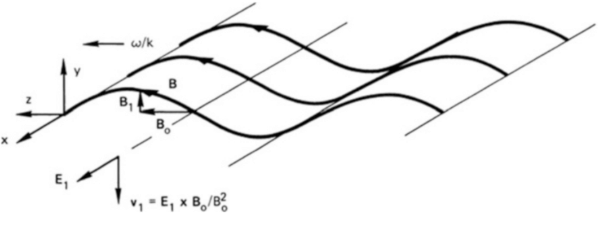

# MHD and Alfvén Waves {#sec-mhd-waves}

::: {.callout-tip title="Related Chapters"}
For general wave properties and cold-plasma dispersion theory, see @sec-waves and @sec-CPDR; for warm, electrostatic, and wave–particle resonance physics, see @sec-warm-waves; for whistler waves and wave identification ratios, see @sec-whistler; for inhomogeneous Alfvén field-line resonance, see @sec-flr; for gyrokinetic treatment of kinetic Alfvén waves, see @sec-gyrokinetics; for parametric instabilities, see @sec-parametric; for Elsässer variables and Alfvénic turbulence, see @sec-turbulence; for numerical MHD and circularly polarized Alfvén wave benchmarks, see @sec-test.

For interactive Friedrich diagrams, dispersion curves, and animations, see **[PlasmaWaves.jl: MHD & Alfvén Waves](https://henry2004y.github.io/PlasmaWaves/mhd.html)** and **[Kinetic & Inertial Alfvén Waves](https://henry2004y.github.io/PlasmaWaves/kaw.html)**.
:::

## Ideal MHD Wave Equations

### Cold MHD

By ignoring pressure, gravity, viscosity and rotation, we have
$$
\begin{aligned}
\rho \frac{\partial \mathbf{u}}{\partial t} = \mathbf{j}\times\mathbf{B}_0 \\
\mathbf{E} = -\mathbf{u}\times\mathbf{B}_0 \\
\nabla\times\mathbf{E} = -\frac{\partial \mathbf{B}_1}{\partial t} \\
\nabla\cdot\mathbf{B}_1 = 0 \\
\nabla\times\mathbf{B}_1 = \mu_0\mathbf{j}
\end{aligned}
$$ {#eq-mhd_cold}

As usual in wave analysis, $\mathbf{u},\mathbf{j},\mathbf{E}$ are treated as perturbations. The MHD wave equation for the electric field can then be obtained,
$$
\begin{aligned}
\dot{\mathbf{E}} &= -\dot{\mathbf{u}}\times\mathbf{B}_0 = -\frac{1}{\rho}(\mathbf{j}\times\mathbf{B})\times\mathbf{B}_0 = -\frac{1}{\mu_0\rho}[(\nabla\times\mathbf{B}_1)\times\mathbf{B}_0]\times\mathbf{B}_0 \\
\ddot{\mathbf{E}} &= [(\nabla\times(\nabla\times\mathbf{E}))\times\mathbf{V}_A]\times\mathbf{V}_A
\end{aligned}
$$
where $\mathbf{V}_A = \mathbf{B}_0 /\sqrt{\mu_0 \rho}$ is the Alfvén velocity, or if we mutate the triad cross terms,
$$
\ddot{\mathbf{E}} = \mathbf{V}_A \times [\mathbf{V}_A\times\nabla\times(\nabla\times\mathbf{E})]
$$ {#eq-mhd_cold_e_wave}

Alternatively, we can also get the MHD wave equation for the magnetic field:
$$
\begin{aligned}
\left\{ \begin{aligned}
\dot{\mathbf{B}_1} = \nabla\times(\mathbf{u}\times\mathbf{B}_0) \\
(\nabla\times\mathbf{B}_1)\times\mathbf{B}_0 = \mu_0\mathbf{j}\times\mathbf{B}_0 = \mu_0\rho\dot{\mathbf{u}}
\end{aligned} \right. \\
\Rightarrow \ddot{\mathbf{B}_1} = \nabla\times \Big[ \big( \frac{1}{\mu_0\rho}(\nabla\times\mathbf{B}_1)\times\mathbf{B}_0 \big)\times\mathbf{B}_0 \Big]
\end{aligned}
$$
or
$$
\ddot{\mathbf{B}_1} = \nabla\times \Big[ \big( (\nabla\times\mathbf{B}_1)\times\mathbf{V}_A \big)\times\mathbf{V}_A \Big]
$$ {#eq-mhd_cold_b_wave}

We will see soon that in cold MHD the slow mode ceases to exist, and the fast mode moves at Alfvén speed, such that along the magnetic field line, we only have a single wave mode.

### Hot MHD

$$
\begin{aligned}
\frac{\partial\rho}{\partial t}+\nabla\cdot(\rho\mathbf{v})=0 \\
\rho\frac{\mathrm{d}\mathbf{v}}{\mathrm{d}t}=-\nabla p+\mathbf{j}\times\mathbf{B} \\
\mathbf{j}=\frac{1}{\mu_0}\nabla\times\mathbf{B} \\
\frac{\mathrm{d}}{\mathrm{d}t}\Big( p\rho^{-\gamma} \Big)=0 \\
\frac{\partial\mathbf{B}}{\partial t}=-\nabla\times\mathbf{E} \\
\mathbf{E}=-\mathbf{v}\times\mathbf{B}
\end{aligned}
$$

$\dot{\mathbf{E}}$ is ignored because we only consider low frequency waves. We assume no background flow, $\mathbf{u}_0=0$, so the current is purely caused by perturbed velocity $\mathbf{u}_1$. Performing linearization and plane wave decomposition:
$$
\begin{aligned}
-i\omega\rho_1+i\rho_0\mathbf{k}\cdot\mathbf{v}=0 \\
-i\omega\rho_0\mathbf{v}=-i\mathbf{k}p_1+\mathbf{j}\times\mathbf{B}_0 \\
\mathbf{j}=\frac{1}{\mu_0}i\mathbf{k}\times\mathbf{B}_1 \\
p_1/p_0 -\gamma\rho_1/\rho_0 = 0 \\
-i\omega\mathbf{B}_1=i\mathbf{k}\times(\mathbf{v}\times\mathbf{B}_0)
\end{aligned}
$$

Let $\mathbf{B}_0 = B_0\hat{z}$. The linearized equations can be further simplified:
$$
\begin{aligned}
-i\omega\rho_0\mathbf{v}=-i\mathbf{k}\big( \gamma p_0\frac{\mathbf{k}\cdot\mathbf{v}}{\omega} \big) +\Big[ \frac{1}{\mu_0}i\mathbf{k}\times\big( -\frac{\mathbf{k}\times(\mathbf{v}\times\mathbf{B}_0)}{\omega} \big) \Big]\times\mathbf{B}_0 \\
\omega^2 \mathbf{v}-{v_s}^2 \mathbf{k}(\mathbf{k}\cdot\mathbf{v})-{v_A}^2\big[ \mathbf{k}\times\big( \mathbf{k}\times(\mathbf{v}\times\hat{z})\big) \big]\times\hat{z}=0
\end{aligned}
$$
where $v_s=\sqrt{\frac{\gamma p_0}{\rho_0}}$ is the sound speed, and $v_A=\sqrt{\frac{{B_0}^2}{\mu_0\rho_0}}$ is the Alfvén speed. If we write $\mathbf{V}_A = \mathbf{B}_0 / \sqrt{\mu_0 \rho_0}$, this can also be written as
$$
\omega^2 \mathbf{v} - {v_s}^2 \mathbf{k}(\mathbf{k}\cdot\mathbf{v}) - \mathbf{k}\times \mathbf{k}\times (\mathbf{v}\times\mathbf{V}_A) \times\mathbf{V}_A = 0
$$

Due to the symmetry in the perpendicular x-y plane, for simplicity, we assume the wave vector $\mathbf{k}$ lies in the x-z plane with an angle w.r.t. the $z$ axis $\theta$:
$$
\mathbf{k} = k_x\hat{x} + k_z\hat{z} = k_x\hat{x} + k_\parallel\hat{z} = k\sin\theta\hat{x} + k\cos\theta\hat{z}
$$

Now it can be written as
$$
\begin{pmatrix}
-\omega^2/k^2 + v_A^2 + v_s^2\sin^2\theta & 0 & v_s^2\sin\theta\cos\theta \\
0 & -\omega^2/k^2+v_A^2\cos^2\theta & 0 \\
v_s^2\sin\theta\cos\theta & 0 & -\omega^2/k^2+v_s^2\cos^2\theta
\end{pmatrix}
\begin{pmatrix}
v_x \\ v_y \\ v_z
\end{pmatrix} = 0
$$ {#eq-mhd_v_perturbation}


## Fast and Slow Magnetosonic Waves {#sec-fast_slow}

The $x$-$z$ components of @eq-mhd_v_perturbation give
$$
\begin{aligned}
(\omega^2-k^2{v_A}^2-{k_x}^2{v_s}^2)v_x -k_x k_z{v_x}^2v_z = 0 \\
(\omega^2-{k_z}^2{v_s}^2)v_z -k_x k_z{v_s}^2v_x=0
\end{aligned}
$$

The dispersion relation is given by the determinant being 0,
$$
\begin{aligned}
\omega^4-k^2({v_A}^2+{v_s}^2)\omega^2+{k_z}^2{v_s}^2k^2{v_A}^2=0 \\
\frac{\omega^2}{k^2}=\frac{1}{2}({v_A}^2+{v_s}^2)\pm\frac{1}{2}\sqrt{({v_A}^2+{v_s}^2)^2-4{v_s}^2{v_A}^2\cos^2\theta}
\end{aligned}
$$ {#eq-mhd_fast_slow}

"+" corresponds to the fast mode, or magnetosonic mode, and "-" corresponds to the slow mode.
The Friedrich graph @fig-mhd-friedrich is very useful in interpreting @eq-mhd_fast_slow. Both the low-$\beta$ ($v_A>v_s$) and high-$\beta$ ($v_A<v_s$) regimes are shown; if $v_A<v_s$, then along the background magnetic field direction $\hat{z}$ the fast wave has phase speed $v_\mathrm{ph} = v_s$, and the slow wave has phase speed $v_\mathrm{ph} = v_A$ overlapping with the Alfvén wave. Thus in the high-$\beta$ case the slow wave may have a faster phase speed than the Alfvén wave at a proper angle!

Another thing to be careful about is that when you observe a wave propagating at the Alfvén speed along the field line, you need more information to determine the characteristics of the wave:

* Check the $\beta$-regime as well as the compressionality to determine if it has fast/slow wave component.
* Check the polarization to see if it is an cyclotron wave.
* Check the parallel electric field to see if has kinetic features.

.](../images/pw_friedrich.png){#fig-mhd-friedrich}

::: {.content-visible unless-format="pdf"}
```{=html}
<figure style="text-align: center;">
  <video src="https://henry2004y.github.io/PlasmaWaves/assets/gallery/friedrich_sweep.mp4" autoplay loop muted playsinline controls style="max-width: 100%; border-radius: 8px;"></video>
  <figcaption>Friedrich phase-velocity diagram sweeping $v_s / v_A$ smoothly between the low-$\beta$ and high-$\beta$ regimes — from <a href="https://henry2004y.github.io/PlasmaWaves/mhd.html#Friedrich-Diagram-Regime-Sweep" target="_blank" rel="noopener">PlasmaWaves.jl</a>.</figcaption>
</figure>
```
:::

::: {.content-visible when-format="pdf"}
*Animation: [Friedrich Diagram Regime Sweep (PlasmaWaves.jl)](https://henry2004y.github.io/PlasmaWaves/mhd.html#Friedrich-Diagram-Regime-Sweep).*
:::

Given the velocity perturbation $\mathbf{v}_1 = (v_x, 0, v_z)$, the other perturbations are given as
$$
\begin{aligned}
\rho_1 &= \frac{\rho_0}{\omega}\mathbf{k}\cdot\mathbf{v} \\
p_1 &= \gamma p_0\frac{\rho_1}{\rho_0} = \frac{\gamma p_0}{\omega}\mathbf{k}\cdot\mathbf{v} \\
\mathbf{E} &= B_0 v_x\hat{y} \\
\mathbf{B}_1 &= \frac{\mathbf{k}}{\omega}\times\mathbf{E} = \frac{(\mathbf{k}\cdot\mathbf{v})\mathbf{B}_0 - (\mathbf{k}\cdot\mathbf{B}_0)\mathbf{v}}{\omega} = -\frac{B_0 v_x k_z}{\omega}\hat{x} + \frac{B_0v_xk_x}{\omega}\hat{z} \\
\mathbf{j} &= \frac{1}{\mu_0}\nabla\times\mathbf{B}_1 = \frac{i\mathbf{k}\times\mathbf{B}_1}{\mu_0}
\end{aligned}
$$ {#eq-mhd_fast_perturbations}

$\mathbf{E}$ shows that the fast/slow modes in a uniform plasma are also linearly polarized. When we have $\theta=90^\circ$ (perpendicular propagation), the magnetic perturbation can be simplified to
$$
\mathbf{B}_1 = \frac{v}{\omega/k_\perp}\mathbf{B}_0
$$
which means that the perturbed magnetic field is always aligned with the background magnetic field.

The distinction between the fast and slow waves can be further understood by comparing the signs of the wave induced fluctuations in the plasma and magnetic pressures: $p$ and $\mathbf{B}_0\cdot\mathbf{B}/\mu_0$, respectively. It follows from @eq-mhd_fast_perturbations that
$$
\frac{\mathbf{B}_0\cdot\mathbf{B}}{\mu_0} = \frac{\mathbf{k}\cdot\mathbf{v}B_0^2 - (\mathbf{k}\cdot\mathbf{B}_0)(\mathbf{B}_0\cdot\mathbf{v})}{\mu_0\,\omega}
$$

The $z$-component of the perturbed momentum equation yields
$$
\omega\rho_0 v_z = k \cos\theta p
$$

Combining the above, we have
$$
\frac{\mathbf{B}_0\cdot\mathbf{B}}{\mu_0} = \frac{v_A^2}{v_s^2}\left( 1 - \frac{k^2 v_s^2\cos^2\theta}{\omega^2} \right) p
$$ {#eq-mhd-B-P-perturb-relation}

Hence, $p$ and $\mathbf{B}_0\cdot\mathbf{B}/\mu_0$ have the same sign if $V_\mathrm{ph}=\omega/k>v_s \,\cos\theta$, and the opposite sign if $V_\mathrm{ph}<v_s\,\cos\theta$. It is straightforward to show that $v_+> v_s\,\cos\theta$, and $v_-<v_s\,\cos\theta$. Thus, we conclude that in the fast magnetosonic wave the pressure and magnetic energy fluctuations reinforce one another, whereas the fluctuations oppose one another in the slow magnetosonic wave.

The temperature perturbation, based on the equation of state, can be derived as follows:
$$
\begin{aligned}
T_1 &= T - T_0 = \frac{p_0 + p_1}{(n_0 + n_1)k_B} - \frac{p_0}{n_0 k_B} \\
&= p_0\left( 1+\gamma\frac{n_1}{n_0} \right) \frac{1}{(n_0 + n_1)k_B} - \frac{p_0}{n_0 k_B} \\
&= p_0\frac{1}{k_B}\left[ \left(1+\gamma\frac{n_1}{n_0}\right)\frac{1}{n_0 + n_1} - \frac{1}{n_0} \right] \\
&= p_0\frac{1}{k_B}\left[ \frac{(\gamma-1)n_1}{n_0(n_0+n_1)} \right] \\
&= T_0\left(\gamma-1 \right)\frac{\mathbf{k}\cdot\mathbf{v}}{\omega + \mathbf{k}\cdot\mathbf{v}}
\end{aligned}
$$ {#eq-mhd_fast_wave_T_perturbation}

@eq-mhd_fast_wave_T_perturbation shows that temperature does not follow the same sinusoidal shape as the perturbed velocity.

Special attention is required for the extreme cases. When $\theta=90^\circ$, the fast wave phase speed $v_\mathrm{ph}=\sqrt{v_A^2 + v_s^2}$ while the slow wave phase speed $v_\mathrm{ph}=0$. Slow waves cannot propagate perpendicular to the magnetic field. However, this is still a valid solution with all the slow mode perturbation properties, and you will see in @sec-mirror-instability and @sec-mirror that this is named _mirror mode_. When $\theta=0^\circ$, the fast wave phase speed $v_\mathrm{ph}=\max(v_A, v_s)$ while the slow wave phase speed $v_\mathrm{ph}=\min(v_A, v_s)$.

It is important to understand the nature of fast and slow waves under the _cold plasma limit_, i.e. in the low-$\beta$ regime where $v_A\gg v_s$ (cold, strong B). If $v_s\rightarrow 0$, the slow mode ceases to exit ($V_\mathrm{ph}\rightarrow 0$) and the phase speed of the fast mode becomes $v_p \approx v_A$. This is often called the _compressional Alfvén wave_, which is actually a fast wave in the low-$\beta$ limit. If $\beta$ is low but we still have a finite sound speed, the dispersion relation for the slow wave reduces to
$$
\omega \simeq k\,v_s\,\cos\theta
$$

Thus, in low-$\beta$ plasmas the slow wave is a sound wave modified by the presence of the magnetic field.

::: {.content-visible unless-format="pdf"}
```{=html}
<figure style="text-align: center;">
  <video src="https://henry2004y.github.io/PlasmaWaves/assets/gallery/magnetosonic_waves.mp4" autoplay loop muted playsinline controls style="max-width: 100%; border-radius: 8px;"></video>
  <figcaption>Fast vs. slow magnetosonic waves showing reinforcing vs. opposing plasma and magnetic pressure perturbations — from <a href="https://henry2004y.github.io/PlasmaWaves/mhd.html#Fast-vs.-Slow-Magnetosonic-Waves" target="_blank" rel="noopener">PlasmaWaves.jl</a>.</figcaption>
</figure>
```
:::

::: {.content-visible when-format="pdf"}
*Animation: [Fast vs. Slow Magnetosonic Waves (PlasmaWaves.jl)](https://henry2004y.github.io/PlasmaWaves/mhd.html#Fast-vs.-Slow-Magnetosonic-Waves).*
:::

Sometimes the fast wave dispersion relation is written in alternative ways. Let $a=\omega/(k_\parallel v_A)=\omega/(k\cos\theta\,v_A)$. From @eq-mhd_fast_slow, we have
$$
\cos^2\theta = \frac{a^2\left( v_s^2/v_A^2 + 1 \right)-v_s^2/v_A^2}{a^4}
$$ {#eq-mhd-fast-angle}

This expression is useful when considering the wave resonance and mode conversions. For example, Alfvén resonance occurs when
$$
\omega^2 = k_\parallel^2 v_A^2
$$ {#eq-mhd-alfven-resonance}
i.e. $a=1$ under the low frequency approximation. In higher frequency cases, the Alfvén resonance condition is modified as
$$
a = \frac{1}{\left( 1-\omega^2/\Omega_i^2 \right)^2}
$$ {#eq-mhd-alfven-resonance-flr}
because of the finite ion Larmor radius effects. However, note that the Alfvén resonance singularity can be removed by including non‐MHD effects such as electron inertia or ion Larmor radius corrections!


## The Alfvén Wave Series {#sec-alfven-series}

Alfvén waves form a broad family of low-frequency electromagnetic plasma modes united by the magnetic-tension restoring force in the long-wavelength, small-amplitude ideal MHD limit ($\omega \ll \Omega_i$, $k_\perp r_{Li} \ll 1$, $k_\perp d_e \ll 1$). As wave amplitude, polarization, ion/electron dispersion, finite plasma $\beta$, spatial geometry, or relativistic and collisional effects become important, the basic shear Alfvén wave branches into a rich hierarchy of distinct modes.

### Linear Shear Alfvén Wave (SAW) {#sec-linear-saw}

For any nonzero $v_y$, the $y$-component of @eq-mhd_v_perturbation gives
$$
\omega^2 = k^2v_A^2\cos^2\theta = k_\parallel^2 v_A^2
$$
which is known as the _Alfvén wave_, in a uniform plasma immersed in a uniform background magnetic field with phase speed
$$
v_p = v_A\cos\theta
$$

The group velocity and hence energy propagation is always parallel to $\mathbf{B}$ regardless of the direction of $\mathbf{k}$, and for this reason this mode is also know as the _guided_ mode. This property, of course, has the direct bearing on the feature of Alfvén wave resonant absorption.

Given the velocity perturbation $\mathbf{v}_1 = (0, v_y, 0)$, $-i\omega\rho_1 + \rho_0 \mathbf{k}\cdot\mathbf{v} = 0$, $\omega\mathbf{B}_1 + \mathbf{k}\times(\mathbf{v}\times\mathbf{B}_0) = 0$, the other perturbations are given as
$$
\begin{aligned}
\rho_1 &= 0 \\
p_1 &= 0 \\
\mathbf{E} &= -B_0 v_y\hat{x} \\
\mathbf{B}_1 &= \frac{\mathbf{k}}{\omega}\times\mathbf{E} = -\frac{k_zB_0v_y}{\omega}\hat{y} = -\frac{\mathbf{v}}{\omega/k_\parallel}B_0 \\
\mathbf{j} &= \frac{1}{\mu_0}\nabla\times\mathbf{B}_1 = \frac{i\mathbf{k}\times\mathbf{B}_1}{\mu_0}
\end{aligned}
$$ {#eq-mhd_Alfven_perturbations}

SAW has a wave vector $\mathbf{k}$ in the XZ-plane. $\mathbf{E}$ shall oscillate in the X-direction; $\mathbf{B}$ shall oscillate in the Y-direction. The electric current of the wave $\mathbf{j}$ lies in the XZ-plane. The timescale of the variations of the wave fields is much longer than the ion gyroperiod $\Omega_i^{-1}$. In both the perpendicular and parallel directions, the spatial scale of the waves $1/k$ are much larger than ion motion scale $r_{iL}$. The wave carries a Poynting flux $\mathbf{S} = \mathbf{E}\times\mathbf{B}_1$ strictly parallel to $\mathbf{B}_0$. The ratio of the wave electric field to the wave magnetic field $|\mathbf{E}|/|\mathbf{B}_1|$ is exactly one Alfvén speed $V_A$.

$\mathbf{E}$ (or $\mathbf{B}_1$) in @eq-mhd_Alfven_perturbations shows that the Alfvén wave in a uniform plasma is a linearly polarized wave if $\mathbf{v}_1 = (0, v_y, 0)$. If instead we set $\mathbf{k}=(0,0,k)$ ($\theta=0^\circ$) and $\mathbf{v}_1 = (v_x, v_y, 0)$, then $\mathbf{k}\cdot\mathbf{v}=0\Rightarrow \rho_1=0$ but $\mathbf{E}=-\mathbf{v}\times\mathbf{B}_0 = kv_y\hat{x} - kv_x\hat{y}$ can be a circularly polarized wave or else. Correlated $\mathbf{B}_1$ and $\mathbf{v}$ corresponds to waves propagating anti-parallel to the $\mathbf{B}_0$ ($\mathbf{k}\cdot\mathbf{B}_0<0$), and anti-correlated $\mathbf{B}_1$ and $\mathbf{v}$ corresponds to waves propagating parallel to the $\mathbf{B}_0$ ($\mathbf{k}\cdot\mathbf{B}_0>0$). (This is the same as expressed by the Alfvénicity condition @eq-Alfvenity.) The resultant magnetic field then exhibits shear, thus the Alfvén wave is called the _shear Alfvén wave_ (SAW). An interactive animation of SAW is linked below.

::: {.content-visible unless-format="pdf"}
```{=html}
<figure style="text-align: center;">
  <video src="https://henry2004y.github.io/PlasmaWaves/assets/gallery/alfven_wave.mp4" autoplay loop muted playsinline controls style="max-width: 100%; border-radius: 8px;"></video>
  <figcaption>Shear Alfvén wave propagation showing transverse magnetic field line oscillation and fluid velocity — from <a href="https://henry2004y.github.io/PlasmaWaves/mhd.html#Wave-Propagation-Animations" target="_blank" rel="noopener">PlasmaWaves.jl</a>.</figcaption>
</figure>
```
:::

::: {.content-visible when-format="pdf"}
*Animation: [Shear Alfvén Wave (PlasmaWaves.jl)](https://henry2004y.github.io/PlasmaWaves/mhd.html#Wave-Propagation-Animations).*
:::

To understand what happens physically in an Alfvén wave, recall that this is an electromagnetic wave with a fluctuating magnetic field $\mathbf{B}_1$ given by
$$
\nabla\times\mathbf{E}_1 = -\dot{\mathbf{B}}_1\quad E_x=(\omega/k)B_y
$$ {#eq-alfven-perturb-e-b}

The small component $B_y$, when added to $\mathbf{B}_0$, gives the magnetic field lines a sinusoidal ripple, shown exaggerated in @fig-alfven-wave-oscillations. At the point shown, $B_y$ is in the positive $y$ direction, so, according to @eq-alfven-perturb-e-b, $E_x$ is in the positive $x$ direction if $\omega/k$ is in the $z$ direction. The electric field $E_x$ gives the plasma an $\mathbf{E}_1\times\mathbf{B}_0$ drift in the negative $y$ direction. Since we have taken the limit $\omega^2\ll\Omega_{c}$, both ions and electrons will have the same drift $v_y$, obtained from @sec-CPDR the component $v_y$ under $T_i=0$:
$$
\begin{aligned}
v_{ix} &= \frac{iq}{m \omega}\left( 1-\frac{\Omega_c^2}{\omega^2} \right)^{-1} E_1 \\
v_{iy} &= \frac{q}{m\omega}\frac{\Omega_c}{\omega} \left( 1-\frac{\Omega_c^2}{\omega^2} \right)^{-1} E_1
\end{aligned}
$$ {#eq-vxy-CPDR}

Thus, the fluid moves up and down in the y direction. The magnitude of this velocity is $|E_x/B_0|$. Since the ripple in the field is moving by at the phase velocity $\omega/k$, the magnetic field is also moving downward at the point indicated in @fig-alfven-wave-oscillations. The downward velocity of the magnetic field lines is $(\omega/k)|B_y/B_0|$, which, according @eq-alfven-perturb-e-b, is just equal to the fluid velocity $|E_x/B_0|$. Thus, the fluid
and the field lines oscillate together as if the particles were stuck to the lines. The magnetic field lines act as if they were mass-loaded strings under tension, and an Alfvén wave can be regarded as the propagating disturbance occurring when the strings are plucked. This concept of plasma frozen to the field lines and moving with them is a
useful one for understanding many low-frequency plasma phenomena. It can be shown that this notion is an accurate one as long as there is no electric field along $\mathbf{B}$.

{#fig-alfven-wave-oscillations}

It remains for us to see what sustains the electric field $E_x$ which we presupposed was there. As $\mathbf{E}_1$ fluctuates, the ions' inertia causes them to lag behind the electrons, and there is a polarization drift $\mathbf{v}_p$ in the direction of $\mathbf{E}_1$. This drift $v_{ix}$ is given by @eq-vxy-CPDR and causes a current $\mathbf{j}_1$ to flow in the $x$ direction. The resulting $\mathbf{j}_1\times\mathbf{B}_0$ force on the fluid is in the $y$ direction and is $90^\circ$ out of phase with the velocity $\mathbf{v}_1$. This force perpetuates the oscillation in the same way as in any oscillator where the force is out of phase with the velocity. It is, of course, always the ion inertia that causes an overshoot and a sustained oscillation, but in a plasma the momentum is transferred in a complicated way via the electromagnetic forces.

In a more realistic geometry for experiments, $\mathbf{E}_1$ would be in the radial direction and $\mathbf{v}_1$ in the azimuthal direction. The motion of the plasma is then incompressible. This is the reason the $\nabla p$ term in the equation of motion could be neglected.

In a non-uniform plasma, SAW attains the interesting property of a continuous spectrum. To illustrate this feature, let us consider the simplified slab model of a cold plasma with a non-uniform density, $\rho=\rho(x)$, and a uniform $\mathbf{B}_0 = B_0\hat{z}$. Assuming at $t=0$ a localized initial perturbation $\mathbf{B}_{1y}(x,t=0) = \exp(-x^2/\Delta x^2)$, $|k_y\Delta_x|\ll1$, and $\partial\mathbf{B}_{1y}/\partial t=0$, the perturbation then evolves according to the following wave equation (@eq-mhd_cold_b_wave, $B_{1z}=0$ so no coupling between the fast mode and Alfvén mode):
$$
[\partial_t^2 + \omega_A^2(x)]B_{1y}(x,t) = 0
$$

Here $\omega_A^2(x) = k_z^2v_A^2(x)$ and the solution is
$$
B_{1y}(x,t) = \hat{B}_{1y}(x,0)\cos[\omega_A(x)t]
$$ {#eq-mhd_alfven_slab_by}

@eq-mhd_alfven_slab_by shows that every point in $x$ oscillates at a different frequency, $\omega_A(x)$. With a continuously varying $\omega_A(x)$; the wave frequency, thus, constitutes a continuous spectrum. While the above result is based on a model with a 1D non-uniformity in x, this general feature of SAW continuous spectrum also holds in magnetized plasmas with 2D or 3D non-uniformities. A good example is geomagnetic pulsations in the Earth's magnetosphere observed by Engebretson shown in Figure 1 of [@chen2021physics].

@eq-mhd_alfven_slab_by also indicates an unique and important property of SAW continuous spectrum: the spatial structure evolves with time. Specifically, the wave number in the non-uniformity direction is, time asymptotically, given by:
$$
|k_x| = \bigg\lvert\frac{\partial \ln B_{1y}}{\partial x}\bigg\rvert \simeq \bigg\lvert\frac{\mathrm{d} \omega_A(x)}{\mathrm{d} x}\bigg\rvert t
$$ {#eq-mhd_alfven_wavenumber_nonuniform}

That $|k_x|$ increases with $t$ is significant, since it implies that any initially long-scale perturbations will evolve into short scales. This evolution of a smooth $B_{1y}$ at $t=0$ into spatially fast-varying perturbations at later $t$ is illustrated in the phase-mixing animation below.

::: {.content-visible unless-format="pdf"}
```{=html}
<figure style="text-align: center;">
  <video src="https://henry2004y.github.io/PlasmaWaves/assets/gallery/phase_mixing.mp4" autoplay loop muted playsinline controls style="max-width: 100%; border-radius: 8px;"></video>
  <figcaption>Non-uniform shear Alfvén wave phase mixing showing $|k_x| \simeq |\omega_A'(x)| t$ developing fine transverse structure over time — from <a href="https://henry2004y.github.io/PlasmaWaves/mhd.html#Non-Uniform-SAW-Phase-Mixing" target="_blank" rel="noopener">PlasmaWaves.jl</a>.</figcaption>
</figure>
```
:::

::: {.content-visible when-format="pdf"}
*Animation: [Non-Uniform SAW Phase Mixing (PlasmaWaves.jl)](https://henry2004y.github.io/PlasmaWaves/mhd.html#Non-Uniform-SAW-Phase-Mixing).*
:::

Another consequence of $|k_x|$ increasing with $t$ is the temporal decay of $B_{1x}$. From $\nabla\cdot\mathbf{B}_1 \simeq \nabla_\perp\cdot\mathbf{B}_{1\perp}=0$, we can readily derive that, for $|\omega_A^\prime t|\gg |k_y|$:
$$
B_{1x}(x, t)\simeq \frac{k_y}{\omega_A^\prime(x)t}\hat{B}_{1y}(x,0)e^{-i\omega_A(x)t}\Big[ 1+\mathcal{O}\Big( \frac{k_y}{|\omega_A^\prime t|+ ...} \Big) \Big]
$$

That is, $B_{1x}$ decays temporally due to the phase mixing of increasingly more rapidly varying neighboring perturbations.

Noting that, as $t\rightarrow\infty$, $|k_x|\rightarrow\infty$, it thus suggests that the perturbation will develop singular structures toward the steady state. As we will see in the field line resonance @sec-flr, the singularity is reached at the Alfvén resonant point $x_r$, where $\omega^2=\omega_A^2(x_r)$ along with a finite resonant wave-energy absorption rate. Note that at the isolated extrema of the SAW continuum, $|\omega_A^\prime|=0$, phase mixing vanishes; consequently, perturbation remains regular and experiences no damping via resonant absorption. This feature has important implications to Alfvén instabilities in laboratory plasmas.

Space plasmas support a variety of waves, but for heating the plasma and accelerating the electrons and ions, Alfvén waves are a predominant source. Near the Sun, Alfvén waves are excited and propagate outward. They exchange their energy with particles to accelerate them in the form of solar wind and heat the electrons. When perpendicular wavelength of the wave becomes comparable to the ion gyro-radius ($k_\perp r_{Li}\sim 1$) or inertial length ($k_\perp d_i \sim 1$) in the case of kinetic Alfvén waves (KAWs, @sec-kaw) or inertial Alfvén waves (IAWs, @eq-iaw), respectively, then the wave in both the limits has a _nonzero parallel electric field_ component which is responsible for the acceleration of the particles via the Landau mechanism. This is also consistent with the generalized Ohm's law @eq-genearlized_ohm_law: only when we go beyond Hall MHD can $\mathbf{E}_\parallel$ be nonzero. (WHAT ABOUT $\eta\mathbf{j}$?) KAW relates to $\frac{\nabla P_e}{ne}$ term, while IAW relates to $\frac{\partial \mathbf{j}}{\partial t}$ term. The key interest is in $E_\parallel$. KAWs and IAWs have significance not only in space plasmas but also in laboratory plasma such as in fusion reactors.

Alfvén wave has very high saturation level, meaning that it takes a long time for the wave to reach the nonlinear phase. (???)

__SAW in a Slab__

We now look deeper into the properties of Alfvén waves in a nonuniform magnetized plasma slab that carries a current flowing along an externally imposed magnetic field $B_{0z}\hat{z}$, where $B_{0z}$ is assumed to be a constant. First, we formulate the governing equation for the slab geometry, under the ideal MHD condition. Then we show that Alfvén waves are always neutrally stable, with important indication at the end.

The presence of an equilibrium current density $\mathbf{J}_0 = \widehat{z}J_0(x)$ produces a local magnetic field of the form
$$
\mathbf{B}_0 = \hat{z}B_{0z} + \hat{y}B_{0y}(x)
$$

The Ampère's law gives
$$
\nabla\times\mathbf{B}_0 = \mu_0 \mathbf{J}_0 \Rightarrow \frac{\partial B_{0y}}{\partial x}-\frac{\partial B_{0x}}{\partial y} = \frac{\partial B_{0y}}{\partial x} = \mu_0 J_0(x)
$$ {#eq-ampere_slab}

From the force balance equation,
$$
\mathbf{J}_0\times\mathbf{B}_0 = \nabla P_0
$$ {#eq-force_balance_slab}

Substituting @eq-ampere_slab into @eq-force_balance_slab, we get
$$
\frac{{B_{0y}(x)}^2}{2\mu_0} + P_0(x) = \text{const.}
$$

Designate all perturbation quantities with a subscript 1, and assume $e^{-i\omega t+ik_y y+ i k_z z}$ dependence for all perturbations (nonuniform in the $x$-direction, thus no sinuisoidal wave assumption). From linearized Faraday's law and Ohm's law in ideal MHD,

$$
\begin{aligned}
-\nabla\times\mathbf{E}_1 = \nabla\times(\mathbf{v}_1\times\mathbf{B}_0) = \frac{\partial\mathbf{B}_1}{\partial t} \\
-i\omega\mathbf{B}_1 = \mathbf{v}_1\cancel{(\nabla\cdot\mathbf{B}_0)}-\mathbf{B}_0\cancel{(\nabla\cdot\mathbf{v}_1)}+(\mathbf{B}_0\cdot\nabla)
\mathbf{v}_1 - (\mathbf{v}_1\cdot\nabla)\mathbf{B}_0
\end{aligned}
$$
where we have assumed the plasma is incompressible. Replace $\nabla$ with $i\mathbf{k}$, $\mathbf{v}_1=i\omega \pmb{\xi}_1$ and take the $x$-component, we get
$$
B_{1x} = i(\mathbf{k}\cdot\mathbf{B}_0)\xi_{1x}
$$ {#eq-mhd_slab_b1x}
where $\mathbf{k}=\hat{y}k_y+\hat{z}k_z$.

The MHD force law can be linearized to
$$
\rho_0 \frac{\partial \mathbf{v}_1}{\partial t} = -\nabla\Big( p_1 + \frac{\mathbf{B}_0\cdot\mathbf{B}_1}{\mu_0}\Big) + \frac{1}{\mu_0}\big[ (\mathbf{B}_0\cdot\nabla)\mathbf{B}_1 + (\mathbf{B}_1\cdot\nabla)\mathbf{B}_0\big]
$$ {#eq-mhd_momentum_linearized_slab}

Since the plasma is incompressible, $\nabla\cdot\pmb{v}_1=0,\ \dot{\pmb{\xi}}=\mathbf{v}_1\Rightarrow \nabla\cdot\pmb{\xi}=0$. In addition, $\nabla\cdot\mathbf{B}_1=0$. We then have
$$
\begin{aligned}
\mathbf{k}\cdot\pmb{\xi}_{1yz}&=i\frac{\partial \xi_{1x}}{\partial x} \\
\mathbf{k}\cdot\pmb{B}_{1yz}&=i\frac{\partial B_{1x}}{\partial x}
\end{aligned}
$$
where $\pmb{\xi}_{1yz} = (0,\xi_{1y},\xi_{1z})$, $\mathbf{B}_{1yz}=(0,B_{1y},B_{1z})$. The $x$-component of @eq-mhd_momentum_linearized_slab gives
$$
-\rho_0\omega^2 \xi_{1x} = -\frac{\partial}{\partial x}\Big( p_1 + \frac{\mathbf{B}_0\cdot\mathbf{B}_1}{\mu_0}\Big) +\frac{1}{\mu_0} \big[ (\mathbf{B}_0\cdot\nabla)B_{1x} \big]
$$ {#eq-mhd_momentum_linearized_slab_x}

The dot product of @eq-mhd_momentum_linearized_slab with $\mathbf{k}$ gives
$$
\begin{aligned}
-\rho_0 \omega^2 \mathbf{k}\cdot\pmb{\xi}_{1yz} &= ik^2 \Big( p_1 + \frac{\mathbf{B}_0\cdot\mathbf{B}_1}{\mu_0}\Big) + \frac{1}{\mu_0}\big[ i(\mathbf{k}\cdot\mathbf{B}_0)(\mathbf{k}\cdot\mathbf{B}_{1yz}) + B_{1x}\frac{\partial }{\partial x}(\mathbf{k}\cdot\mathbf{B}_0)\big]\\
-\rho_0 \omega^2 i\frac{\partial \xi_{1x}}{\partial x} &= ik^2 \Big( p_1 + \frac{\mathbf{B}_0\cdot\mathbf{B}_1}{\mu_0}\Big) + \frac{1}{\mu_0}\big[ i(\mathbf{k}\cdot\mathbf{B}_0)(i\frac{\partial B_{1x}}{\partial x}) + B_{1x}\frac{\partial }{\partial x}(\mathbf{k}\cdot\mathbf{B}_0)\big]
\end{aligned}
$$ {#eq-mhd_momentum_linearized_slab_k}

Finally, canceling $p_1 + \frac{\mathbf{B}_0\cdot\mathbf{B}_1}{\mu_0}$ from @eq-mhd_momentum_linearized_slab_x and @eq-mhd_momentum_linearized_slab_k and substituting $B_{1x}$ from @eq-mhd_slab_b1x, we obtain the governing equation
$$
\frac{\partial}{\partial x}\Big\{ \rho_0 \big[ \omega^2 - (\mathbf{k}\cdot\mathbf{v}_A)^2\big]\frac{\partial \xi_{1x}}{\partial x}\Big\} -k^2\rho_0 \big[ \omega^2 - (\mathbf{k}\cdot\mathbf{v}_A)^2\big]\xi_{1x}=0
$$ {#eq-mhd_slab_governing}
where $k^2={k_y}^2+ {k_z}^2$, $\mathbf{v}_A = v_A \mathbf{B}_0/B_0$, and $v_A=B_0/\sqrt{\mu_0 \rho_0}$ is the local Alfvén speed. This is the governing equation of shear Alfvén waves in a slab geometry derived by Hasegawa and Liu Chen in the 1970s, which is readily compared with Eq.(10.33) in [@bellan2008fundamentals].

It is easy to show that this governing equation always yields _neutrally stable_ solutions of SAWs, i.e. $\omega_i=\Im(\omega)=0$. Multiply it by $\xi_{1x}^\ast$, and integrate the resultant equation to get
$$
\int_{-\infty}^{\infty}\mathrm{d}x \rho_0 \big[ \omega^2-(\mathbf{k}\cdot\mathbf{v}_A)^2\big] \Big[ \bigg\lvert \frac{\mathrm{d}\xi_{1x}}{\mathrm{d}x}\bigg\rvert^2 + k^2\lvert\xi_{1x}\rvert^2 \Big] = 0
$$
where we have assumed that $\xi_{1x}$ vanishes on the boundary. This gives
$$
\omega^2 = \frac{\int_{-\infty}^{\infty}\mathrm{d}x \rho_0 (\mathbf{k}\cdot\mathbf{v}_A)^2\Big[ \bigg\lvert \frac{\mathrm{d}\xi_{1x}}{\mathrm{d}x}\bigg\rvert^2 + k^2\lvert \xi_{1x}\rvert^2 \Big]}{\int_{-\infty}^{\infty}\rho_0[ \lvert \frac{\mathrm{d}\xi_{1x}}{\mathrm{d}x}\rvert^2 + k^2\lvert \xi_{1x}\rvert^2]\mathrm{d}x} \ge 0
$$

SAWs are the dominant low frequency waves in a current carrying plasma. The neutrally stable modes studies above can be destabilized by unfavorable curvature, and such modes are called _ballooning modes_ (@sec-ballooning). They may also be destabilized by a finite electrical resistivity, and these are _tearing modes_ (@sec-tearing). Their interaction with fusion-generated alpha particles are a major issue in all magnetic fusion schemes. Finally, since the governing equation exhibits a singularity when $\omega=\mathbf{k}\cdot\mathbf{v}_A$, this singularity represents resonance absorption, which forms the basis of _Alfvén wave heating_ (i.e. field line resonance, @sec-flr). This singularity also give rise to the so called "Alfvén continuum spectrum" mentioned above.

Note that the governing equation is valid even if $B_{0z}$ is an arbitrary function of $x$. If in addition, an external gravity $\mathbf{g}=\hat{x}g$ in the x-direction is present, the governing equation is modified simply by inserting the term $-(g/\rho_0)\mathrm{d}\rho_0/\mathrm{d}x$ in the second square bracket, and the equation is identical to Eq.(10.33) of Bellan. This is the most general equation which describes the _magneto-Rayleigh-Taylor instability_ (MRT) in Cartesian geometry using the incompressible, ideal MHD model.


### Circularly and Spherically Polarized Alfvén Waves {#sec-nonlinear-alfven}

The linear shear Alfvén wave derived above assumes infinitesimal amplitude ($|\mathbf{B}_1|/B_0 \ll 1$). When the wave amplitude becomes finite, polarization plays a decisive role in whether the wave remains an exact nonlinear solution of compressible ideal MHD or steepens and generates compressive perturbations.

#### Why Linearly Polarized Alfvén Waves Steepen

In compressible ideal MHD, the momentum equation contains the total pressure gradient $-\nabla(p + B^2/2\mu_0)$. For a transverse wave with $\mathbf{B} = B_0\hat{z} + \delta\mathbf{B}_\perp(z,t)$, the magnetic pressure is
$$
\frac{B^2}{2\mu_0} = \frac{B_0^2}{2\mu_0} + \frac{|\delta\mathbf{B}_\perp(z,t)|^2}{2\mu_0}
$$
For a **linearly polarized** wave, $\delta\mathbf{B}_\perp = \delta B \cos(kz - \omega t)\hat{y}$, so $|\delta\mathbf{B}_\perp|^2 = \frac{1}{2}\delta B^2 [1 + \cos(2kz - 2\omega t)]$ varies in space at wavenumber $2k$. This creates a nonlinear **ponderomotive force** $-\partial_z(|\delta\mathbf{B}_\perp|^2/2\mu_0)$ along $\hat{z}$ that drives second-harmonic longitudinal velocity and density perturbations ($\delta v_z, \delta\rho \propto (\delta B/B_0)^2$). Consequently, a finite-amplitude linearly polarized Alfvén wave is **not** an exact solution of compressible ideal MHD: it couples to magnetosonic modes and steepens into compressive structures or rotational/switch-on shocks.

#### Exact Nonlinear Circularly Polarized Alfvén Waves (CPAW)

If instead the wave maintains a **constant total magnetic field magnitude**,
$$
|\mathbf{B}(\mathbf{x}, t)|^2 = B_0^2 + |\delta\mathbf{B}_\perp(\mathbf{x}, t)|^2 = \text{const.},
$$ {#eq-constant-B-condition}
then the magnetic pressure gradient vanishes identically, $\nabla(B^2/2\mu_0) = 0$. Setting $\rho = \rho_0 = \text{const.}$, $p = p_0 = \text{const.}$, and $\nabla\cdot\mathbf{v} = 0$, the full nonlinear ideal MHD momentum and induction equations reduce to
$$
\begin{aligned}
\frac{\partial \mathbf{v}}{\partial t} + (\mathbf{v}\cdot\nabla)\mathbf{v} &= \frac{1}{\mu_0\rho_0}(\mathbf{B}\cdot\nabla)\mathbf{B}, \\
\frac{\partial \mathbf{B}}{\partial t} + (\mathbf{v}\cdot\nabla)\mathbf{B} &= (\mathbf{B}\cdot\nabla)\mathbf{v}.
\end{aligned}
$$ {#eq-mhd-constant-B}

Choosing the **Walén (Alfvénicity) relation**
$$
\delta\mathbf{v} = \mp \frac{\delta\mathbf{B}}{\sqrt{\mu_0\rho_0}}
$$ {#eq-walen-exact}
cancels the nonlinear advection $(\delta\mathbf{v}\cdot\nabla)\delta\mathbf{v}$ against the nonlinear magnetic tension $(\delta\mathbf{B}\cdot\nabla)\delta\mathbf{B}/\mu_0\rho_0$ identically for **arbitrary amplitude** $|\delta\mathbf{B}|/B_0$! What remains is a pure linear advection along $\mathbf{B}_0$ at $\pm v_A$:
$$
\left(\frac{\partial}{\partial t} \pm \mathbf{v}_A\cdot\nabla\right)\delta\mathbf{B} = 0.
$$
This is the same exact cancellation captured by the incompressible Elsässer formulation in @sec-turbulence (setting $\mathbf{z}^- = 0$ or $\mathbf{z}^+ = 0$).

The canonical example is a **circularly polarized Alfvén wave** propagating along $\mathbf{B}_0 = B_0\hat{z}$ (or at an arbitrary oblique angle $\mathbf{k}$ with $\delta\mathbf{B}\perp\mathbf{k}$ and constant $|\mathbf{B}|$):
$$
\begin{aligned}
\delta\mathbf{B}_\perp(z,t) &= \delta B \left[\cos(kz - \omega t)\hat{x} \pm \sin(kz - \omega t)\hat{y}\right], \\
\delta\mathbf{v}_\perp(z,t) &= -\frac{\omega/k}{v_A}\frac{\delta\mathbf{B}_\perp(z,t)}{\sqrt{\mu_0\rho_0}}, \qquad \omega = \pm k v_A,
\end{aligned}
$$ {#eq-cpaw-exact}
where the $+$ ($-$) sign inside the brackets gives right-hand (left-hand) circular polarization with respect to $\mathbf{B}_0$ for $\omega/k > 0$. Because @eq-cpaw-exact is an exact smooth nonlinear solution of ideal MHD for any amplitude $\delta B/B_0$, it is one of the standard convergence benchmarks for MHD codes (see @sec-test).

#### Spherically (Arc-) Polarized Alfvén Waves and Solar Wind Switchbacks

The constant-$|\mathbf{B}|$ condition @eq-constant-B-condition does not restrict the wave to a circle in the plane perpendicular to $\mathbf{B}_0$. More generally, any wave whose total magnetic field vector $\mathbf{B}(\mathbf{x}, t)$ has its tip constrained to move on a **sphere of constant radius** $|\mathbf{B}| = B_{\text{tot}} = \text{const.}$ (with $\mathbf{k}\cdot\mathbf{B} = \text{const.}$ from $\nabla\cdot\mathbf{B} = 0$) satisfies @eq-mhd-constant-B exactly when paired with the Walén relation @eq-walen-exact [Barnes & Hollweg, 1974].

* **Arc-polarized (spherically polarized) waves**: In 1D propagation along $\hat{n}$, the tip of $\mathbf{B}$ traces an arc on the sphere $|\mathbf{B}| = \text{const.}$ (or a circle in the plane perpendicular to $\hat{n}$). Unlike small-amplitude linear waves, large-amplitude waves ($\delta B / B_0 \sim \mathcal{O}(1)$) in the solar wind naturally relax toward spherical polarization because any $|\mathbf{B}|$ variation is rapidly damped by compressive steepening and Landau damping.
* **Magnetic switchbacks**: In the inner heliosphere observed by *Parker Solar Probe*, large-amplitude spherically polarized Alfvénic fluctuations can deflect $\mathbf{B}$ by more than $90^\circ$—briefly reversing the radial magnetic field component—while keeping $|\mathbf{B}| \approx \text{const.}$ and maintaining the outward-propagating Alfvénic velocity–magnetic field correlation (producing a characteristic one-sided radial velocity spike $\Delta v_r \sim 2 v_A$ for a $180^\circ$ reversal).

#### Parametric Decay Instability (PDI) and the DNLS Equation

Although circularly polarized Alfvén waves are exact nonlinear equilibria of compressible ideal MHD, they are **not necessarily nonlinearly stable**. A finite-amplitude pump CPAW $(\omega_0, k_0)$ can decay via a three-wave resonant interaction (@sec-parametric) into a forward-propagating ion-acoustic (slow magnetosonic) wave $(\omega_s, k_s)$ and a backward-propagating daughter Alfvén wave $(\omega_b, k_b)$ [Goldstein, 1978; Derby, 1978]:
$$
\omega_0 = \omega_s + \omega_b, \qquad k_0 = k_s + k_b.
$$ {#eq-pdi-matching}

* **Regime**: In ideal MHD, PDI operates most efficiently at low plasma beta ($\beta = c_s^2/v_A^2 < 1$), where $k_s \approx 2k_0/(1+\sqrt{\beta})$ and the daughter Alfvén wave has lower frequency $\omega_b < \omega_0$ and opposite propagation direction. Because PDI generates backward-propagating Alfvén waves from a purely outward-propagating wave train, it is a key mechanism for initiating Alfvénic turbulence (@sec-turbulence) and heating the solar wind.
* **Modulational and beat instabilities**: When dispersion (Hall term) is included, left-hand and right-hand CPAWs exhibit additional modulational and beat instabilities depending on $\beta$ and polarization handedness.

When weak nonlinearity and weak Hall dispersion ($k d_i \ll 1$) compete for a quasi-parallel Alfvén wave packet, the complex transverse magnetic field $b = (B_x + i B_y)/B_0$ obeys the **Derivative Nonlinear Schrödinger (DNLS)** equation [Rogister, 1971; Cohen & Kulsrud, 1974; Kaup & Newell, 1978]:
$$
\frac{\partial b}{\partial t} + \frac{v_A}{4(1-\beta)}\frac{\partial}{\partial \xi}\left(|b|^2 b\right) + i\frac{v_A^2}{2\Omega_i}\frac{\partial^2 b}{\partial \xi^2} = 0,
$$ {#eq-dnls}
where $\xi = z - v_A t$ is the wave-frame coordinate. The DNLS equation is integrable via the inverse scattering transform and supports **bright and dark Alfvén solitons**, envelope steepening, and modulational instability, with the sign of the nonlinear term reversing across $\beta = 1$.

### Dispersive Hall-MHD Alfvén Waves {#sec-hall-alfven}

As the wave frequency approaches the ion cyclotron frequency ($\omega \sim \Omega_i$) or the parallel wavelength approaches the ion inertial length ($k_\parallel d_i \sim 1$, where $d_i = c/\omega_{pi} = v_A/\Omega_i$), ions and electrons decouple and the **Hall term** must be retained in Ohm's law:
$$
\mathbf{E} = -\mathbf{v}\times\mathbf{B} + \frac{1}{ne}\mathbf{j}\times\mathbf{B}.
$$ {#eq-hall-ohm}

Substituting @eq-hall-ohm and $\mathbf{j} = (\nabla\times\mathbf{B})/\mu_0$ into Faraday's law yields the Hall-MHD induction equation:
$$
\frac{\partial\mathbf{B}}{\partial t} = \nabla\times(\mathbf{v}\times\mathbf{B}) - \frac{1}{\mu_0 ne}\nabla\times\left[(\nabla\times\mathbf{B})\times\mathbf{B}\right].
$$ {#eq-hall-induction}

For parallel propagation ($\mathbf{k} = k_\parallel\hat{z}$) along $\mathbf{B}_0 = B_0\hat{z}$ with transverse perturbations $\delta\mathbf{v}_\perp, \delta\mathbf{B}_\perp$, introducing the circularly polarized combinations $B_\pm = B_x \pm i B_y$ and $v_\pm = v_x \pm i v_y$ decouples the linearized (and, for constant $|\mathbf{B}|$, exact nonlinear!) Hall-MHD equations into
$$
\begin{aligned}
-i\omega v_\pm &= \frac{i k_\parallel B_0}{\mu_0 \rho_0} B_\pm, \\
-i\omega B_\pm &= i k_\parallel B_0 v_\pm \mp \frac{i k_\parallel^2 B_0}{\mu_0 n e} B_\pm.
\end{aligned}
$$
Eliminating $v_\pm$ gives the **Hall-MHD dispersion relation**:
$$
\omega^2 = k_\parallel^2 v_A^2 \left(1 \pm \frac{\omega}{\Omega_i}\right) \quad \Longleftrightarrow \quad \frac{\omega}{k_\parallel v_A} = \sqrt{1 + \left(\frac{k_\parallel d_i}{2}\right)^2} \pm \frac{k_\parallel d_i}{2}.
$$ {#eq-hall-alfven-dispersion}

The Hall term lifts the MHD degeneracy between left- and right-hand circular polarizations:

1. **Right-hand ($+$) branch — Magnetosonic–Whistler mode**: Phase speed increases above $v_A$ ($\omega > k_\parallel v_A$). For $k_\parallel d_i \ll 1$, $\omega \approx k_\parallel v_A (1 + k_\parallel d_i/2)$; for $k_\parallel d_i \gg 1$ (but $k_\parallel d_e \ll 1$), it transitions smoothly into the quadratic whistler dispersion $\omega \approx \Omega_i (k_\parallel d_i)^2 = (B_0/\mu_0 n e) k_\parallel^2$ (@sec-whistler).
2. **Left-hand ($-$) branch — Alfvén–Ion Cyclotron Wave (ICW)**: Phase speed decreases below $v_A$ ($\omega < k_\parallel v_A$). As $k_\parallel d_i \to \infty$, $\omega \to \Omega_i$ asymptotically, approaching the ion cyclotron resonance (matching the cold-plasma $L$-mode in @sec-CPDR).

Notably, just like ideal-MHD CPAWs, **circularly polarized Hall-MHD waves remain exact arbitrary-amplitude nonlinear solutions** of compressible Hall-MHD (with $\rho = \text{const.}$, $p = \text{const.}$, $|\mathbf{B}| = \text{const.}$), with a **dispersively modified Walén relation**
$$
\frac{\delta v_\perp}{\delta B_\perp} = \frac{k_\parallel v_A^2}{\omega B_0} = \frac{B_0}{\mu_0 \rho_0 v_{\text{ph}}},
$$ {#eq-hall-walen}
which directly reproduces the Hall-MHD whistler benchmark relation @eq-R-whistler-B-v in @sec-test and reduces to $\delta v_\perp / \delta B_\perp = 1/\sqrt{\mu_0\rho_0}$ when $v_{\text{ph}} = v_A$.

### Two-Fluid Model of Alfvén Modes (IAW & KAW) {#sec-two-fluid-alfven}

We now examine the MHD modes from a two-fluid point of view. The two-fluid point of view shows that the shear mode occurs as one of two distinct modes, only one of which can exist for given plasma parameters. Which of these shear modes occurs depends upon the ratio of hydrodynamic pressure to magnetic pressure. This ratio is defined for each species s as
$$
\beta_s = \frac{n k_B T_s}{B^2/\mu_0}
$$
The subscript s is not used if electrons and ions have the same temperature. $\beta_i$ measures the ratio of ion thermal velocity to the Alfvén velocity since
$$
\frac{v_{Ti}^2}{v_A^2} = \frac{k_B T_i/m_i}{B^2/nm_i\mu_0} = \beta_i
$$

Thus, $v_{Ti}\ll v_A$ corresponds to $\beta_i\ll 1$. Magnetic forces dominate hydrodynamic forces in a low $\beta$ plasma, whereas in a high $\beta$ plasma the opposite is true.

The ratio of electron thermal velocity to Alfvén velocity is also of interest and is
$$
\frac{v_{Te}^2}{v_A^2} = \frac{k_B T_e/m_e}{B^2/nm_i\mu_0} = \frac{m_i}{m_e}\beta_e
$$

Thus, $v_{Te}^2\gg v_A^2$ when $\beta_e\gg m_e/m_i$ and $v_{Te}^2\ll v_A^2$ when $\beta_e\ll m_e/m_i$. Shear Alfvén wave physics is different in the $\beta_e\gg m_e/m_i$ and $\beta_e\ll m_e/m_i$ regimes which therefore must be investigated separately. MHD ignores this $\beta_e$ dependence, an oversimplification which leads to the paradoxes.

Both Faraday's law and the pre-Maxwell Ampère's law (no displacement current) are fundamental to Alfvén wave dynamics. The system of linearized equations thus is
$$
\begin{aligned}
\nabla\times\mathbf{E}_1 = -\frac{\partial\mathbf{B}_1}{\partial t} \\
\nabla\times\mathbf{B}_1 = \mu_0 \mathbf{j}_1
\end{aligned}
$$ {#eq-maxwell-linearized}

If the dependence of $\mathbf{j}_1$ on $\mathbf{E}_1$ can be determined, then the combination of Ampère's law and Faraday's law provides a complete self-consistent description of the coupled fields $\mathbf{E}_1, \mathbf{B}_1$ and hence describes the normal modes. From a mathematical point of view, specifying $\mathbf{j}_1(\mathbf{E}_1)$ means that there are as many equations as dependent variables in the pair of @eq-maxwell-linearized. The relationship between $\mathbf{j}_1$ and $\mathbf{E}_1$ is determined by the Lorentz equation or some generalization thereof (e.g., drift equations, Vlasov equation, fluid equation of motion). The MHD derivation used the polarization drift to give a relationship between $j_{1\perp}$ and $E_{1\perp}$ but leaves ambiguous the relationship between $j_{1\parallel}$ and $E_{1\parallel}$.

The two-fluid equations provide a definite description of the relationship between $j_{1\parallel}$ and $E_{1\parallel}$. At frequencies well below the cyclotron frequency, decoupling of modes also occurs in the two-fluid description, and this decoupling is more clearly defined and more symmetric than in MHD. The decoupling in a uniform plasma results because the dependence of $\mathbf{j}_1$ on $\mathbf{E}_1$ has the property that $j_{1z}\sim E_{1z}$ and $\mathbf{j}_{1\perp}\sim\mathbf{E}_{1\perp}$. Thus, for $\omega\ll\omega_{ci}$ there is a simple linear relation between parallel electric field and parallel current and another distinct simple linear relation between perpendicular electric field and perpendicular current; these two linear relations mean that the tensor relating $\mathbf{j}_1$ to $\mathbf{E}_1$ is diagonal (at higher frequencies this is not the case). The decoupling can be seen by supposing that all first order quantities have the dependence $\exp(i\mathbf{k}_\perp\cdot\mathbf{x}+ik_z z)$ where $\mathbf{k}_\perp = k_x\hat{x}+k_y\hat{y}$. Mode decoupling can be seen by examining @tbl-par-perp-mode-decoupling which lists the electric and magnetic field components:

| $\mathbf{E}$ components | $\mathbf{B}$ components |
|:-----------------------:|:-----------------------:|
| * $\hat{k}_\perp\cdot\mathbf{E}_1$ | $\hat{k}_\perp\cdot\mathbf{B}_1$ |
| $\hat{z}\times\hat{k}_\perp\cdot\mathbf{E}_1$ | * $\hat{z}\times\hat{k}_\perp\cdot\mathbf{B}_1$ |
| * $\hat{z}\cdot\mathbf{E}_1$ | $\hat{z}\cdot\mathbf{B}_1$ |

: Parallel and perpendicular mode decoupling {#tbl-par-perp-mode-decoupling}

Because of the property that $j_{1z}\sim E_{1z}$ and $\mathbf{j}_{1\perp}\sim\mathbf{E}_{1\perp}$ the terms starting with an asterisk are decoupled from the rest. Hence, one mode consists of solely interrelationships between the starred terms (this mode is called $E_z$ mode since it has finite $E_z$) and the other distinct mode consists solely of interrelationships between the non-starred terms (this mode is called the $B_z$ mode since it has finite $B_z$). Since the modes are decoupled, it is possible to "turn off" the $E_z$ mode when considering the $B_z$ mode and vice versa. If the plasma is non-uniform, the $E_z$ and $B_z$ modes can become coupled.

The ideal MHD formalism sidesteps discussion of the $E_z$ mode. Instead, two disconnected assumptions are invoked in ideal MHD, namely

1. it is assumed that $E_{z1} = 0$ and
2. the parallel current $j_{z1}$ is assumed to arrange itself spontaneously in such a way as to always satisfy $\nabla\cdot\mathbf{j}_1=0$.

This pair of assumptions completes the system of equations, but omits the parallel dynamics associated with the $E_z$ mode and instead replaces this dynamics with an assumption that $j_{z1}$ is determined by some unspecified automatic feedback mechanism. In contrast, the two-fluid equations describe how particle dynamics determines the relationship between $j_{z1}$ and $E_{z1}$. Thus, while MHD is both simpler and self-consistent, it omits some vital physics.

The two-fluid model is based on the linearized equations of motion
$$
m_s n \frac{\partial\mathbf{u}_{s1}}{\partial t} = nq_s\left( \mathbf{E}_1 + \mathbf{u}_{\sigma 1}\times\mathbf{B} \right) - \nabla\cdot\overleftrightarrow{P}_{s1}
$$ {#eq-kaw-2fluid-1}

Charge neutrality is assumed so that $n_i=n_e=n$. Also, the pressure terms is
$$
\nabla\cdot\overleftrightarrow{P}_{s1} = \nabla\cdot
\begin{bmatrix}
p_{s\perp 1} && 0 && 0 \\ 0 && p_{s\perp 1} && 0 \\ 0 && 0 && p_{sz1}
\end{bmatrix} = \nabla_\perp p_{s\perp 1} + \hat{z}\frac{\partial p_{sz1}}{\partial z}
$$ {#eq-kaw-2fluid-2}

Assuming $\omega\ll \omega_{ci}$ implies $\omega\ll \omega_{ce}$ also and so perpendicular motion can be described by drift theory for both ions and electrons. However, here the drift approximation is used for the fluid equations, rather than for a single particle. Following the drift method of analysis, the left hand side of @eq-kaw-2fluid-1 is neglected to first approximation, resulting in
$$
\mathbf{u}_{s1}\times\mathbf{B} \simeq -\mathbf{E}_{1\perp} + \nabla_\perp p_{s\perp 1}/nq_s
$$ {#eq-kaw-2fluid-3}
which may be solved for $\mathbf{u}_{s1}$ to give
$$
\mathbf{u}_{s\perp 1} = \frac{\mathbf{E}_1\times\mathbf{B}}{B^2} - \frac{\nabla p_{s\perp 1}\times\mathbf{B}}{nq_s B^2}
$$ {#eq-kaw-2fluid-4}

The first term is the single-particle $\mathbf{E}\times\mathbf{B}$ drift and the second term is called the diamagnetic drift, a fluid effect that does not exist for single-particle motion (@sec-fluid-drift-perp). Because $\mathbf{u}_{s\perp 1}$ is time-dependent there is also a polarization drift. Recalling that the form of the single-particle polarization drift for electric field only is $\mathbf{v}_p=m\dot{\mathbf{E}}_{1\perp}/qB^2$ and using $\mathbf{E}_{1\perp}-\nabla_\perp p_{s\perp 1}/nq_s$ for the fluid model instead of just $\mathbf{E}_{1\perp}$ for single particles (@eq-kaw-2fluid-3) the fluid polarization drift is obtained. With the inclusion of this higher order correction, the perpendicular fluid motion becomes
$$
\mathbf{u}_{s\perp 1} = \frac{\mathbf{E}_1\times\mathbf{B}}{B^2} - \frac{\nabla p_{s\perp 1}\times\mathbf{B}}{nq_s B^2} + \frac{m_s}{q_s B^2}\dot{\mathbf{E}}_{1\perp} - \frac{m_s}{n q_s^2 B^2}\nabla_\perp \dot{p}_{s\sigma 1}
$$ {#eq-kaw-2fluid-5}

The last two terms are smaller than the first two terms by the ratio $\omega/\omega_{cs}$ and so may be ignored when the electron and ion fluid velocities are considered separately. However, when the perpendicular current, i.e. $\mathbf{j}_{1\perp} = \sum n q_s \mathbf{u}_{s\perp 1}$ is considered, the electron and ion $\mathbf{E}\times\mathbf{B}$ drift terms cancel so that the polarization terms becomes the leading terms involving the electric field. Because of the mass in the numerator, the ion polarization drift is much larger than the electron polarization drift. Thus, the perpendicular current comes form ion polarization drift and diamagnetic current
$$
\mu_0\mathbf{j}_{\perp 1} = \frac{\mu_0 nm_i\dot{\mathbf{E}}_{1\perp}}{B^2} - \sum_s \frac{\nabla p_{s\perp 1}\times\mathbf{B}}{B^2} = \frac{1}{v_A^2}\dot{\mathbf{E}}_{\perp 1} - \frac{\mu_0\nabla p_{\perp 1}\times\mathbf{B}}{B^2}
$$ {#eq-kaw-2fluid-current}
where $p_{\perp 1}=\sum p_{s\perp 1}$. The terms involving $\dot{p}_{\perp 1}$ has been dropped because it is small by $\omega/\omega_c$ compared to the $p_{\perp 1}$ term.

The center of mass perpendicular motions is
$$
\mathbf{U}_{\perp 1} = \frac{\sum m_s n \mathbf{u}_{s\perp 1}}{\sum m_s n}\approx \mathbf{u}_{i\perp 1}
$$

An important issue for the perpendicular motion is _whether $\mathbf{u}_{s\perp 1}$ is compressible or incompressible_. Let us temporarily ignore parallel motion and consider the continuity equation
$$
\frac{\partial n_1}{\partial t} + n\nabla\cdot\mathbf{u}_{s\perp 1} = 0
$$ {#eq-kaw-2fluid-6}

If $\nabla\cdot\mathbf{u}_{s\perp 1}=0$, the mode does not involve any density perturbation, i.e. $n_1=0$, and is said to be an incompressible mode. On the other hand, if $\nabla\cdot\mathbf{u}_{s\perp 1}\neq 0$ then there are fluctuations in density and the mode is said to be compressible.

To proceed further, consider the vector identity
$$
\nabla\cdot(\mathbf{F}\times\mathbf{G}) = \mathbf{G}\cdot\nabla\times\mathbf{F} - \mathbf{F}\cdot\nabla\times\mathbf{G}
$$

If $\mathbf{G}$ is spatially uniform, this identity reduces to $\nabla\cdot(\mathbf{F}\times\mathbf{G}) = \mathbf{G}\cdot\nabla\times\mathbf{F}$ which in turn vanishes if $\mathbf{F}$ is the gradient of a scalar. Taking the divergence of @eq-kaw-2fluid-5 and ignoring the polarization terms (they are of order $\omega/\omega_{ci}$ and are only important when calculating the current which we are not interested in right now) gives
$$
\nabla\cdot\mathbf{u}_{s\perp 1} = \frac{1}{B^2}\mathbf{B}\cdot\nabla\times\mathbf{E}_1 = \frac{1}{B}\hat{z}\cdot\nabla\times\mathbf{E}_1
$$ {#eq-kaw-2fluid-7}
to lowest order. Setting $\mathbf{E}_1=-\nabla\phi$ (i.e. assuming that the electric field is electrostatic) would cause the right hand side of @eq-kaw-2fluid-7 to vanish, but such an assumption is overly restrictive because all that matters here is the $z$-component of $\nabla\times\mathbf{E}_1$. The $z$-component of $\nabla\times\mathbf{E}_1$ involves only the perpendicular component of the electric field (i.e. only the $x$ and $y$ components of the electric field) and so the least restrictive assumption for the right hand side of @eq-kaw-2fluid-7 to vanish is to have $\mathbf{E}_{1\perp} = -\nabla_\perp \phi$. Thus, one possibility is to have $\mathbf{E}_{1\perp}=-\nabla_\perp \phi$ in which case the perpendicular electric field is electrostatic in nature and the mode is incompressible.

The other possibility is to have $\hat{z}\cdot\nabla\times\mathbf{E}_1\neq 0$. In this case, invoking Faraday's law reduces @eq-kaw-2fluid-7 to
$$
\nabla\cdot\mathbf{u}_{s\perp 1} = -\frac{1}{B}\hat{z}\cdot\frac{\partial\mathbf{B}_1}{\partial t} = -\frac{1}{B}\frac{\partial B_{z1}}{\partial t}
$$ {#eq-kaw-2fluid-8}

Combining @eq-kaw-2fluid-6 and @eq-kaw-2fluid-8 and then integrating in time gives
$$
\frac{n_1}{n} = \frac{B_{z1}}{B}
$$
which shows that compression/rarefaction is associated with having finite $B_{z1}$ (similar to the argument in @eq-kmhd_B_perturb).

In summary, there are two general kinds of behavior:

| Quantity | _Shear modes_ | _Compressible modes_ |
|:--------:|:-------------:|:--------------------:|
| $n_1$    | 0             | $\neq 0$             |
| $\nabla\cdot\mathbf{u}_{s\perp 1}$ | 0                   | $\neq 0$ |
| $\nabla\times\mathbf{E}_{1\perp}$  | $-\nabla_\perp\phi$ | $\neq 0$ |
| $B_{z1}$ | 0             | $\neq 0$             |

: Incompressible and compressible modes from two-fluid theory. {#tbl-2fluid-shear-incompressible-modes}

@eq-kaw-2fluid-current provides a relationship between the perpendicular electric field and the perpendicular current. A relationship between the parallel electric field and the parallel current is now required. To obtain this, all vectors are decomposed into components parallel and perpendicular to the equilibrium magnetic field, i.e. $\mathbf{E}_1 = \mathbf{E}_{\perp 1}+E_{z1}\hat{z}, \nabla=\nabla_\perp + \hat{z}\partial_z$ etc. All quantities are assumed to be proportional to $f(x,y)\exp(ik_z z-i\omega t)$. Thus, Faraday's law can be written as
$$
\nabla_\perp\times\mathbf{E}_{\perp 1} + \nabla_\perp\times E_{z1}\hat{z} + \hat{z}\frac{\partial}{\partial z}\times\mathbf{E}_{\perp 1} = -\frac{\partial}{\partial t}\left( \mathbf{B}_{\perp 1} + B_{z1}\hat{z} \right)
$$
which has a parallel component
$$
\hat{z}\cdot\nabla_\perp\times\mathbf{E}_{\perp 1} = i\omega B_{z1}
$$
and a perpendicular component
$$
\left( \nabla_\perp E_{z1} - ik_z\mathbf{E}_{\perp 1} \right)\times\hat{z} = i\omega\mathbf{B}_{\perp 1}
$$ {#eq-kaw-faraday-perp}

Similarly Ampère's law can be decomposed into
$$
\hat{z}\cdot\nabla_\perp\times\mathbf{B}_{\perp 1} = \mu_0\mathbf{j}_{z1}
$$
and
$$
\left( \nabla_\perp B_{z1} - ik_z\mathbf{B}_{\perp 1} \right)\times\hat{z} = \mu_0\mathbf{j}_{\perp 1}
$$ {#eq-kaw-ampere-perp}

Substituting @eq-kaw-2fluid-current into @eq-kaw-ampere-perp gives
$$
\left( \nabla_\perp B_{z1} - ik_z\mathbf{B}_{\perp 1} \right)\times\hat{z} = \frac{i\omega}{v_A^2}\mathbf{E}_{\perp 1} - \frac{\mu_0 \nabla p_1\times\hat{z}}{B}
$$
or, after re-arrangement,
$$
\nabla_\perp\left( B_{z1} + \frac{\mu_0 p_{\perp 1}}{B} \right)\times\hat{z} - ik_z\mathbf{B}_{\perp 1}\times\hat{z} = -\frac{i\omega}{v_A^2}\mathbf{E}_{\perp 1}
$$ {#eq-kaw-E-perp}

The shear and compressional modes are now considered separately.

#### Two-Fluid Shear Modes: Inertial and Kinetic Alfvén Waves

As discussed above these modes have $B_{z1}=0, \mathbf{E}_{\perp 1}=-\nabla_\perp\phi_1$, and $\nabla\cdot\mathbf{u}_{s\perp 1}=0$. We first consider the parallel component of the linearized equation of motion, namely
$$
nm_s\frac{\partial u_{sz1}}{\partial t} = nq_sE_{z1} - \frac{\partial p_{s1}}{\partial z}
$$ {#eq-kaw-2fluid-linearized-par-motion}
where $p_{s1} = \gamma_s n_{s1} k_B T_s$ and $\gamma=1$ if the motion is isothermal and $\gamma_s=3$ if the motion is adiabatic and the compression is one-dimensional. The isothermal case corresponds to $\omega^2/k_z^2\ll k_B T_s/m_s$ and vice versa for the adiabatic case.

The continuity equation is
$$
\frac{\partial n_1}{\partial t} + \nabla\cdot(n\mathbf{u}_{s1}) = 0
$$

Because the shear mode is incompressible in the perpendicular direction, the continuity equation reduces to
$$
\frac{\partial n_1}{\partial t} + \frac{\partial}{\partial z}(n_0 u_{sz1}) = 0
$$

Taking the time derivative of @eq-kaw-2fluid-linearized-par-motion gives (isothermal?)
$$
\frac{\partial^2 u_{sz1}}{\partial t^2} - \gamma_s\frac{k_B T_s}{m_s}\frac{\partial^2 u_{s z1}}{\partial z^2} = \frac{q_s}{m_s}\frac{\partial E_{z1}}{\partial t}
$$ {#eq-kaw-shear-2ndorder-par-motion}
which is similar to electron plasma wave and ion acoustic wave dynamics except it has _not_ been assumed that $E_{z1}$ is electrostatic.

Invoking the assumption that all quantities are of the form $f(x,y)\exp(ik_z z-i\omega t)$ @eq-kaw-shear-2ndorder-par-motion can be solved to give
$$
u_{sz1} = \frac{i\omega q_s}{m_s}\frac{E_{z1}}{\omega^2 - \gamma_s k_z^2 k_B T_s /m_s}
$$
and so the relation between parallel current and parallel electric field is
$$
\mu_0 j_{z1} = \frac{i\omega}{c^2}E_{z1}\sum_s \frac{\omega_{ps}^2}{\omega^2 - \gamma_s k_z^2 k_B T_s/m_s}
$$

Using $\hat{z}\cdot\nabla\times\mathbf{B}_1=\nabla\cdot(\mathbf{B}_1\times\hat{z})=\nabla\cdot(\mathbf{B}_{\perp 1}\times\hat{z})$ the parallel component of Ampère's law becomes for the shear wave
$$
\nabla_\perp\cdot(\mathbf{B}_{\perp 1}\times\hat{z}) = \frac{i\omega}{c^2}E_{z1}\sum_s \frac{\omega_{ps}^2}{\omega^2 - \gamma_s k_z^2 k_B T_s/m_s}
$$ {#eq-kaw-shear-par-ampere}

Ion acoustic wave physics is embedded in @eq-kaw-shear-par-ampere as well as shear Alfvén physics. The ion acoustic mode can be retrieved by assuming that the electric field is electrostatic in which case $\mathbf{B}_{\perp 1}$ vanishes (???Why???). For the special case where the electric field is just in the z direction, and assuming that $k_BT_i/m_i\ll \omega^2/k_z^2\ll k_B T_e/m_e$ the right hand side of @eq-kaw-shear-par-ampere becomes
$$
\left( \frac{\omega_{pi}^2}{\omega^2} - \frac{1}{k_z^2\lambda_{De}^2} \right)E_{z1} = 0
$$
which gives the ion acoustic wave $\omega^2=k_z^2 k_B T_e/m_i$ (see [@chen2016introduction] and [@bellan2008fundamentals] Sec.4.2.1). This shows that the acoustic wave is associated with having finite $E_{z1}$ and also requires $T_e\gg T_i$ in order to exist.

Returning to shear waves, we now assume that the electric field is not electrostatic so $\mathbf{B}_{\perp 1}$ does not vanish and @eq-kaw-shear-par-ampere has to be considered in its entirety. For shear waves the character of the parallel current changes depending on whether the wave parallel phase velocity is faster or slower than the electron thermal velocity:

1. The $\omega^2/k_z^2\gg k_B T_e/m_e$ case is called the _inertial limit_ while
2. The $\omega^2/k_z^2\ll k_B T_e/m_e$ case is called the _kinetic limit_.

The perpendicular component of Faraday's law is (@eq-kaw-faraday-perp)
$$
\nabla_\perp E_{z1}\times\hat{z} - ik_z\mathbf{E}_{\perp 1}\times\hat{z} = i\omega\mathbf{B}_{\perp 1}
$$ {#eq-kaw-faraay-perp2}

Substitution of $\mathbf{E}_{\perp 1}$ as determined from @eq-kaw-E-perp into @eq-kaw-faraay-perp2 gives
$$
-\frac{i\omega}{v_A^2}\nabla_\perp E_{z1}\times\hat{z} - ik_z\left( \frac{\mu_0\nabla p_{\perp 1}}{B}\times\hat{z} - ik_z\mathbf{B}_{\perp 1}\times\hat{z} \right)\times\hat{z} = \frac{\omega^2}{v_A^2}\mathbf{B}_{\perp 1}
$$
which may be solved for $\mathbf{B}_{\perp 1}$ to give
$$
\mathbf{B}_{\perp 1} = \frac{1}{\omega^2 - k_z^2v_A^2}\left( -i\omega\nabla_\perp E_{z1}\times\hat{z} + ik_zv_A^2\frac{\mu_0\nabla_\perp p_{\perp 1}}{B} \right)
$$
and
$$
\mathbf{B}_{\perp 1}\times\hat{z} = \frac{1}{\omega^2 - k_z^2v_A^2}\left( i\omega\nabla_\perp E_{z1} + ik_zv_A^2\frac{\mu_0\nabla_\perp p_{\perp 1}}{B}\times\hat{z} \right)
$$

Substitution of $\mathbf{B}_{\perp 1}\times\hat{z}$ into @eq-kaw-shear-par-ampere gives
$$
\nabla_\perp\cdot\left( \frac{1}{\omega^2 - k_z^2v_A^2}\left( \nabla_\perp E_{z1} + k_zv_A^2\frac{\mu_0\nabla_\perp p_{\perp 1}}{\omega B}\times\hat{z} \right) \right) = E_{z1}\sum_s \frac{\omega_{ps}^2/c^2}{\omega^2 - \gamma_s k_z^2 k_B T_s/m_s}
$$

However, because $\nabla_\perp\cdot(\nabla_\perp p_{\perp 1}\times\hat{z})=\nabla\cdot(\nabla p_{\perp 1}\times\hat{z})=0$ (divergence of a curl) the term involving pressure vanishes, leaving an equation involving $E_{z1}$ only, namely
$$
\nabla_\perp\cdot\left( \frac{1}{\omega^2 - k_z^2v_A^2} \nabla_\perp E_{z1}\right) - E_{z1}\sum_s \frac{\omega_{ps}^2/c^2}{\omega^2 - \gamma_s k_z^2 k_B T_s/m_s} = 0
$$ {#eq-kaw-shear-fundamental}

This is the fundamental equation for shear waves. On replacing $\nabla_\perp\rightarrow i\mathbf{k}_\perp$, @eq-kaw-shear-fundamental becomes
$$
\frac{k_\perp^2}{\omega^2 - k_z^2v_A^2} + \frac{\omega_{pe}^2}{c^2}\frac{1}{\omega^2 - \gamma_ek_z^2 k_B T_e/m_e} + \frac{\omega_{pi}^2}{c^2}\frac{1}{\omega^2 - \gamma_i k_z^2 k_B T_i/m_i} = 0
$$ {#eq-kaw-shear-linerized}

In the situation where $\omega^2/k_z^2\gg k_B T_e/m_e$, the second term dominates the third term since $\omega_{pe}^2\gg\omega_{pi}^2$ and so @eq-kaw-shear-linerized can be recast as
$$
\omega^2 = \frac{k_z^2 v_A^2}{1+k_\perp^2c^2/\omega_{pe}^2}
$$ {#eq-iaw}
which is called the _inertial Alfvén wave_ (IAW). If $k_\perp^2c^2/\omega_{pe}^2$ is not too large, then $\omega/k_z$ is of the order of the Alfvén velocity and the condition $\omega^2\gg k_z^2 k_B T_e/m_e$ corresponds to $v_A^2\gg k_B T_e/m_e$ or
$$
\beta_e = \frac{nk_B T_e}{B^2/2\mu_0}\ll \frac{m_e}{m_i}
$$

Thus, inertial Alfvén wave shear modes exist only in the ultra-low $\beta$ regime where $\beta_e\ll m_e/m_i$.

In the situation where $k_B T_i/m_i \ll \omega^2/k_z^2 \ll k_B T_e/m_e$, @eq-kaw-shear-fundamental can be recast as
$$
\frac{k_\perp^2}{\omega^2 - k_z^2v_A^2} - \frac{\omega_{pe}^2}{c^2}\frac{1}{k_z^2 k_B T_e/m_e} + \frac{\omega_{pi}^2}{c^2}\frac{1}{\omega^2} = 0
$$ {#eq-kaw-1}

Because $\omega^2$ appears in the respective denominators of two distinct terms, @eq-kaw-1 is fourth order in $\omega^2$ and so describes in two distinct modes. Let us suppose that the mode in question is much faster than the acoustic velocity, i.e. $\omega^2/k_z^2\gg k_B T_e/m_i$. In this case the ion term can be dropped and the remaining terms can be re-arranged to give
$$
\omega^2 = k_z^2 v_A^2 \left( 1+\frac{k_\perp^2}{v_A^2}\frac{k_B T_e}{m_e}\frac{c^2}{\omega_{pe}^2} \right)
$$

This is called the _kinetic Alfvén wave_ (KAW). Using
$$
r_{fL}^2 = \frac{1}{v_A^2}\frac{k_B T_e}{m_e}\frac{c^2}{\omega_{pe}^2} = \frac{1}{\omega_{ci}^2}\frac{k_B T_e}{m_i}
$$ {#eq-kaw-fictitious-larmor}
as a fictitious ion Larmor radius calculated using the electron temperature instead of the ion temperature, the KAW dispersion relation can be expressed more succinctly as
$$
\omega^2 = k_z^2 v_A^2\left( 1+k_\perp^2r_{fL}^2 \right)
$$ {#eq-kaw-2}

If $k_\perp^2r_{Ls}^2$ is not too large, then $\omega/k_z$ is again of the order of $v_A$ and so the condition $\omega^2\ll k_z^2k_B T_e/m_e$ corresponds to having $\beta_e\gg m_e/m_i$. The condition $\omega^2/k_z^2\gg k_B T_e/m_i$ which was also assumed corresponds to assuming that $\beta_e\ll 1$. Thus, the KAW dispersion relation @eq-kaw-2 is valid in the regime $m_e/m_i\ll \beta_e\ll 1$.

Let us now consider the situation where $\omega^2/k_z^2\ll k_B T_i/m_i, k_B T_e/m_e$. In this case @eq-kaw-1 again reduces to
$$
\omega^2 = k_z^2 v_A^2\left( 1+k_\perp^2r_{fL}^2 \right)
$$ {#eq-kaw-3}
but this time
$$
r_{fL}^2 = \frac{1}{\omega_{ci}^2}\frac{k_B (T_e+T_i)}{m_i}
$$ {#eq-kaw-fictitious-larmor2}

This situation would describe shear modes in a high $\beta$ plasma (ion thermal velocity faster than Alfvén velocity).

To summarize: the shear mode has $B_{z1} = 0, E_{z1} \neq 0, j_{z1} \neq 0, E_{\perp 1} = −\nabla \phi_1$ and exists in the form of the inertial Alfvén wave for $\beta_e \ll m_e/m_i$ and in the form of the kinetic Alfvén wave for $\beta_e \gg m_e/m_i$. The shear mode involves incompressible perpendicular motion, i.e., $\nabla\cdot\mathbf{u}_{s\perp 1} = i\mathbf{k}_\perp \cdot \mathbf{u}_{s\perp 1} = 0$, which means that $\mathbf{k}_\perp$ is orthogonal to $\mathbf{u}_{s\perp 1}$. For example, in Cartesian geometry, this means that if $\mathbf{u}_{s\perp 1}$ is in the $x$ direction, then $\mathbf{k}_\perp$ must be in the $y$ direction while in cylindrical geometry, this means that if $\mathbf{u}_{s\perp 1}$ is in the $\theta$ direction, then $\mathbf{k}_\perp$ must be in the $r$ direction. The inertial Alfvén wave is known as a cold plasma wave because its dispersion relation does not depend on temperature (such a mode would exist even in the limit of a cold plasma). The kinetic Alfvén wave depends on the plasma having finite temperature and is therefore called a warm plasma wave. The shear mode can be coupled to ion acoustic modes since both shear and ion acoustic modes involve finite $E_{\parallel 1}$.

#### Two-Fluid Compressional Modes

The compressional mode involves assuming that $B_{z1}$ is finite and $E_{z1}=0$. Having $E_{z1}=0$ means that there is no parallel motion and, in particular, implies that $j_{z1}=0$. Thus, for the compressional mode Faraday's law has the form
$$
\begin{aligned}
\nabla_\perp\cdot(\mathbf{E}_{\perp 1}\times\hat{z}) &= i\omega B_{z1} \\
-ik_z\mathbf{E}_{\perp 1}\times\hat{z} &= i\omega \mathbf{B}_{\perp 1}
\end{aligned}
$$ {#eq-2fluid-faraday-compressional}

Using @eq-2fluid-faraday-compressional to substitute for $\mathbf{B}_{\perp 1}$ in @eq-kaw-E-perp and then solving for $\mathbf{E}_{\perp 1}$ gives
$$
\mathbf{E}_{\perp 1} = \frac{i\omega v_A^2}{\omega^2-k_z^2 v_A^2} \nabla_\perp\left( B_{z1} + \frac{\mu_0 p_{\perp 1}}{B} \right) \times\hat{z}
$$

Since
$$
\mathbf{E}_{\perp 1}\times\hat{z} = -\frac{i\omega v_A^2}{\omega^2-k_z^2 v_A^2} \nabla_\perp\left( B_{z1} + \frac{\mu_0 p_{\perp 1}}{B} \right)
$$

@eq-2fluid-faraday-compressional becomes
$$
\nabla_\perp\cdot\left( \frac{v_A^2}{\omega^2-k_z^2 v_A^2} \nabla_\perp\left( B_{z1} + \frac{\mu_0 p_{\perp 1}}{B} \right) \right) + B_{z1} = 0
$$ {#eq-2fluid-faraday-compressional2}

If we assume that the perpendicular motion is adiabatic, then
$$
\frac{p_{\perp 1}}{p} = \gamma\frac{n_1}{n} = \gamma\frac{B_{z1}}{B}
$$

Substitute for $p_{\perp 1}$ in @eq-2fluid-faraday-compressional2 gives (???)
$$
\nabla_\perp\cdot\left( \frac{v_A^2+c_s^2}{\omega^2-k_z^2 v_A^2} \nabla_\perp B_{z1}\right) + B_{z1} = 0
$$ {#eq-2fluid-faraday-compressional3}
where
$$
c_s^2 = \gamma k_B\frac{T_e + T_i}{m_i}
$$

On replacing $\nabla_\perp\rightarrow i\mathbf{k}_\perp$, @eq-2fluid-faraday-compressional3 becomes the dispersion relation
$$
\frac{-k_\perp^2(v_A^2+c_s^2)}{\omega^2 - k_z^2v_A^2} + 1 = 0
$$
or
$$
\omega^2 = k^2v_A^2 + k_\perp^2 c_s^2
$$
where $k^2=k_z^2+k+\perp^2$. Since $\nabla\cdot\mathbf{u}_{s\perp 1}=i\mathbf{k}_\perp\cdot\mathbf{u}_{s\perp 1}\neq 0$, the perpendicular wave vector $\mathbf{k}_\perp$ is at least partially co-aligned with the perpendicular velocity.

#### Differences Between the Two-Fluid and MHD Descriptions

The two-fluid description shows that the Alfvén mode (finite $E_z$) appears as either an inertial or a kinetic Alfvén wave depending on the plasma $\beta$; the MHD description assumes that $E_z = 0$ for this mode and does not distinguish between inertial and kinetic modes. The two-fluid description also shows that finite $E_z$ will give ion acoustic modes in the parallel direction which are decoupled. The MHD description predicts a so-called sound wave which differs from the ion acoustic wave because the MHD sound wave does not have the requirement that $T_e \gg T_i$; the MHD sound wave is an artifact for parallel propagation in a plasma with low collisionality (if the collisions are sufficiently large, then the plasma would behave like a neutral gas). Then MHD description predicts a coupling between oblique sound waves via a square root relation (@eq-mhd_fast_slow) which does not exist in the two-fluid model.

#### Kinetic Alfvén Wave (KAW) Properties {#sec-kaw}

The solution of @eq-mhd_alfven_wavenumber_nonuniform exhibits singularities as $t\rightarrow\infty$ naturally suggests that the microscopic length-scale physics neglected in the ideal MHD fluid description should be included in the long-time-scale dynamics of SAWs. For low-frequency SAWs, one can readily recognize the relevant perpendicular (to $\mathbf{B}_0$) microscopic scales are either the ion Larmor radius, $r_{iL}=v_{ti}/\omega_{ci}$ with $v_{ti}$ and $\omega_{ci}$ being, respectively, the ion thermal speed and ion cyclotron frequency, and/or $r_{eL}=v_{te}/\omega_{ce}$ with $v_{te}$ being the electron thermal speed. Including the effects of finite $r_{iL}$, $r_{eL}$ and/or $T_e$ in the SAW dynamics then led to the discovery of the so-called _kinetic Alfvén wave_ (KAW) [Hasegawa and Chen].

In KAWs, parallel electric field $E_\parallel$ can be developed and facilitate particle heating, acceleration, and transport, especially for electrons. However, the inverse mechanism is also possible that electrons moving along the magnetic field in the opposite direction, become retarded by this field component and feed their energy into the KAW. For example, Hasegawa [1979] showed that an electron beam moving along an inhomogeneous magnetic field can excite KAWs.

Excitation of KAWs requires $\beta<1$. It has been found in the plasma sheet, at the plasma sheet boundary layer (PSBL), and in the inner magnetosphere.  

KAW differ from SAW because the short wavelength requires a significant $E_\parallel$ to maintain charge neutrality due to ion density perturbations caused by the ion polarization drift. When $v_{te}>v_A$, the parallel electric field counteracts electron pressure that would push the electrons away from the ion density perturbations. When $v_{te}<v_A$, the electric field must overcome the electron inertia that prevents the electrons from responding rapidly to the ion density perturbations. $E_\parallel$ associated with small-scale KAWs may efficiently accelerate particles on the magnetic field lines. (Chaston+ 2009) presented observations in the magnetotail from the Cluster spacecraft showing that KAWs radiate outward from the X-line with outward energy fluxes equivalent to that contained in the outstreaming ions. Wave-particle energy exchange between KAWs and plasmas near the dayside magnetopause has been confirmed by MMS observations (Gershman+ 2017).

We consider a KAW with a wave vector $\mathbf{k}$ in the XZ-plane, same as in the SAW case. In many aspects, KAW is similar to SAW: $\mathbf{E}$ shall oscillate in the X-direction; $\mathbf{B}$ shall oscillate in the Y-direction. The electric current of the wave $i\mathbf{k}\times\mathbf{B}_1/\mu_0$ is still in the XZ-plane. The timescale of the variations of the wave field of KAW is much longer than the ion gyroperiod. However, unlike SAW, KAW has

* a perpendicular scale $k_\perp^{-1}$ that is comparable to the particle kinetic scale $r_{iL}$.
* a very oblique wave vector $k_\perp \gg k_\parallel$ so that the wave is not strongly affected by the Landau damping.
* $k_\perp^{-1} \ll k_\parallel^{-1}$. The finite-Larmor-radius effect starts to become important as the perpendicular wavelength is comparable to the ion gyromotion: Ions can not follow the $\mathbf{E}\times\mathbf{B}$ drift in the electric fields of KAW, because they encounter significantly different electric field in the different phases of the gyromotion.
Electrons are still frozen-in in the presence of the wave field. The difference in the ion and electron motion in the perpendicular direction introduces charge separation and coupling to the electrostatic mode. Because the wave electric field $E_x$ is mainly parallel to the $\mathbf{k}$, $\nabla\times\mathbf{E}=i\mathbf{k}\times\mathbf{E}$ is small and $\nabla\cdot\mathbf{E}=i\mathbf{k}\cdot\mathbf{E}$ is relatively large for KAW. Accordingly, the perpendicular wave electric field $E_x$ is mostly electrostatic in KAW.
* Because of charge separation in KAW, electrons need to move along the magnetic field to preserve the charge neutrality. Associated with the parallel motion of electron, a small wave electric field $E_\parallel$ is established, the existence of which is a distinct feature of KAW. The parallel motion of electrons creates a field-aligned current $j_\parallel$ of KAW. From Ampère's law $i\mathbf{k}\times\mathbf{B}_1=\mu_0 \mathbf{j}$, the field-aligned current $\mathbf{j}_z$ produces a wave magnetic field $\mathbf{B}_{1y}$. As a result, KAW is in fact an EM wave. The ratio of the wave electric field to the wave magnetic field is $V_A\sqrt{1+k_x^2 r_{iL}^2}$ (Stasiewicz et al. 2000). The kinetic correction $k_x^2 r_{iL}^2$ introduces a deviation of the ratio $E_x/B_y$ from one $V_A$ as in the SAWs.

While SAW satisfy $\omega=k_\parallel v_A$, the dispersion relation of KAW can be written as (Johnson & Cheng, 1997)
$$
\omega^2 = k_\parallel^2 v_A^2 \Big[ \frac{1}{1-I_0(k_\perp^2 r_{iL}^2)e^{-k_\perp^2 r_{iL}^2}} + \frac{T_e}{T_i} \Big]k_\perp^2 r_{iL}^2
$$ {#eq-kaw_dispersion}
where $I_0$ is the modified Bessel function. Using a Padé approximation $I_0(x)e^{-x}\approx 1/(1+x)$ when $x=k_\perp^2r_{iL}^2\sim\mathcal{O}(1)$, the relation can be simplified to
$$
\omega^2 = k_\parallel^2 v_A^2\Big[1+\Big(1+\frac{T_e}{T_i}k_\perp^2r_{iL}^2\Big) \Big] =  k_\parallel^2 v_A^2 [1+k_\perp^2(r_{iL}^2+r_{fL}^2)]
$$ {#eq-kaw_dispersion_ion_approxi}
where $r_{fL}=\sqrt{k_B T_e/m_i}/\omega_{ci}$. So we recover the two-fluid dispersion relation of KAW @eq-kaw-2. We can see from @eq-kaw_dispersion_ion_approxi that the phase speed for KAW is always larger than $v_A$.

While SAWs do not have ion density perturbations, KAWs do. In compressibility is only required in the perpendicular direction, but not in the parallel direction w.r.t. the magnetic field.

The polarizations of KAW can be expressed as
$$
\left\lvert \frac{\delta \mathbf{E}_\perp}{\delta \mathbf{B}_\perp} \right\rvert = v_A(1+k_\perp^2r_{iL}^2)[1+k_\perp^2(r_{iL}^2+r_{fL}^2)]^{-1/2}
$$
where $\delta\mathbf{E}_\perp \perp \delta\mathbf{B}_\perp$. KAWs are right-hand polarized. The parallel electric field is
$$
\left\lvert \frac{\delta E_\parallel}{\delta E_\perp} \right\rvert = k_\parallel k_\perp\frac{r_{fL}^2}{1+k_\perp^2r_{iL}^2}
$$

.](../images/pw_kaw_iaw_dispersion.png){#fig-kaw-iaw-dispersion}

It has been shown that KAWs can be generated via magnetic reconnection, mode conversion, and phase mixing.

[@gurram2021shear] used a 2D VPIC simulation to show a transition from KAWs to SAWs from the immediate vicinity of the reconnection region to the exhaust. They checked two important quantities we have seen above:

* the transition in wave speeds from super Alfvénic near the X-point to order of the Alfvén speed deeper into the exhaust ($\sim 60 d_i$ from the X-point);
* the transition of $k_\perp d_i$ from larger than unity to smaller than unity.

It would be very intuitive to compare animations between [MHD Alfvén waves](https://youtu.be/7RB_kD9aSqo) and [kinetic Alfvén waves](https://youtu.be/aRLXQRvwCas). In a typical MHD Alfvén wave, the particles (yellow) move freely along the magnetic field lines (blue). In a kinetic Alfvén wave, some particles become trapped in the weak spots of the wave's magnetic field and ride along with the wave as it moves through space.

::: {.content-visible unless-format="pdf"}
```{=html}
<figure style="text-align: center;">
  <video src="https://henry2004y.github.io/PlasmaWaves/assets/gallery/kaw_vs_saw.mp4" autoplay loop muted playsinline controls style="max-width: 100%; border-radius: 8px;"></video>
  <figcaption>Kinetic Alfvén wave (KAW) vs. ideal shear Alfvén wave (SAW) showing finite $E_\parallel$ and resonant electron trapping — from <a href="https://henry2004y.github.io/PlasmaWaves/kaw.html#KAW-vs.-Ideal-SAW-Electron-Trapping" target="_blank" rel="noopener">PlasmaWaves.jl</a>.</figcaption>
</figure>
```
:::

::: {.content-visible when-format="pdf"}
*Animation: [KAW vs. Ideal SAW Electron Trapping (PlasmaWaves.jl)](https://henry2004y.github.io/PlasmaWaves/kaw.html#KAW-vs.-Ideal-SAW-Electron-Trapping).*
:::

::: {.content-visible unless-format="pdf"}

<iframe width="560" height="315" src="https://www.youtube.com/embed/aRLXQRvwCas" title="Kinetic Alfvén wave" frameborder="0" allow="accelerometer; autoplay; clipboard-write; encrypted-media; gyroscope; picture-in-picture" allowfullscreen></iframe>

<iframe width="560" height="315" src="https://www.youtube.com/embed/7RB_kD9aSqo" title="Shear Alfvén wave" frameborder="0" allow="accelerometer; autoplay; clipboard-write; encrypted-media; gyroscope; picture-in-picture" allowfullscreen></iframe>

:::

Almost half a century after the discovery of KAW, [@chen2021physics] demonstrated that the proper treatment of this wave requires gyrokinetics (@sec-gyrokinetics). However, under some circumstances ($\beta\gg 1$?) the two-fluid theory can recover most if not all of the KAW physics. I need to go over the derivations!

I am not the only person who is confused by so many different names assigned to Alfvén waves. [The Alfvén Wave Zoo](https://www.scirp.org/html/101254_101254.htm#txtF6) is a nice review of all the existence names related to Alfvén waves. Many wave modes degenerate into the classical Alfvén mode in the small k limitation, but they may show different polarizations.


### Modern and Specialized Alfvén Wave Variants {#sec-modern-alfven}

Beyond uniform, non-relativistic, fully ionized plasmas, Alfvén waves acquire rich additional physics in structured astrophysical environments, magnetic fusion devices, extreme compact-object plasmas, and weakly ionized atmospheres.

#### Surface and Torsional Alfvén Waves

In a structured magnetized plasma with sharp transverse density discontinuities (such as Earth's magnetopause, solar coronal loops, or photospheric magnetic flux tubes), the Alfvén speed jumps from $v_{A1}$ to $v_{A2}$ across an interface:

* **Surface Alfvén waves**: Propagate along the interface with amplitude decaying exponentially away from the boundary, at an intermediate phase speed
  $$
  v_{\text{surf}}^2 = \frac{\rho_1 v_{A1}^2 + \rho_2 v_{A2}^2}{\rho_1 + \rho_2} = \frac{B_1^2 + B_2^2}{\mu_0(\rho_1 + \rho_2)}.
  $$ {#eq-surface-alfven}
  When the discontinuity has a finite transition layer of width $a$, the surface wave resonantly couples to the local Alfvén continuum inside the layer ($\omega = k_\parallel v_A(x_r)$), leading to **resonant absorption** (closely related to field-line resonance in @sec-flr).
* **Torsional Alfvén waves**: In a cylindrical magnetic flux tube, the axisymmetric ($m=0$) incompressible shear Alfvén mode twists magnetic shells azimuthally ($\delta v_\phi, \delta B_\phi$) without displacing the tube axis or compressing the plasma. Each concentric magnetic surface oscillates independently at its local Alfvén speed $v_A(r)$, producing rotational phase mixing. In contrast, the $m=1$ kink mode displaces the entire flux tube transversely at the kink speed $v_k = \sqrt{(\rho_i v_{Ai}^2 + \rho_e v_{Ae}^2)/(\rho_i + \rho_e)}$.

#### Alfvén Eigenmodes in Toroidal Plasmas (TAE, BAE, RSAE)

In a sheared cylindrical or slab plasma, the shear Alfvén continuum $\omega_A(r) = |k_\parallel(r)| v_A(r)$ causes strong continuum damping via phase mixing (@sec-linear-saw). In a **toroidal** magnetic confinement device (tokamak or stellarator), poloidal variation of the magnetic field strength $B \approx B_0(1 - \varepsilon\cos\theta)$ couples neighboring poloidal harmonics $m$ and $m+1$ where their continua cross ($k_{\parallel,m} = -k_{\parallel,m+1}$), opening **frequency gaps** in the Alfvén continuum:

* **Toroidal Alfvén Eigenmode (TAE)**: A discrete, weakly damped global eigenmode residing inside the toroidicity-induced gap centered at $\omega_{\text{TAE}} \approx v_A / (2 q R_0)$ (where $q$ is the safety factor and $R_0$ is the major radius). Because it sits inside the gap, it avoids continuum damping and can be driven unstable by fusion-born $\alpha$-particles or neutral-beam ions via wave–particle resonance.
* **Beta-induced Alfvén Eigenmode (BAE)** and **Reversed-Shear Alfvén Eigenmode (RSAE)**: Gaps induced by finite plasma compressibility ($\omega_{\text{BAE}} \sim \sqrt{7/4 + T_e/T_i}\, v_{ti}/R_0$) or non-monotonic safety-factor profiles ($q_{\min}$ extrema where continuum shear vanishes). A unified kinetic/gyrokinetic description of these modes and KAWs is developed in [@chen2021physics] (see also @sec-gyrokinetics).

#### Relativistic Alfvén Waves

In magnetically dominated astrophysical plasmas—such as pulsar magnetospheres, magnetar flares, and relativistic AGN/GRB jets—the magnetic energy density can rival or exceed the plasma rest-mass energy density. Defining the **magnetization parameter**
$$
\sigma \equiv \frac{B_0^2}{\mu_0 \rho_0 h c^2},
$$ {#eq-rel-sigma}
where $h = 1 + \frac{\gamma}{\gamma-1}\frac{p_0}{\rho_0 c^2}$ is the specific relativistic enthalpy, the displacement current $\frac{1}{c^2}\frac{\partial\mathbf{E}}{\partial t}$ can no longer be neglected. The relativistic shear Alfvén phase speed becomes bounded by $c$:
$$
v_A = c\sqrt{\frac{\sigma}{1 + \sigma}} = \frac{v_{A,\text{NR}}}{\sqrt{1 + v_{A,\text{NR}}^2/c^2}}.
$$ {#eq-rel-alfven-speed}
In the force-free limit ($\sigma \gg 1$), $v_A \to c$ and relativistic Alfvén waves behave almost like vacuum electromagnetic waves guided strictly along magnetic field lines, though nonlinear interactions between counter-propagating relativistic Alfvén wave packets can still drive strong turbulence and charge-starvation dissipation.

#### Partially Ionized (Ion–Neutral) Alfvén Waves

In weakly ionized environments such as Earth's ionosphere (@sec-iono), the solar chromosphere, and molecular clouds, ions experience momentum-exchange collisions with neutrals at frequency $\nu_{in}$ (and neutrals with ions at $\nu_{ni} = (\rho_i/\rho_n)\nu_{in}$):

* **Low-frequency (coupled) limit** ($\omega \ll \nu_{ni}$): Neutrals are collisionally dragged along with the ions, so the wave propagates at the slower *total-density* Alfvén speed $v_{A,\text{tot}} = B_0/\sqrt{\mu_0(\rho_i + \rho_n)}$.
* **High-frequency (decoupled) limit** ($\omega \gg \nu_{in}$): Only ions oscillate with the field lines at the faster *ion* Alfvén speed $v_{Ai} = B_0/\sqrt{\mu_0\rho_i}$, experiencing weak collisional damping $\gamma \approx -\nu_{in}/2$.
* **Intermediate regime** ($\nu_{ni} \lesssim \omega \lesssim \nu_{in}$): Strong ion–neutral friction (ambipolar / Pedersen dissipation) heavily damps Alfvén waves and can even create a propagation cutoff when $\rho_n/\rho_i \gg 1$.

#### Summary of the Alfvén Wave Series

| Variant | Key Regime / Scale | Dispersion ($\omega^2$) | Polarization | $E_\parallel$ & $\delta n$ | Primary Physics / Context |
| :--- | :--- | :--- | :--- | :--- | :--- |
| **Linear SAW** | $\omega \ll \Omega_i$, $k_\perp \rho_i, k_\perp d_e \ll 1$, $\delta B \ll B_0$ | $k_\parallel^2 v_A^2$ | Linear (or arbitrary at $\theta=0$) | $E_\parallel = 0$, $\delta n = 0$ | Guided magnetic tension wave; ideal MHD |
| **CPAW / Spherically Polarized** | Arbitrary $\delta B / B_0$, $|\mathbf{B}| = \text{const.}$ | $k_\parallel^2 v_A^2$ (exact) | Circular / Spherical arc | $E_\parallel = 0$, $\delta n = 0$ | Exact nonlinear MHD solution; PDI; solar wind switchbacks |
| **Hall-MHD Alfvén (ICW / Whistler)** | $k_\parallel d_i \sim 1$, $\omega \lesssim \Omega_i$ | $k_\parallel^2 v_A^2(1 \pm \omega/\Omega_i)$ | Circular (L: ICW, R: whistler) | $E_\parallel = 0$ ($\theta=0$) | Ion-scale dispersion; DNLS solitons; foreshock waves |
| **Inertial Alfvén Wave (IAW)** | $\beta_e \ll m_e/m_i$, $k_\perp d_e \sim 1$ | $\dfrac{k_\parallel^2 v_A^2}{1 + k_\perp^2 d_e^2}$ | Quasi-linear ($\delta E_\perp$ ES) | $E_\parallel \neq 0$, $\delta n \neq 0$ | Electron inertia; auroral electron acceleration |
| **Kinetic Alfvén Wave (KAW)** | $m_e/m_i \ll \beta_e \lesssim 1$, $k_\perp \rho_i \sim 1$ | $k_\parallel^2 v_A^2[1 + k_\perp^2(\rho_i^2 + \rho_s^2)]$ | Right-hand elliptical | $E_\parallel \neq 0$, $\delta n \neq 0$ | FLR + electron pressure; reconnection, turbulence dissipation |
| **Surface / Torsional AW** | Transverse $\rho(x), B(x)$ boundary / flux tube | $k_\parallel^2 v_{\text{surf}}^2$ or $k_\parallel^2 v_A^2(r)$ | Transverse / azimuthal | Ideal: $0$ (finite at resonance) | Coronal loops, magnetopause, resonant absorption |
| **Toroidal AE (TAE / BAE)** | Toroidal geometry, continuum gaps | $\omega_{\text{TAE}} \approx v_A / (2qR_0)$ | Shear Alfvénic | Kinetic corrections | Magnetic fusion; energetic $\alpha$-particle transport |
| **Relativistic AW** | $\sigma = B_0^2/(\mu_0 \rho_0 h c^2) \gtrsim 1$ | $k_\parallel^2 c^2 \dfrac{\sigma}{1+\sigma}$ | Transverse EM | $E_\parallel = 0$ (ideal) | Pulsar magnetospheres, magnetars, relativistic jets |
| **Ion–Neutral AW** | Weakly ionized, $\omega \sim \nu_{in}, \nu_{ni}$ | Complex ($\rho_i \leftrightarrow \rho_i+\rho_n$) | Shear Alfvénic | Collisional $\mathbf{E}$ | Ionosphere, chromosphere, ambipolar damping |

: Overview of the Alfvén wave series from classical linear MHD to nonlinear, dispersive, kinetic, and modern variants. {#tbl-alfven-series}

## MHD Waves in CPDR {#sec-mhd-CPDR}

CPDR is a general treatment of cold plasma waves, while MHD waves are the low-frequency approximation to CPDR's solution. For parallel-propagating cold plasma waves,

* The MHD low-frequency fast mode and Alfvén mode degenerate. They have the same dispersion relation (i.e. same phase/group velocity) so it is impossible to distinguish the two modes.
* At higher frequency in the ion scale and below $\omega_{ce}$, the fast mode becomes the R mode, and the Alfvén mode becomes the L mode, with opposite sense of polariztion. Therefore, we name these the Alfvén Ion-Cyclotron mode and the magnetosonic-whistler mode. Some people also call the former incompressible Alfvén wave, and the latter compressible Alfvén wave.
* A typical application is the study of beam-beam instability in foreshocks. Typically, we have $\beta \ll 1$: this is a requirement from the two-fluid theory, and also remember the cold plasma assumption is the extreme case $P = 0$. The beam is a source of free energy that can trigger instability. In the fluid theory, this is known as the two-stream instability; in the kinetic treatment, the name "beam-beam" suggests that kinetic effects kick in.
* Here comes another two fancy words: normal cyclotron resonance and anamolous cyclotron resonance. Cyclotron resonance occurs under two conditions: 1) ions move at the same speed as the wave phase speed and 2) the transverse EM wave is left-handed polarized, same as the gyration direction of ions. Low-frequency magnetosonic waves are right-handed, but they can still resonate with ions. This requires that ions move in the same direction as the fast waves but faster, so that from ions' perspective, the fast waves are doppler-shifted to be left-handed with the same frequency as the ion gyration. Thus this is termed "anomalous", accounting for the fact of different handedness. Ion cyclotron waves are left-handed, same as the ion gyration. These waves move in the opposite direction as the ion beam, so they never change handedness due to the doppler effect, but the frequency is up-shifted such that it matches the ion cyclotron frequency. This is the reason why ion cyclotron waves possess rest frame frequency slightly smaller than the cyclotron frequency. From Peter Gary's definition, the instability corresponds to the magnetosonic mode is called ion-ion right-hand resonance instability, and the instability corresponds to the Alfvén ion-cyclotron wave is called ion-ion left-hand resonance instability.
* Whistler waves in literature span a wide of frequency ranges from the MHD scale to the electron cyclotron frequency. Therefore, electron as well as ion instabilities can both generate whistlers. For strictly parallel waves, whistlers and fast waves do not have density perturbations. However, for oblique waves, they can have density perturbations.

## Limitations of the MHD Model

The MHD model ignores parallel electron dynamics and so has a shear mode dispersion $\omega^2=k_z^2 v_A^2$ that has no dependence on $k_\perp$. Some researchers interpret this as a license to allow arbitrarily large $k_\perp$ in which case a shear mode could be localized to a single field line. However, the two-fluid model of the shear mode does have a dependence on $k_\perp$ which becomes important when either $k_\perp c/\omega_{pe}$ or $k_\perp r_{Ls}$ become of order unity (whether to use $c\omega_{pe}$ or $r_{Ls}$ depends on whether $\beta m_i/m_e$ is small or large compared to unity). Since $c\omega_{pe}$ and $r_{Ls}$ are typically small lengths, the MHD point of view is acceptable provided the characteristic length of perpendicular localization is much larger than $c\omega_{pe}$ or $r_\text{Ls}$.

MHD also predicts a sound wave which is identical to the ordinary hydrodynamic sound wave of an unmagnetized gas. The perpendicular behavior of this sound wave is consistent with the two-fluid model because both two-fluid and MHD perpendicular motions involve compressional behavior associated with having finite $B_{z1}$. However, the parallel behavior of the MHD sound wave is problematical because $E_{z1}$ is assumed to be identically zero in MHD. According to the two-fluid model, any parallel acceleration requires a parallel electric field. The two-fluid $B_{z1}$ mode is decoupled from the two-fluid $E_{z1}$ mode so that the two-fluid $B_{z1}$ mode is both compressional and has no parallel motion associated with it.

The MHD analysis makes no restriction on the electron to ion temperature ratio and predicts that a sound wave would exist for $T_e = T_i$. In contrast, the two-fluid model shows that sound waves can only exist when $T_e \gg T_i$ because only in this regime is it possible to have $k_B T_i /m_i \ll \omega^2 / k_z^2 \ll k_B T_e /m_e$ and so have inertial behavior for ions and kinetic behavior for electrons.

Various paradoxes develop in the MHD treatment of the shear mode but not in the two-fluid description. These paradoxes illustrate the limitations of the MHD description of a plasma and shows that MHD results must be treated with caution for the shear (slow) mode. MHD provides an adequate description of the fast (compressional) mode.

