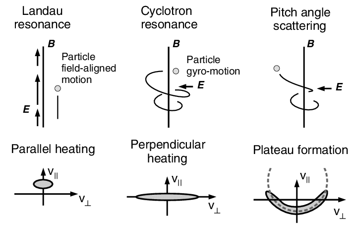

# Warm, Electrostatic, and Kinetic Waves {#sec-warm-waves}

::: {.callout-tip title="Related Chapters"}
For general wave properties and cold-plasma dispersion theory, see @sec-waves and @sec-CPDR; for MHD and Alfvén waves, see @sec-mhd-waves; for whistler waves and wave identification, see @sec-whistler; for the Vlasov equation, Landau damping, and full kinetic dispersion tensor, see @sec-kinetic and @sec-dispersion; for nonlinear ion-acoustic shocks and ponderomotive effects, see @sec-nonlinear.

For interactive dispersion curves and animations of Langmuir, ion-acoustic, Bernstein, and lower hybrid waves, see **[PlasmaWaves.jl: Kinetic, Landau & Bernstein](https://henry2004y.github.io/PlasmaWaves/kinetic.html)** and **[Cold Plasma & Whistlers](https://henry2004y.github.io/PlasmaWaves/cold.html)**.
:::

## Warm Uniform Plasma

The analysis of cold plasma waves, although very complicated already, leaves out all of the physics that relates to finite temperature effects. These effects may be included in varying degrees of approximation, and it is intructive to include at this stage only the simplest thermal correction terms through the inclusion of a finite pressure term. For the sake of simplicity, we only consider the 1D case. The approach is very similar to cold plasma situation, except that we have _pressure_ included in the equation, and we also need to specify the relation of pressure and temperature through the equation of state.

### Two-fluid approach

Equilibrium:
$$
\begin{aligned}
&m_i=\infty,\ T_i=0,\ v_{i,0}=0,\ n_{e0}=n_{i0}=n_0,\ E_0=0,\ B_0=0 \\
&P_0=const.,\ v_{e0}=0
\end{aligned}
$$

The equation of motion for electron is
$$
\frac{\partial \mathbf{v}}{\partial t}+\mathbf{v}\cdot\nabla\mathbf{v}=-\frac{e}{m_e}\mathbf{E}-\frac{\nabla P}{\rho}
$$

Assume
$$
\begin{aligned}
&P=P_0 \Big( \frac{n}{n_0}\Big)^\gamma  &\text{adiabatic}\\
&P=nk_B T_e  &\text{isothermal}(\gamma=1)
\end{aligned}
$$

Define $P_1=\Big( \partial P/\partial \rho\Big)\rho_1\equiv {v_{th}}^2\rho_1={v_{th}}^2 n_1 m=k_BTn_1$. Decompose the primitive variables into equilibrium and perturbation components:

$$
\begin{aligned}
&n= n_0+n_1=n_0+\tilde{n}_1e^{-i\omega t+ikx} \\
&v=\cancel{v_0}+v_1=\tilde{v}_1 e^{-i\omega t+ikx} \\
&P=P_0+P_1=P_0+\tilde{P}_1e^{-i\omega t+ikx}
\end{aligned}
$$

Substituting into the equation of motion and keeping only first order terms, we get
$$
\begin{aligned}
\frac{\partial v_1}{\partial t}&=-\frac{e}{m_e}(E_1)-\frac{\nabla (P_1)}{n_0m_e} \\
-i\omega v_1&=-\frac{e}{m_e}E_1-\frac{ik{v_{th}}^2 n_1}{n_0}
\end{aligned}
$$

The continuity equation gives
$$
\begin{aligned}
\frac{\partial n}{\partial t}+\frac{\partial}{\partial x}\Big( nv\Big)=0 \\
\Rightarrow v_1=\frac{\omega n_1}{kn_0}
\end{aligned}
$$

Substituting this into the linearized equation of motion, we get
$$
n_1=\frac{kn_0eE_1}{im_e(\omega^2-k^2{v_{th}}^2)}
$$

which is the density perturbation in response to $E_1$. Following the same approach as before, we can easily get the dielectric function:
$$
\frac{\epsilon}{\epsilon_0}=1-\frac{{\omega_{pe}}^2}{\omega^2-k^2{v_{th}}^2}
$$

Let $\epsilon=0$, we get the dispersion relation for warm plasma
$$
\omega^2=k^2{v_{th}}^2+{\omega_{pe}}^2
$$

This is called the _Bohm-Gross dispersion relation_ (BGDR). [@swanson2012plasma] has shown that by keeping higher order terms,
$$
\omega^2 = \omega_{pe}^2\left[ 1 + \frac{3}{2}\left( \frac{k v_{th}}{\omega_{pe}} \right)^2 + \frac{15}{4}\left( \frac{k v_{th}}{\omega_{pe}} \right)^4 \right]
$$
so it is apparent that _the moment expansion is an expansion in the ratio of the thermal velocity to the phase velocity_. The BGDR now resolves the ambiguity in cold plasma theory and supports the notion that $P=0$ in cold plasma is a cutoff rather than a resonance, since this dispersion relation describes a wave with a cutoff at $\omega_{pe}$ that propagates near the electron thermal speed for high frequencies.

We see from this example that the fluid equations which are based on moment expansions are valid as long as the phase velocity is large compared to the thermal speed, $v_p\gg v_{th}$.

### Vlasov approach

Assume Maxwellian distribution for electrons:
$$
g_e(v)=\frac{1}{\sqrt{2\pi}}\frac{1}{v_{th,e}}e^{-v^2/2{v_{th,e}}^2}
$$

Assuming $\frac{\omega}{k}\gg v_{th,e}$, i.e. the phase speed is much larger than the characteristic thermal speed, we can do Taylor series expansion
$$
\frac{1}{(v-\omega/k)^2}=\frac{1}{(\omega/k)^2}\frac{1}{(1-kv/\omega)^2}\approx \frac{k^2}{\omega^2}\Big[ 1+\frac{2kv}{\omega}+\frac{3k^2v^2}{\omega^2}+...\Big]
$$

Then the dielectric function is
$$
\begin{aligned}
\frac{\epsilon}{\epsilon_0}&=1-\frac{{\omega_{pe}}^2}{k^2}\int_{-\infty}^{\infty}dv g(v)\frac{k^2}{\omega^2}\Big[ 1+\frac{2kv}{\omega}+\frac{3k^2v^2}{\omega^2}+...\Big] \\
&\doteq 1-\frac{{\omega_{pe}}^2}{\omega^2}\Big[ 1+\frac{3k^2{v_{th}}^2}{\omega^2} \Big] .
\end{aligned}
$$

Let $\epsilon=0$, we can get the dispersion relation for warm plasma,
$$
\begin{aligned}
&\text{lowest order: } \omega=\pm \omega_{pe} \\
&\text{first order:} 1-\frac{{\omega_{pe}}^2}{\omega^2}\Big( 1+\frac{3k^2{v_{th}}^2}{{\omega_{pe}}^2}\Big)=0\Rightarrow \omega^2={\omega_{pe}}^2+3k^2{v_{th,e}}^2
\end{aligned}
$$

Note here we insert $0^{th}$ order solution to $1^{st}$ order equation to get the next level approximation. Comparing with the results from 2-fluid theory, we see that the expression is very similar except a discrepancy in the coefficient. This is owing to the fact that we do not specify $\gamma$ in the equation of state. Actually, there are still ambiguities and debates about the exact equation of state. I wonder if I can get the exact coefficient under some assumption.

The opposite limit case: $\frac{\omega}{k}\ll v_{th}$. From 2-fluid theory,
$$
\frac{\epsilon}{\epsilon_0}\approxeq1+\frac{{\omega_{pe}}^2}{k^2{v_{th,e}}^2}
$$

From Vlasov theory,
$$
\begin{aligned}
\frac{\epsilon}{\epsilon_0}&=1-\frac{{\omega_{pe}}^2}{k^2}\int_{-\infty}^{\infty}dv\frac{\partial g/\partial v}{v-\omega/k}=
1-\frac{{\omega_{pe}}^2}{k^2}\int_{-\infty}^{\infty}\frac{1}{v-\cancel{\omega/k}}\frac{1}{\sqrt{2\pi}}\frac{1}{v_{th,e}}\Big(\frac{-v}{{v_{th,e}}^2} \Big) e^{-v^2/2{v_{th,e}}^2}dv  \\
&=1+\frac{{\omega_{pe}}^2}{k^2}\int_{-\infty}^{\infty}\frac{1}{v_{th,e}^2}\frac{1}{\sqrt{2\pi}} e^{-v^2/2{v_{th,e}}^2}dv \\
&=1+\frac{{\omega_{pe}}^2}{k^2{v_{th,e}}^2}
\end{aligned}
$$

So we can see in the two limit cases that they "almost" give the same results!

If we include ion motion in the 2-fluid theory ($n_{1i}\neq0, T_i\neq0,m_i\neq\infty$), applying the linear superposition property, we have

$$
\frac{\epsilon}{\epsilon_0}=\underbrace{1}_{\nabla\cdot(\epsilon_0\mathbf{E}_1)}-\underbrace{\frac{{\omega_{pe}}^2}{\omega^2-k^2{v_{th,e}}^2}}_{en_{1e}}-\underbrace{\frac{{\omega_{pi}}^2}{\omega^2-k^2{v_{th,i}}^2}}_{en_{1i}}
$$

### Ion-acoustic wave

Assume $v_{th,e}\gg \frac{\omega}{k}\gg v_{th,i}$, we have the simplified dielectric function
$$
\frac{\epsilon}{\epsilon_0}=1+\frac{{\omega_{pe}}^2}{k^2{v_{th,e}}^2}-\frac{{\omega_{pi}}^2}{\omega^2}
$$

Assume quasi-neutrality condition: $n_{1e}\approx n_{1i}$, s.t.
$$
\nabla\cdot(\epsilon_0\mathbf{E}_1)=e(n_{1e}-n_{1i})\approx 0
$$
so we can ignore the "1" in the dielectric function. Let $\epsilon=0$, we get
$$
\begin{aligned}
\frac{{\omega_{pe}}^2}{k^2{v_{th,e}}^2}-\frac{{\omega_{pi}}^2}{\omega^2}=0 \\
\Rightarrow \omega^2=k^2{v_{th,e}}^2\frac{m_e}{m_i},\ \frac{\omega}{k}=\sqrt{\frac{k_BT_e}{m_i}}\equiv c_s
\end{aligned}
$$

Physically, electron sees the electric field created by ions due to ion plasma oscillation. Since electrons move much faster than ions, this electric field is nearly electrostatic for electrons. As a result, electron just follows the ion motion.

There are some other ways to get the ion-acoustic wave. If $\omega\ll \omega_{pe}$, we can treat this wave as electrostatic wave for electron. The distribution for electron number density is
$$
\begin{aligned}
&n_{e}=n_0e^{e\phi/k_B T_e}\approxeq n_{0e}+n_{1e} \approxeq n_0[1+\frac{e\phi}{k_BT_e}+...] \\
\Rightarrow &n_{1e}=n_0\frac{e\phi}{k_BT_e}=\frac{n_0eE_1}{-ikm_e{v_{th,e}}^2}
\end{aligned}
$$

Note that here the tilde signs $\sim$ of the variables are neglected for convenience without ambiguity.

Do we need to calculate $n_{1i}$??? Yes. MORE to do here!

Also, from the linearized equation of motion for electron,
$$
\begin{aligned}
\frac{\partial v_{e1}}{\partial t}=-\frac{e}{m_e}E_1-\frac{\nabla P_1}{n_0m_e} \\
-i\omega v_{e1}=-\frac{e}{m_e}E_1-\frac{ik P_1}{n_0m_e}=-\frac{e}{m_e}E_1-\frac{ik n_{1e}k_BT_e}{n_0m_e}
\end{aligned}
$$

In the $\omega\rightarrow 0$ limit, $LHS\doteq0$, we get
$$
n_{1e}= \frac{n_0eE_1}{-ikm_e{v_{th,e}}^2}
$$

Then again we get the dielectric function through Poisson's equation. For the kinetic treatment of ion-acoustic wave damping as a function of $T_e/T_i$, see @sec-landau_damping and the [ion-acoustic wave animation on PlasmaWaves.jl](https://henry2004y.github.io/PlasmaWaves/kinetic.html#Kinetic-Wave-Animations).

## Electrostatic Wave in a Magnetized Plasma {#sec-es_wave_magnetized}

Now we continue to discuss the property of electrostatic waves with background magnetic field.

First let us introduce a useful result for continuity equation. Assuming $n_0=n_0(\mathbf{x}),\ \mathbf{v}_0=\mathbf{v}_0(\mathbf{x})$ in equilibrium, $\mathbf{x}_1=\mathbf{x}_1(\mathbf{x},t)$ is the perturbation in displacement. We can show that the linearized continuity equation has an equivalent form:
$$
\frac{\partial n_1(\mathbf{x},t)}{\partial t}+\nabla\cdot[ n_0(\mathbf{x})\mathbf{v}_1(\mathbf{x},t)+n_1(\mathbf{x},t)\mathbf{v}_0(\mathbf{x},t)]=0
\Leftrightarrow n_1(\mathbf{x},t)=-\nabla\cdot[n_0(\mathbf{x})\mathbf{x}_1(\mathbf{x},t)]
$$

The proof is related to mass conservation shown as follows. Intuitively, you can think of this as the degree of condensation only depends on displacement, not on how you get there (speed).

In 1D,
$$
\begin{aligned}
n_0=n_0(x_0)=\text{unperturbed density} \\
x= x_0+x_1(x_0,t)=\text{instantanenous position} \\
n(x_0,t)=n_0(x_0)+n_1(x_0,t)=\text{total density}
\end{aligned}
$$

At time $t$, $[x_0,x_0+\mathrm{d}x]\rightarrow[x_0+x_1(x_0,t),x_0+\mathrm{d}x+x_1(x_0+\mathrm{d}x,t)]$. Due to mass conservation, we have (This looks like the derivation of deformation in fluid dynamics.)

$$
\begin{aligned}
n_0(x_0)\mathrm{d}x&=[n_0(x_0+x_1)+n_1(x_0+x_1,t)]\cdot[x_0+\mathrm{d}x+x_1(x_0+\mathrm{d}x,t)-(x_0+x_1(x_0,t))] \\
&\approx \Big[n_0(x_0)+x_1\frac{\partial n_0(x_0)}{\partial x_0}+n_1(x_0,t)\Big]\mathrm{d}x\Big[1+\frac{\partial x_1(x_0,t)}{\partial x_0}\Big]
\end{aligned}
$$

$$
\begin{aligned}
&\Rightarrow n_0(x_0)=n_0(x_0)+n_0(x_0)\frac{\partial x_1(x_0,t)}{\partial x_0}+x_1\frac{\partial n_0(x_0)}{\partial x_0}+n_1(x_0,t) \\
&\Rightarrow n_1(x_0,t)=-n_0(x_0)\frac{\partial x_1(x_0,t)}{\partial x_0}-x_1\frac{\partial n_0}{\partial x_0}=-\frac{\partial}{\partial x_0}\big[ n_0(x_0)x_1(x_0,t) \big] \\
&\Rightarrow n_1(x,t)=-\frac{\partial}{\partial x}\big[ n_0(x)x_1(x,t)\big]
\end{aligned}
$$

The simplest equilibrium state in a constant magnetized plasma is
$$
\begin{aligned}
&n_{i0}=n_{e0}=n_0,\ \mathbf{E}_0=0,\ \mathbf{B}_0=B_0\widehat{z} \\
&\mathbf{v}_{e0}=\mathbf{v}_{i0}=0,\ T_e=0,\ T_i=0,\ m_i=\infty
\end{aligned}
$$

Now introduce an electrostatic perturbation ($\mathbf{E}_1=-\nabla\phi_1$)
$$
\begin{aligned}
\mathbf{E}_1=\tilde{\mathbf{E}_1}e^{-i\omega t+i\mathbf{k}\cdot\mathbf{x}}=-i\mathbf{k}\tilde{\phi}_1 e^{-i\omega t+i\mathbf{k}\cdot\mathbf{x}}
\end{aligned}
$$

we can confirm that this is indeed an electrostatic perturbation since $\mathbf{E}_1\parallel \mathbf{k}$ and $\mathbf{B}_1=0$.

_Case 1_: $\mathbf{k}=k_z\widehat{z}\parallel \mathbf{B}_0$, i.e. parallel propagation. Then $\mathbf{E}_1=\widehat{z}E_{1z}e^{-i\omega t+ik_z z}$. This is the same as if there is no magnetic field, so the dielectric function is

$$
\frac{\epsilon}{\epsilon_0}=1-\frac{{\omega_{pe}}^2}{\omega^2}
$$

_Case 2_: $\mathbf{k}\perp \mathbf{B}_0$, i.e. perpendicular propagation. Without loss of generality, let $\mathbf{k}=k_x\widehat{x}$. Then

$$
\mathbf{E}_1=\widehat{x}\tilde{E}_{1x}e^{-i\omega t+ik_x x}
$$

The equations of motion (cold plasma) in the $x$ and $y$ direction are
$$
\begin{aligned}
\ddot{x}_1 &= -\frac{e}{m_e}[E_{1x}+\dot{y}_1B_0] \\
\ddot{y}_1 &= -\frac{e}{m_e}[-\dot{x}_1B_0] \\
\Rightarrow \dot{y}_1&=\frac{eB_0}{m_e}x_1=|\Omega_e| x_1  \\
\ddot{x}_1&=-\frac{e}{m_e}[E_{1x}+|\Omega_e|\cdot{y_1}B_0]=-\frac{e}{m_e}E_{1x}-{\Omega_e}^2 x_1,  \\
\Rightarrow x_1&=\frac{-\frac{e}{m_e}E_{1x}}{-\omega^2+{\Omega_e}^2}
\end{aligned}
$$

Then we have the perturbed density in response to the perturbed electric field $E_{1x}$:
$$
\begin{aligned}
n_1=-n_0\nabla\cdot\mathbf{x}_1=-n_0ik_x x_1=-n_0ik_x\frac{-\frac{e}{m_e}E_{1x}}{-\omega^2+{\Omega_e}^2}
\end{aligned}
$$

From Poisson's equation, we get the dielectric function (the same method as before):
$$
\frac{\epsilon}{\epsilon_0}=1-\frac{{\omega_{pe}}^2}{\omega^2-{\Omega_e}^2}
$$

Let $\epsilon=0$, we have
$$
\omega=\sqrt{{\omega_{pe}}^2+{\Omega_e}^2}\equiv \omega_{UH}
$$
which is called the _upper hybrid_ frequency. This is the highest characteristic frequency in plasma. This upper hybrid wave is a havoc to some beam generator devices as it appears near the electron collector.

What if ions are included? Similar to previous derivations and notice that we are still within the range of linear theory, we have
$$
\frac{\epsilon}{\epsilon_0}=1-\frac{{\omega_{pe}}^2}{\omega^2-{\Omega_e}^2}-\frac{{\omega_{pi}}^2}{\omega^2-{\Omega_i}^2}
$$

For $\Omega_i\ll \omega\ll \Omega_e$ with quasi-neutrality condition $n_{1e}\approx n_{1i}$, we can have a simplified dispersion relation by letting $\epsilon=0$:
$$
\begin{aligned}
&\frac{{\omega_{pe}}^2}{{\Omega_{e}}^2}=\frac{{\omega_{pi}}^2}{\omega^2}\\
\Rightarrow& \omega=\sqrt{{\omega_{pi}}^2\frac{{\Omega_e}^2}{{\omega_{pe}}^2}}=\sqrt{|\Omega_e \Omega_i|}\equiv \omega_{LH}
\end{aligned}
$$
which gives us the _low hybrid wave_ frequency. It equals to the geometric mean of the two cyclotron frequencies. Actually, this can be obtained from pure plasma motion argument. Recall that $\Omega_i \ll \omega \ll \Omega_e$ means that for electrons the plasma seems to be nonmagnetized, so they moves only under the electric field,
$$
v_{1ex}=\frac{-eE_{1x}}{m_e(-i\omega)}
$$

On the other hand, for ions the magnetic field is strong while electric field still exists, so it experiences polarization drift along the direction of perturbed electric field,
$$
v_{1ix}=\frac{1}{\Omega_i}\frac{\partial}{\partial t}\Big( \frac{E_{1x}}{B_0}\Big)
$$

Under quasi-neutrality condition, $v_{1ix}=v_{1ex}$, so we have
$$
\frac{-eE_{1x}}{m_e(-i\omega)}=\frac{1}{\Omega_i}\frac{\partial}{\partial t}\Big( \frac{E_{1x}}{B_0}\Big) \Rightarrow \omega=\sqrt{|\Omega_e \Omega_i|}
$$

See the [lower hybrid wave animation on PlasmaWaves.jl](https://henry2004y.github.io/PlasmaWaves/cold.html#Lower-Hybrid-Wave) for a visualization of the coupled electron $\mathbf{E}\times\mathbf{B}$ / unmagnetized response and magnetized ion polarization drift.

If we consider warm plasma for 1D, there is an additional pressure term in the momentum equation. The continuity equation together with Poisson's equation give the relation of perturbed displacement and electric field:
$$
\begin{aligned}
&n_1=-\nabla\cdot(n_0\mathbf{x}_1)=-ik_xn_0x_1 \\
&\nabla\cdot(\epsilon_0\mathbf{E}_1)=ik_x\epsilon_0E_{1}=-en_{1e}=eik_xn_0x_1 \\
\Rightarrow& E_{1}=\frac{en_0x_1}{\epsilon_0}
\end{aligned}
$$

Substituting into the momentum equation, we get
$$
\begin{aligned}
\ddot{x}_1+{\Omega_e}^2x_1&=-\frac{e}{m_e}E_{1}-\frac{\nabla P_1}{n_0m_e}  \\
&=-{\omega_{pe}}^2 x_1-{k_x}^2{v_{th,e}}^2x_1
\end{aligned}
$$
where $v_{th,e}=\sqrt{k_BT_e/m_e}$. This gives us (You can gain a sense of the equivalent force law from the dispersion relation.)
$$
\omega^2={\omega_{pe}}^2+{\Omega_e}^2+{k_x}^2{v_{th,e}}^2
$$

This is also equivalent to the dielectric function
$$
\frac{\epsilon}{\epsilon_0}=1-\frac{{\omega_{pe}}^2}{\omega^2-{\Omega_{e}}^2-{k_x}^2{v_{th,e}}^2}
$$

## Kinetic Slow Modes

The least-damped kinetic slow mode is associated with the ion-acoustic (IA) wave and a nonpropagating (NP) mode, both of which exhibit an anticorrelation between $\delta n$ and $\delta B$. A comparison of the damping rates of the IA mode and the NP mode suggests that the IA mode is the dominating kinetic slow mode at low $\beta_\parallel$, while the NP mode is the dominating kinetic slow mode at high $\beta_\parallel$ [@verscharen2017kinetic]. Temperature anisotropies alter the dispersion relations and the damping behavior of slow modes in kinetic plasmas, and can drive the NP mode (i.e., the mirror mode) to be unstable.

## Wave-Particle Interactions

Different wavemodes exchange energy with particles by different mechanisms including

1. Landau resonance which heats in the direction parallel to the magnetic field and can give a parallel beam in the velocity distribution function (VDF) (@fig-wave-particle left). Charged particles exchange energy with $E_\parallel$.

2. Cyclotron resonance which heats in the direction perpendicular to the magnetic field and broadens the velocity distribution function in the perpendicular direction (@fig-wave-particle middle). Charged particles exchange energy with $E_\perp$. Left-hand polarized ion cyclotron waves can lead to ion heating in the perpendicular direction.

3. Pitch angle scattering which can lead to the formation of a plateau in the VDF (@fig-wave-particle right).

The resonance parameters for the Landau and cyclotron resonances are
$$
\xi_\text{L} = \frac{\omega}{k_\parallel v_{\text{th},s}}
$$ {#eq-landau_resonance}

$$
\xi_\text{C} = \frac{\omega-\Omega_s}{k_\parallel v_{\text{th},s}}
$$ {#eq-cyclotron_resonance}

Here the frequency $\omega$ is measured in the plasma rest frame. $\Omega_s$ denotes the cyclotron frequency of particle species $s$ (ion species and electrons), $k_\parallel$ the parallel component of the wavevector, and $v_{\text{th},s}$ the particle thermal speed of species $s$. In general, the resonance parameter can be defined for arbitrary harmonics of the cyclotron frequency $m=0,\pm 1,\pm 2,...$:
$$
\xi^{(m)} = \frac{\omega - m\Omega_s}{k_\parallel v_{\text{th},s}}
$$ {#eq-harmonic_resonance}

{#fig-wave-particle}

Note that the resonance parameters above are defined for a Maxwellian plasma. A correction is needed when treating a non-Maxwellian plasma to find the suitable velocity-space gradient for the resonance. The resonance is efficient when the parameter $\xi_\text{L}$ or $\xi_\text{C}$ is on the order of unity. Strictly speaking, the wave damping (or particle acceleration) is most efficient, typically for $1<\xi<5$. The upper limit is not exact, but the resonance becomes gradually inefficient at larger values of $\xi$. For $\xi<1$ the particle motion is slower than the wave propagation and the particles do not have a sufficient time for exchanging energy with the wave electric field. For $\xi>5$ there are increasingly fewer particles with higher velocities for the resonance (higher than the thermal speed).

### Pitch Angle Scattering

Charged particles can be scattered by the wave electric and magnetic fields incoherently, and the scattering deforms the velocity distribution function along the co-centric contours centered at the wave phase speed (@fig-wave-particle, right panel). The reason for the deformation is that the particle kinetic energy $K_{wv}$ (per unit mass) does not change in the co-moving frame with the apparent wave phase speed in the parallel direction to the mean magnetic field:
$$
K_{wv} = \frac{1}{2}\left[ v_\perp^2 + \left( v_\parallel - \frac{\omega}{k_\parallel} \right)^2 \right] = \text{const}.
$$

The co-centric deformation of the distribution function achieves a quasi-linear equilibrium in that the velocity–space gradient becomes zero (plateau formation) in the pitch angle directions. For example, in the solar wind ions are found to be resonating with obliquely propagating Alfvén/ion cyclotron waves. Note that the relevant phase speed is $\omega/k_\parallel$, and is different from the true phase speed $\omega/k$. The perpendicular component of the wavevector $k_\perp$ does not play a role in pitch angle scattering.

This process is well explained by [Plasma Zoo: Gyroresonant Scattering](https://svs.gsfc.nasa.gov/4649/).

